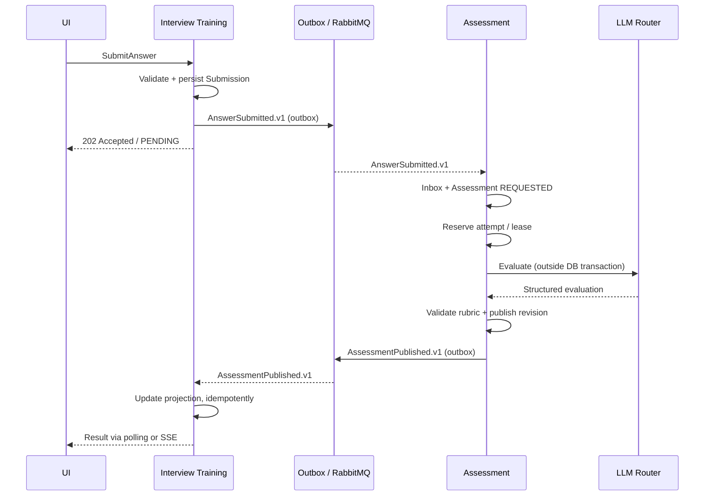

# 002 — Cycle métier, commandes et événements

## Chorégraphie V1 — validée

## Commandes Interview Training

| Commande | Handler | Domaine |
|---|---|---|
| StartTrainingSession | StartTrainingSessionHandler | TrainingSession.start() |
| PresentQuestion | PresentQuestionHandler | session.present_question() |
| SubmitAnswer | SubmitAnswerHandler | session.submit_answer() |
| RecordAssessmentResult | RecordAssessmentResultHandler | session.record_assessment() |
| PresentNextQuestion | PresentNextQuestionHandler | session.present_next_question() |
| CompleteTrainingSession | CompleteTrainingSessionHandler | session.complete() |

## Commandes Assessment

| Commande | Handler | Domaine |
|---|---|---|
| RequestAssessment | RequestAssessmentHandler | Assessment.request() |
| StartAssessmentAttempt | StartAssessmentAttemptHandler | assessment.start_attempt() |
| PublishAssessment | PublishAssessmentHandler | assessment.publish() |
| FailAssessmentAttempt | FailAssessmentAttemptHandler | assessment.fail_attempt() |
| RequestReassessment | RequestReassessmentHandler | assessment.request_revision() (future) |

## Domain Events locaux vs Integration Events

- Locaux : TrainingSessionStarted, QuestionPresented, AnswerRecorded, AssessmentRequested, AssessmentAttemptStarted, TurnAssessmentRecorded.
- Externes versionnés : **AnswerSubmitted.v1**, **AssessmentPublished.v1**, **AssessmentFailed.v1** (échec terminal uniquement).
- Les commandes expriment une intention ; les events expriment un fait.
- Les événements externes sont publiés seulement après commit, depuis l'outbox.

## Frontières transactionnelles proposées

- **T3** : Submission + idempotency command + outbox AnswerSubmitted ; commit atomique.
- **T4** : inbox + création Assessment REQUESTED + planification durable du travail ; commit, puis ACK RabbitMQ.
- **T5** : réserver l'AssessmentAttempt avec lease/fencing ; commit.
- **Hors transaction** : appel LLM et fallback.
- **T6** : valider lease, Rubric et correction ; persister AssessmentRevision et outbox AssessmentPublished ; commit.
- **T8** : inbox AssessmentPublished + rattachement submission_id + projection du résultat ; commit, puis ACK.

Ne jamais garder de transaction DB ouverte pendant l'appel réseau LLM. L'exécution durable peut utiliser une work queue DB ou une outbox de tâches, pas un simple `delay()` non récupérable après commit. Le mécanisme de work queue retenu (table `work_items`, lease, fencing) est décrit dans le [complément de l'ADR 0004](../decisions/0004-reliable-messaging.md#complément--work-queue-durable-accepted-2026-11-17) ; Knowledge Base l'utilise en premier ([cycle d'ingestion](bounded-contexts/knowledge-base.md#6-workflow-de-traitement-avec-work_items)).

## Erreurs et idempotence

- HTTP : Idempotency-Key + fingerprint ; même requête → même résultat ; clé réutilisée avec contenu différent → 409.
- Agrégat : une réponse finale logique par tour, sauf politique explicitement contraire.
- Consumer : inbox `UNIQUE(consumer_name,event_id)` dans la transaction métier.
- Assessment : contrainte unique sur la soumission et politique d'évaluation initiale.
- Worker : lease et fencing ; une tentative expirée ne peut publier.
- Projection : ordonner les révisions sans supposer un ordre de livraison RabbitMQ.
- Outbox : event_id stable jusqu'à confirmation publication.
- Recovery : reprise des REQUESTED et EVALUATING expirés ; reconciliation des écarts.

## Retries

429 → respecter Retry-After et basculer selon quota ; 5xx/timeout → retry borné puis fallback ; réponse JSON invalide → validation/retentative contrôlée. Erreur de contrat ou barème manquant → échec fonctionnel, pas de boucle LLM. AssessmentFailed.v1 n'est émis qu'en cas terminal.

## Modes pédagogiques

- **IMMEDIATE** : correction disponible avant progression selon politique de session.
- **END_OF_SESSION** : poursuite des questions pendant les corrections, feedback présenté à la fin ; la séance peut être close avant que toutes les évaluations soient publiées.

Le transport asynchrone ne dicte pas la visibilité pédagogique.
