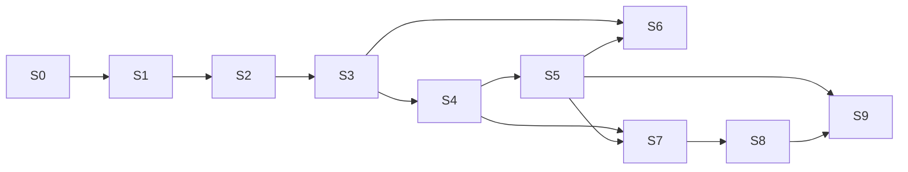

# Knowledge Base — Feuille de route S0 à S9

> **Statut : Accepted pour le découpage et l'ordre des slices** (revue du
> 2026-11-17) ; le contenu détaillé de chaque slice est **Proposed** et sera
> affiné au démarrage de la slice. Référence : [conception Knowledge Base](knowledge-base.md).
>
> Règles transverses :
> - une slice ne crée que les dossiers, agrégats et adapters qu'elle utilise
>   ([005](../005-project-structure.md#règle-dor--on-ne-crée-un-dossier-que-lorsquon-y-met-du-code)) ;
> - les protections de fiabilité (lease, fencing, reprise, retry) existent
>   dès S0 et sont **utilisées** par chaque slice qui introduit un traitement ;
>   S8 durcit, il n'est pas le premier moment où l'on récupère une tâche perdue ;
> - les tests d'intégration tournent contre les vrais services de
>   `compose.test.yaml` ;
> - les seuils de qualité de recherche sont fixés **après** une mesure de
>   référence, jamais supposés.

## Vue d'ensemble

| Slice | Objectif | Dépend de |
|---|---|---|
| [S0](#s0--infrastructure-de-traitement-durable) | Infrastructure de traitement durable : work queue, leases, fencing, retries, scheduler | ADR 0004 (complément), 0007 |
| [S1](#s1--domaine-knowledgedocument-et-documentversion) | Domaine `KnowledgeDocument` et `DocumentVersion` | S0 (package) |
| [S2](#s2--import-markdowntxt-stockage-original-et-dédoublonnage) | Import Markdown/TXT, stockage original et dédoublonnage | S0, S1 |
| [S3](#s3--docling-markdown-knowledgeunit-et-chunking) | Docling Markdown, `KnowledgeUnit` et chunking | S2 |
| [S4](#s4--embeddings-qdrant-index-initial-et-publication) | Embeddings, Qdrant, index initial et publication | S3 |
| [S5](#s5--recherche-sémantique-provenance-et-évaluation-rag) | Recherche sémantique, provenance et évaluation RAG | S4 |
| [S6](#s6--extraction-pdfdocx-avec-docling) | Extraction PDF/DOCX avec Docling | S3, S5 |
| [S7](#s7--versions-concurrentes-retrait-et-purge) | Versions concurrentes, retrait et purge | S4, S5 |
| [S8](#s8--durcissement-de-la-réconciliation-et-gestion-des-erreurs) | Durcissement de la réconciliation et gestion des erreurs | S7 |
| [S9](#s9--benchmark-des-embeddings-et-migration-bluegreen) | Benchmark des embeddings et migration blue/green | S5, S8 |

---

## S0 — Infrastructure de traitement durable

> **Statut : implémentée (2026-11-18)** sur `feature/knowledge-base-v1` — unitaires, architecture et 109 tests d'intégration verts ; scénario 14 : invariant prouvé, reprise par le broker non observée ([S0 §12.2](knowledge-base-s0.md#122-intégration-postgresql-et-rabbitmq-réels-composetestyaml)).

- **Objectif :** tout travail enregistré dans une transaction métier est
  exécuté puis terminé explicitement, malgré pertes de messages, redélivrances
  et crashs.
- **Périmètre :** table `knowledge_base.work_items`, port `WorkQueue`,
  transitions SQL, tâches `execute` / `dispatch` / `recover`, registre de
  handlers, ressources asyncio prefork, services `worker_ingestion` et
  `scheduler`, volumes, tests d'architecture. **Aucun `kind` métier.**
- **Composants :** `knowledge_base/{domain/providers, adapters/controller/tasks,
  adapters/gateway/persistence, frameworks}`, `runtime/worker.py`,
  `alembic/env.py`, Compose, Dockerfile.
- **Tests, critères, risques :** voir [knowledge-base-s0.md](knowledge-base-s0.md).

## S1 — Domaine `KnowledgeDocument` et `DocumentVersion`

> **Statut : implémentée (2026-11-18)** — 96 tests unitaires du domaine, 8 mutations sur 8 détectées, règle d'architecture « domaine pur = bibliothèque standard ».

- **Objectif :** modèle pur du document et de ses versions, avec les
  invariants I1 à I6 de [knowledge-base.md §4](knowledge-base.md#4-invariants).
- **Périmètre :** agrégat `KnowledgeDocument`, entité `DocumentVersion`, VO
  `DocumentSource`, `ContentHash`, `DocumentKind`, `FailureReason` ; états du
  §5.1–5.2 (`DISCARDED`, `SUPERSEDED`) ; règle de publication monotone (I5)
  exprimée sur l'agrégat ; Domain Events `DocumentImported`,
  `DocumentVersionDiscarded`.
  **Hors périmètre :** `KnowledgeCorpus`, `SearchIndex`, `Indexation`
  (introduits en S4), persistance.
- **Dépendances :** S0 (package existant).
- **Composants :** `knowledge_base/domain/{entities,value_objects,events,exceptions}`.
- **Tests unitaires :** numéros strictement croissants ; import de N+1 →
  versions antérieures non publiées `DISCARDED` ; publication refusée si
  `number ≤ publié`, si la version n'est pas `EXTRACTED`, si le document est
  `WITHDRAWN` ; `SUPERSEDED` uniquement depuis `PUBLISHED` ; retrait →
  aucune nouvelle version ; immutabilité de la source.
- **Tests d'intégration :** aucun (domaine pur).
- **Critères d'acceptation :** chaque invariant I1–I6 couvert par un test qui
  échoue si la règle est supprimée ; aucun import hors bibliothèque standard
  (test d'architecture).
- **Risques :** sur-modélisation ; anticiper S4 ou S7 dans l'agrégat.

## S2 — Import Markdown/TXT, stockage original et dédoublonnage

> **Statut : implémentée (2026-11-18)** — import multipart (corps mis en tampon par Starlette, copie vers le volume en flux avec limite appliquée pendant la copie), blob adressé par SHA-256, `Idempotency-Key`, O2 tranché (§16) ; 309 unitaires et 162 tests d'intégration verts.

- **Objectif :** importer un fichier Markdown ou TXT, conserver l'original,
  enregistrer document et version `RECEIVED`, planifier l'extraction.
- **Périmètre :** `ImportDocument`, `ImportDocumentVersion` ; endpoint
  multipart avec limites (20 Mo, liste blanche de types) ; `Idempotency-Key` +
  empreinte de requête (002) ; `DocumentBlobStore` sur volume adressé par
  SHA-256 (ADR 0012) ; persistance SQLAlchemy du document ; enqueue de
  `extract_version` (son handler n'arrive qu'en S3 : l'item reste `PENDING`,
  car le dispatcher ignore les `kind` non enregistrés — S0 §8.2) ;
  décision O2 (doublon inter-documents).
- **Dépendances :** S0, S1.
- **Composants :** `use_cases/import_document*/`, `adapters/controller/rest/`,
  `adapters/gateway/{persistence,blob}/`, `frameworks/sqlalchemy/`, `register(app)`.
- **Tests unitaires :** handlers avec fakes (dédoublonnage, `DISCARDED` sur
  nouvelle version, enqueue dans la même Unit of Work) ; calcul d'empreinte en
  streaming ; écriture atomique du blob (fake de système de fichiers).
- **Tests d'intégration :** POST réel → lignes, blob et work item ; même
  fichier deux fois → même document ; même `Idempotency-Key` avec un contenu
  différent → 409 ; fichier trop gros → 413 sans blob ni ligne ; rollback de la
  transaction → blob orphelin repérable (purgé par S7/S8).
- **Critères d'acceptation :** réponse 202 avec identifiants ; aucun état
  partiel visible après une erreur ; décision O2 enregistrée dans
  [knowledge-base.md §16](knowledge-base.md#16-points-ouverts).
- **Risques :** streaming multipart et mémoire ; permissions du volume ;
  orphelins de blob entre dépôt et commit.

## S3 — Docling Markdown, `KnowledgeUnit` et chunking

> **Statut : implémentée (2026-11-18)** — `docling-slim[format-markdown]==2.150.1` (sans torch, +93 Mo), segmentation par `DocumentKind`, `ChunkPlanner` avec fallbacks, politique `kb-chunking-v1` (508 tokens, compteur approximatif majorant), handler `extract_version` câblé ; 5 goldens rejoués avec Docling ; 529 unitaires et 192 tests d'intégration verts.

- **Objectif :** transformer une version `RECEIVED` en unités et chunks
  persistés, avec provenance complète.
- **Périmètre :** adapter Docling Markdown → `StructuredDocument` ; adapter TXT
  natif ; `KnowledgeUnitSegmenter` (règles par `DocumentKind`, front-matter
  prioritaire) ; `ChunkPlanner` (budget en tokens, overlap 0, fallbacks
  code/tableau) ; port `TokenCounter` (implémentation provisoire alignée sur le
  tokenizer du profil initial) ; handler `extract_version` → `RecordExtraction`
  sous fencing ; corpus de fixtures FR/EN qui servira à S5.
- **Dépendances :** S2. Vérifier au lock les dépendances réelles de
  `docling-slim[format-markdown]` (torch requis ou non).
- **Composants :** `adapters/gateway/parsing/`, `domain/services/`,
  `domain/value_objects/{structured_document,knowledge_unit,document_chunk,citation,chunking_policy}`,
  `use_cases/record_extraction/`.
- **Tests unitaires :** golden tests sur `StructuredDocument` construits à la
  main : Q + R + code + explication → une unité ; unité trop longue → N chunks
  portant chacun la question racine ; code surdimensionné → fallback documenté ;
  tableau atomique ; citation complète sur chaque chunk ; identifiants
  déterministes (deux exécutions → mêmes `chunk_id`).
- **Tests d'intégration :** fichier Markdown réel → Docling → chunks en base,
  version `EXTRACTED` ; tentative périmée (fencing) → aucun chunk ; Markdown
  invalide ou vide → `FAILED` terminal sans retry.
- **Critères d'acceptation :** les fixtures Q/R/code du corpus produisent les
  unités attendues (golden files versionnés) ; aucun type Docling hors de
  l'adapter (test d'architecture).
- **Risques :** heuristiques Q/R fragiles (O13) ; écarts entre le comptage de
  tokens provisoire et le tokenizer réel (corrigé en S4) ; poids des
  dépendances Docling.

## S4 — Embeddings, Qdrant, index initial et publication

> **Statut : implémentée (2026-11-18)** — profil `intfloat/multilingual-e5-base` épinglé (révision `d1287505`, torch CPU sans CUDA), tokenizer réel (`kb-chunking-v1+xlmr-d1287505`), index initial provisionné par `kb_provision`, indexation vérifiée par manifest, publication sous barrière du corpus, `sync_visibility` ; 759 unitaires et 273 tests d'intégration verts (dont 18 `model` avec le vrai E5) ; import réel jusqu'à `PUBLISHED` sur la stack de dev.

- **Objectif :** indexer les chunks d'une version, vérifier l'index et publier
  la version.
- **Périmètre :** `KnowledgeCorpus` + `SearchIndex` (création du premier index,
  activé sur corpus vide) ; `Indexation` ; `EmbeddingProfile`
  `multilingual-e5-base` ; adapter SentenceTransformers (préfixes, normalisation,
  `TokenCounter` réel) ; adapter Qdrant (collection par index, index de payload,
  points déterministes, `visible=false`) ; manifest et vérification par
  `retrieve` ; handler `index_version` → `CompleteIndexation` →
  `PublishDocumentVersion` (I5, I9 sous `FOR SHARE` du corpus) ; handler
  `sync_visibility` ; torch depuis l'index CPU ; cache de modèles.
- **Dépendances :** S3.
- **Composants :** `domain/entities/{knowledge_corpus,indexation}`,
  `adapters/gateway/{embedding,vector_store}/`,
  `use_cases/{complete_indexation,publish_document_version,sync_document_visibility}/`.
- **Tests unitaires :** préfixe `passage: ` à l'indexation et `query: ` à la
  recherche ; calcul du manifest (ordre canonique, empreinte stable) ;
  publication refusée sans indexation `COMPLETED` dans l'index actif.
- **Tests d'intégration (Qdrant et modèle réels) :** indexation rejouée deux
  fois → mêmes identifiants, même manifest, aucun doublon ; **panne injectée
  entre les upserts et la finalisation** → la reprise aboutit sans doublon ;
  point modifié ou manquant → vérification en échec → pas de `COMPLETED` ;
  collection de dimension incorrecte → échec terminal ; après publication et
  synchronisation, seuls les points de la version publiée sont `visible=true`.
- **Critères d'acceptation :** une version Markdown importée devient
  `PUBLISHED` de bout en bout ; mesures consignées (RAM du worker, temps
  d'indexation par chunk, taille d'image).
- **Risques :** RAM et taille d'image (torch) ; téléchargement du modèle en
  CI (cache) ; déterminisme numérique des embeddings sur CPU.

## S5 — Recherche sémantique, provenance et évaluation RAG

> **Statut : implémentée (2026-11-18)** — contrat public `KnowledgeSearch` et `build_knowledge_search`, `POST /api/v1/knowledge-base/search`, contrôle SQL après Qdrant (`visible=true`), complément f = 2 / 1 passe (O12 tranché, `max_passage_tokens` = 1024 Proposed), small-to-big ; jeu de 42 requêtes : Recall@5 0,881, MRR 0,853, intégrité 1,00 non exercée (unités mono-chunk), inter-langues 0,75 ; seuils de non-régression fixés ; 1 115 unitaires et 321 tests d'intégration verts.

- **Objectif :** rechercher des passages traçables et mesurer la qualité de
  récupération.
- **Périmètre :** query `SearchKnowledge` (§12 de la conception) ; contrat
  public `KnowledgeSearch` et fabrique `build_knowledge_search` ; endpoint REST
  de recherche ; reconstruction small-to-big bornée par `max_passage_tokens` ;
  jeu de référence et métriques ; marqueur pytest `retrieval`.
- **Dépendances :** S4.
- **Composants :** `use_cases/search_knowledge/`, `contracts/{providers,result}/`,
  `adapters/controller/{contracts,rest}/`, `tests/fixtures/knowledge_base/`.
- **Tests unitaires :** contrôle SQL écartant les versions non publiées ;
  passe de complément ; regroupement par unité ; troncature avec question
  racine conservée ; `complete=false` quand les rejets dépassent le complément.
- **Tests d'intégration et d'évaluation :** jeu de référence (30 à 50 requêtes
  FR et EN, unité attendue) : Recall@5, MRR, **intégrité d'unité** (le passage
  contient la question, la réponse de référence et l'exemple de code attendus),
  requêtes inter-langues (FR → document EN) ; Recall@k avec et sans filtres ;
  recherche pendant une republication (fenêtre de synchronisation mesurée).
- **Critères d'acceptation :** mesure de référence enregistrée ; seuils de
  non-régression fixés à partir d'elle ; chaque résultat porte une citation
  complète ; décision O12 consignée.
- **Risques :** jeu de référence trop petit ou trop facile ; latence CPU de
  l'encodage de requête dans l'API ; mémoire du modèle dans le processus API.

## S6 — Extraction PDF/DOCX avec Docling

- **Objectif :** importer des PDF natifs et des DOCX avec la même qualité
  d'unités que le Markdown.
- **Périmètre :** pipelines Docling PDF (layout, tableaux) et DOCX, OCR
  désactivé ; détection d'un PDF sans couche texte → `OCR_REQUIRED` ; limite
  de 300 pages ; heartbeats pendant l'extraction (travail CPU dans un thread) ;
  mesures CPU/RAM par page.
- **Dépendances :** S3 (segmentation), S5 (jeu d'évaluation étendu).
- **Composants :** `adapters/gateway/parsing/`.
- **Tests unitaires :** mapping des étiquettes Docling (code, tableau, titres,
  pages) vers `StructuredDocument` sur des sorties Docling enregistrées.
- **Tests d'intégration :** PDF et DOCX de fixtures équivalents à un Markdown
  existant → unités équivalentes ; PDF scanné → `FAILED` `OCR_REQUIRED` sans
  retry ; PDF chiffré ou corrompu → échec terminal ; PDF de plus de 300 pages
  refusé ; évaluation S5 étendue aux nouveaux formats, avec des unités
  multi-chunks (pour que l'intégrité d'unité soit exercée), des négatifs
  proches et des requêtes à identifiants de code (revue S5).
- **Critères d'acceptation :** mesures consignées ; limites de taille et de
  pages confirmées ou révisées (ADR 0012) ; aucune régression des métriques S5 ;
  intégrité d'unité mesurée sur au moins une unité tronquée.
- **Risques :** qualité du layout PDF sur le code ; durée d'extraction et
  lease ; licences des poids de modèles à revérifier au lock.

## S7 — Versions concurrentes, retrait et purge

- **Objectif :** garantir qu'aucune version obsolète ne devient visible et
  que le retrait est immédiat.
- **Périmètre :** scénarios concurrents de l'import de versions ; annulation
  des items ; `WithdrawDocument` ; handler `purge_document` (points, chunks,
  blobs non référencés) ; nettoyage des orphelins de blob.
- **Dépendances :** S4, S5.
- **Composants :** `use_cases/{withdraw_document,purge_document}/`, adapters
  existants.
- **Tests unitaires :** `DISCARDED` vs `SUPERSEDED` ; retrait → items annulés.
- **Tests d'intégration :** N en cours d'indexation, N+1 importée, N termine →
  N jamais publiée ; recherches concurrentes pendant une republication →
  jamais de passage de deux versions d'un même document ; retrait → 0 résultat
  pour toute recherche commencée après le commit, puis 0 point après purge ;
  tentative zombie écrivant après la purge → points non visibles puis
  supprimés.
- **Critères d'acceptation :** invariants I4, I5, I6, I12 vérifiés sous
  concurrence réelle.
- **Risques :** courses entre purge et upsert ; tests de concurrence instables
  (utiliser des barrières explicites plutôt que des délais).

## S8 — Durcissement de la réconciliation et gestion des erreurs

- **Objectif :** aucun état bloqué ni écart durable entre PostgreSQL, Qdrant et
  le stockage.
- **Périmètre :** `ReconcileKnowledgeBase` (indexations `COMPLETED` non
  publiées, versions sans indexation dans l'index actif, points en trop,
  échantillonnage des manifests, blobs non référencés ; points d'une version
  `PUBLISHED` de document `ACTIVE` avec `visible=false` → replanifier
  `sync_visibility` — fenêtre résiduelle d'une tentative zombie d'`index_version`,
  [knowledge-base.md §7.3](knowledge-base.md#73-conditions-didempotence-des-effets-externes) ;
  versions `EXTRACTED` sans aucune indexation, repérées par le code de journal
  `EXTRACTED_WITHOUT_INDEXATION` de `RecordExtraction`) ; `RetryIngestion`
  (réouverture d'un item `FAILED`) ; catalogue des codes d'erreur ; consultation
  des échecs (endpoint de lecture) ; décision O10 (DLQ).
- **Dépendances :** S7.
- **Tests unitaires :** classification des erreurs par code ; décisions de
  réconciliation.
- **Tests d'intégration :** chaque écart injecté est détecté puis corrigé ;
  `RetryIngestion` sur un item `FAILED` aboutit ; erreur déterministe → aucune
  boucle de retry.
- **Critères d'acceptation :** aucun item `RUNNING` au-delà de son lease,
  aucun écart non corrigé après un cycle de réconciliation.
- **Risques :** réglage des intervalles ; coût de l'échantillonnage sur un
  grand corpus.

## S9 — Benchmark des embeddings et migration blue/green

- **Objectif :** choisir le profil définitif sur mesures et migrer sans
  interruption.
- **Périmètre :** benchmark `multilingual-e5-small`, `multilingual-e5-base`,
  `bge-m3`, éventuellement `Qwen3-Embedding-0.6B`, sur le jeu de S5 étendu en
  S6 (qualité, RAM, CPU, latence de requête, durée d'indexation), y compris
  négatifs proches et requêtes à identifiants de code (O6, recherche
  hybride) ; `ProvisionSearchIndex`,
  backfill, `ActivateSearchIndex` avec barrière (I10, I11) ; retrait de l'ancien
  index ; rechunking si la `ChunkingPolicy` diffère ; décisions O1, O4, O6.
- **Dépendances :** S5, S8.
- **Tests unitaires :** activation refusée si la couverture est incomplète ;
  un seul index `ACTIVE`.
- **Tests d'intégration :** import terminé pendant la construction → présent
  dans le nouvel index avant activation ; activation concurrente d'une
  extraction → sérialisée par le verrou du corpus ; recherche ininterrompue
  pendant la bascule ; collection de l'ancien index supprimée après retrait.
- **Critères d'acceptation :** rapport de benchmark versionné ; **nouvel ADR**
  qui fixe le profil définitif (l'ADR 0011 n'est pas modifié) ; bascule testée.
- **Risques :** RAM avec deux modèles chargés pendant la transition ; durée du
  backfill.
