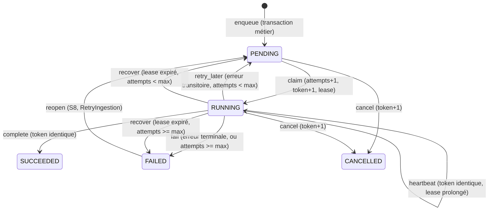

# Knowledge Base — S0 : infrastructure de traitement durable

> **Statut : Accepted — prêt à implémenter** (clôture de conception du
> 2026-11-17). Ce document précise la slice S0 de la
> [feuille de route](knowledge-base-roadmap.md). Il applique le complément
> « work queue durable » de l'[ADR 0004](../../decisions/0004-reliable-messaging.md),
> l'[ADR 0003](../../decisions/0003-modular-monolith-clean-architecture.md) et
> les points d'entrée de
> [005](../005-project-structure.md#surface-publique-dun-contexte-et-composition-root),
> tous Accepted. Le mécanisme (schéma, transitions, fencing, acquittement,
> récupération) est **Accepted** ; les valeurs numériques (délais, tailles de
> lot, nombre de tentatives) sont des **défauts Proposed**, configurables et à
> ajuster sur mesure.
>
> Références : [conception Knowledge Base](knowledge-base.md) §6–§7,
> [ADR 0006](../../decisions/0006-technical-bootstrap.md) (socle existant),
> [ADR 0007](../../decisions/0007-knowledge-base-bounded-context.md).

## Sommaire

1. [Objectif et périmètre](#1-objectif-et-périmètre)
2. [Schéma de `knowledge_base.work_items`](#2-schéma-de-knowledge_basework_items)
3. [Transitions d'état](#3-transitions-détat)
4. [Commandes techniques](#4-commandes-techniques)
5. [Fencing et transactions](#5-fencing-et-transactions)
6. [Conditions exactes d'idempotence](#6-conditions-exactes-didempotence)
7. [Retry et backoff](#7-retry-et-backoff)
8. [Dispatch, messages Celery et scheduler](#8-dispatch-messages-celery-et-scheduler)
   — dont [cycle complet et scénarios de panne](#86-cycle-complet-et-scénarios-de-panne)
9. [Ressources asyncio dans un worker Celery prefork](#9-ressources-asyncio-dans-un-worker-celery-prefork)
10. [Points d'entrée et emplacement du code](#10-points-dentrée-et-emplacement-du-code)
11. [Configuration Docker Compose](#11-configuration-docker-compose)
12. [Stratégie de tests](#12-stratégie-de-tests)
13. [Critères d'acceptation](#13-critères-dacceptation)
14. [Risques](#14-risques)
15. [Mises à jour documentaires attendues](#15-mises-à-jour-documentaires-attendues)
16. [Commandes de validation](#16-commandes-de-validation)

---

## 1. Objectif et périmètre

S0 livre un mécanisme **générique** de travail durable propre à Knowledge
Base : enregistrer un travail dans la même transaction que l'état métier, le
faire exécuter par un worker Celery, survivre aux pertes de messages, aux
redélivrances et aux crashs, et terminer chaque travail dans un état
explicite.

**Dans le périmètre :**

- package `knowledge_base` minimal (points d'entrée, configuration, tables) ;
- schéma PostgreSQL `knowledge_base` et table `work_items` (migration Alembic) ;
- port d'enqueue, adapter SQL du cycle de vie, registre de handlers ;
- tâches Celery `execute`, `dispatch`, `recover` ;
- composition des ressources asyncio dans les workers prefork ;
- services Compose `worker_ingestion` et `scheduler`, volumes `kb_blobs` et
  `models_cache` ;
- extension des tests d'architecture.

**Hors périmètre (slices ultérieures) :** tout `kind` métier
(`extract_version`, `index_version`…), agrégats, endpoints REST, blob store,
Docling, SentenceTransformers, torch, collections Qdrant, Integration Events,
outbox d'événements, `RetryIngestion` (S8).

**Prérequis documentaires :** ADR 0003, 0007, complément de l'ADR 0004 et
document 005 Accepted (fait). Aucun prérequis de décision ne reste ouvert pour
S0.

## 2. Schéma de `knowledge_base.work_items`

| Colonne | Type | Contraintes | Rôle |
|---|---|---|---|
| `id` | `uuid` | PK | identifiant transporté par le message Celery |
| `kind` | `text` | NOT NULL | type de travail ; détermine le handler et la file |
| `payload` | `jsonb` | NOT NULL, défaut `{}` | identifiants uniquement ; jamais de contenu de fichier ni de secret |
| `dedup_key` | `text` | NOT NULL, `UNIQUE` | identité logique complète du travail, ex. `extract_version:<version_id>` |
| `status` | `text` | NOT NULL, `CHECK IN ('PENDING','RUNNING','SUCCEEDED','FAILED','CANCELLED')` | état |
| `attempts` | `integer` | NOT NULL, défaut 0, `>= 0` | nombre de claims effectués |
| `max_attempts` | `integer` | NOT NULL, `>= 1` | défaut par `kind` (5) |
| `fencing_token` | `bigint` | NOT NULL, défaut 0 | incrémenté à chaque claim et à l'annulation |
| `lease_owner` | `text` | NULL | `hostname:pid` du worker ayant fait le claim |
| `lease_expires_at` | `timestamptz` | NULL ; NOT NULL si `RUNNING` (`CHECK`) | fin du lease |
| `available_at` | `timestamptz` | NOT NULL, défaut `now()` | date à partir de laquelle l'item peut être claimé |
| `dispatched_at` | `timestamptz` | NULL | dernier envoi d'un message de réveil |
| `last_error_code` | `text` | NULL | code stable (`TRANSIENT`, `LEASE_EXPIRED`, `UNKNOWN_KIND`, codes métier…) |
| `last_error_message` | `text` | NULL, tronqué à 2 000 caractères | diagnostic, sans secret |
| `correlation_id` | `uuid` | NULL | traçabilité (enveloppe de 004) |
| `created_at` / `updated_at` | `timestamptz` | NOT NULL | horodatage |
| `completed_at` | `timestamptz` | NULL | date d'entrée dans un état terminal |
| `reopen_count` | `integer` | NOT NULL, défaut 0, `>= 0` | *S8 :* réouvertures de l'item `FAILED` (rejeu, réconciliation bornée d'une purge) |

> **Précision d'implémentation (2026-11-17)** — `max_attempts` : la colonne a
> un défaut serveur de 5, appliqué par `enqueue` (qui accepte aussi une valeur
> explicite) tant que l'item n'a pas été claimé. Le **claim** fixe ensuite
> `max_attempts` à la valeur déclarée par le handler du `kind`
> (`WorkHandler.max_attempts`), dans le même `UPDATE` (`CASE kind …` construit
> depuis le registre) ; `retry_later` et `recover` lisent la colonne. Un `kind`
> sans handler garde la valeur de la colonne.

Index :

- `ix_work_items_dispatchable` sur `(available_at)` `WHERE status = 'PENDING'` ;
- `ix_work_items_running_lease` sur `(lease_expires_at)` `WHERE status = 'RUNNING'` ;
- `ix_work_items_kind_status` sur `(kind, status)` (observabilité).

Règles :

- Toutes les dates sont calculées par PostgreSQL (`now()`), jamais par
  l'horloge du worker : aucune dérive d'horloge entre processus.
- `dedup_key` est unique **pour toujours**, y compris pour les items
  terminés. Un nouveau travail logique a donc une clé différente (par exemple
  `sync_visibility:<document_id>:<visibility_revision>`). Une relance manuelle
  (S8) rouvre l'item existant au lieu d'en créer un autre.
- La table appartient au schéma `knowledge_base` (`MetaData(schema=…)` dans
  `frameworks/sqlalchemy/`). La table de versions Alembic reste dans `public`.
- Purge des items terminés : **[Open]**, non nécessaire en V1 (volume faible).

## 3. Transitions d'état



| Transition | Condition SQL (`WHERE`) | Effets |
|---|---|---|
| enqueue | `INSERT … ON CONFLICT (dedup_key) DO NOTHING` | `PENDING`, `available_at = now()` ; renvoie l'item existant en cas de conflit |
| claim | `id = :id AND status = 'PENDING' AND available_at <= now()` | `RUNNING`, `attempts+1`, `fencing_token+1`, `lease_owner`, `lease_expires_at = now() + ttl` |
| heartbeat | `id = :id AND status = 'RUNNING' AND fencing_token = :t` | `lease_expires_at = now() + ttl` |
| complete | `id = :id AND status = 'RUNNING' AND fencing_token = :t` | `SUCCEEDED`, `completed_at`, lease effacé |
| retry_later | idem + `attempts < max_attempts` | `PENDING`, `available_at = now() + backoff(attempts)`, `dispatched_at = NULL`, erreur enregistrée |
| fail | `id = :id AND status = 'RUNNING' AND fencing_token = :t` | `FAILED`, `completed_at`, erreur enregistrée |
| recover | `status = 'RUNNING' AND lease_expires_at < now()` | `attempts < max` → `PENDING` (+ backoff, `LEASE_EXPIRED`) ; sinon `FAILED` (`LEASE_EXPIRED_MAX_ATTEMPTS`) |
| cancel | `id = :id AND status IN ('PENDING','RUNNING')` | `CANCELLED`, `fencing_token+1`, `completed_at` |
| reopen (S8) | `id = :id AND status = 'FAILED'` | `PENDING`, `attempts = 0`, `available_at = now()` ; erreur conservée |

> **Précision d'implémentation S8 (2026-11-18)** — `reopen` efface aussi
> `dispatched_at` et `completed_at`, laisse le jeton de fencing inchangé
> (jamais reculé : le claim suivant l'incrémente) et incrémente
> `reopen_count` (migration `5d2f8c1a7b30`). Il est exécuté par
> `RetryIngestion` sous verrou de la ligne (`SELECT … FOR UPDATE`), dans la
> transaction qui remet l'état métier en attente, et par la réconciliation
> pour une purge `FAILED` (au plus `KB_RECONCILE_MAX_PURGE_REOPENINGS` fois).
> Un travail à refaire après un item **terminé** ne rouvre pas l'item : il
> prend la génération suivante de sa clé, `<clé>:<n>`
> (`WorkQueue.enqueue_again`), et `cancel` annule la clé et ses générations
> ([knowledge-base.md §6, précisions S8](knowledge-base.md#6-workflow-de-traitement-avec-work_items)).

Une transition dont l'UPDATE touche zéro ligne n'est **jamais** une erreur
technique : elle signifie « déjà traité, annulé ou périmé ». L'appelant
journalise et s'arrête.

## 4. Commandes techniques

| Commande | Appelant | Transaction | Rôle |
|---|---|---|---|
| `EnqueueWork(kind, payload, dedup_key, correlation_id?)` | handler métier, via le port `WorkQueue` | **celle du handler métier** (même Unit of Work) | enregistre le travail atomiquement avec l'état métier |
| `CancelWork(dedup_key or id)` | handler métier | celle du handler métier | invalide un travail devenu inutile (ex. version `DISCARDED`) |
| `DispatchPendingWork(batch)` | tâche périodique `dispatch` | propre, courte | sélectionne et marque les items à réveiller, publie après commit |
| `ClaimWorkItem(id, owner)` | tâche `execute` | propre, courte | lease + fencing |
| `HeartbeatWorkItem(id, token)` | handler long | propre, courte | prolonge le lease |
| `CompleteWorkItem(id, token)` | handler | **celle de la finalisation métier** | succès atomique avec les effets métier |
| `RetryWorkItemLater(id, token, error)` | tâche `execute` | propre | erreur transitoire |
| `FailWorkItem(id, token, error)` | tâche `execute` | celle de la finalisation d'échec métier, si le handler en fournit une | échec terminal |
| `RecoverExpiredLeases(batch)` | tâche périodique `recover` | propre, courte | reprise après crash |

Seuls `EnqueueWork` et `CancelWork` sont exposés au domaine, par le port
`domain/providers/work_queue.py` (Protocol). Les autres sont des opérations
d'adapter, utilisées par les tâches Celery.

API cible (signatures indicatives, à affiner pendant l'implémentation sans
changer la sémantique) :

```python
# domain/providers/work_queue.py — port utilisé dans une Unit of Work métier
class WorkQueue(Protocol):
    async def enqueue(self, kind: str, dedup_key: str,
                      payload: Mapping[str, str] | None = None,
                      correlation_id: UUID | None = None) -> UUID: ...
    async def cancel(self, dedup_key: str) -> bool: ...

# adapters/gateway/persistence/sqlalchemy_work_queue.py — cycle de vie
@dataclass(frozen=True)
class ClaimedWorkItem:
    id: UUID
    kind: str
    payload: Mapping[str, str]
    attempts: int
    max_attempts: int
    fencing_token: int
    correlation_id: UUID | None

class SqlAlchemyWorkLifecycle:
    async def select_dispatchable(self, kinds: Collection[str], batch: int,
                                  redispatch_after: timedelta,
                                  max_in_flight: Mapping[str, int]) -> list[tuple[UUID, str]]: ...
    async def claim(self, item_id: UUID, owner: str, lease_ttl: timedelta) -> ClaimedWorkItem | None: ...
    async def heartbeat(self, item_id: UUID, token: int, lease_ttl: timedelta) -> bool: ...
    async def complete(self, session: AsyncSession, item_id: UUID, token: int) -> bool: ...
    async def retry_later(self, item_id: UUID, token: int, error: FailureInfo,
                          delay: timedelta) -> bool: ...
    async def fail(self, session: AsyncSession, item_id: UUID, token: int,
                   error: FailureInfo) -> bool: ...
    async def recover_expired(self, batch: int) -> int: ...
```

`complete` et `fail` reçoivent la session de la transaction de finalisation,
pour s'exécuter atomiquement avec les écritures métier. Un retour `False`
signifie « 0 ligne modifiée ».

## 5. Fencing et transactions

Déroulé d'une exécution (tâche `execute(work_item_id)`) :

```text
T1  claim                → COMMIT       (retour : token, ou None → fin silencieuse)
    handler.execute(item, ctx)          hors transaction : effets externes idempotents,
                                         heartbeats éventuels
T2  finalisation          → COMMIT       écritures métier + complete(id, token)
                                         0 ligne sur complete → ROLLBACK de T2 entier
en cas d'exception :
T2' retry_later | fail    → COMMIT       (+ hook métier d'échec terminal dans la même transaction)
```

Contrat d'un handler (`adapters/controller/tasks/`) :

```python
class WorkHandler(Protocol):
    kind: ClassVar[str]
    queue: ClassVar[str]          # ex. "knowledge_base.ingestion"
    max_attempts: ClassVar[int]

    async def execute(self, item: ClaimedWorkItem, ctx: WorkContext) -> None:
        """Effets externes idempotents, puis ctx.finalize(callback) :
        callback(uow) écrit l'état métier ; ctx ajoute complete(id, token)
        dans la même transaction et lève StaleAttempt si 0 ligne."""

    async def on_terminal_failure(self, uow: UnitOfWork, item: ClaimedWorkItem,
                                  error: FailureReason) -> None:
        """Facultatif : écrit l'échec métier (ex. version FAILED) dans la
        transaction de fail()."""
```

- Classification des erreurs : `TerminalWorkError(code)` → `fail` ;
  `TransientWorkError` et toute exception inattendue → `retry_later`
  (comptée dans `attempts`) ; `StaleAttempt` → journalisée, aucune transition.
- Une transaction n'est **jamais** ouverte pendant le travail hors
  transaction (règle de 002).
- Le handler ne fait aucune écriture métier PostgreSQL en dehors de
  `ctx.finalize` : c'est la condition pour que le fencing protège l'état métier.

> **Précision d'implémentation (2026-11-17)** — cas limites de la
> finalisation et de l'échec :
> - un handler qui rend la main sans appeler `ctx.finalize` est un échec
>   terminal `NOT_FINALIZED` (le hook d'échec est appelé) ;
> - si `on_terminal_failure` lève une exception, la transaction de `fail` est
>   annulée en entier (aucune écriture du hook, l'item reste `RUNNING`), puis
>   l'item passe par `retry_later` dans une transaction propre, avec le code
>   `TERMINAL_HOOK_FAILED` et le backoff ; à la dernière tentative, il est
>   terminé `FAILED` (`TERMINAL_HOOK_FAILED`) **sans** hook. L'état métier de
>   ce dernier cas est le point ouvert O14 de
>   [knowledge-base.md §16](knowledge-base.md#16-points-ouverts).

## 6. Conditions exactes d'idempotence

**La redélivrance d'un message ne garantit pas que l'effet d'un handler ne
s'exécute qu'une seule fois.** Un même item peut être exécuté plusieurs fois :

1. message de réveil envoyé deux fois (redispatch après `redispatch_after`) ;
2. redélivrance RabbitMQ (connexion perdue avant l'acquittement) ;
3. lease expiré pendant qu'une tentative lente est **toujours active**
   (tentative zombie), puis nouveau claim ;
4. crash après les effets externes, mais avant T2.

Les cas 1 et 2 sont absorbés par le claim conditionnel : le second message
trouve l'item `RUNNING` ou terminé et s'arrête. Les cas 3 et 4 provoquent une
**réexécution réelle** du handler.

Garanties qui en résultent :

| Effet | Garantie | Condition |
|---|---|---|
| État métier PostgreSQL | **au plus une** finalisation réussie par item, et **au moins une** issue terminale | écritures métier uniquement dans `ctx.finalize` (fencing) |
| Effet externe (Qdrant, fichier) | **au moins une** exécution si l'item réussit ; **plusieurs** possibles | doit satisfaire les conditions ci-dessous |

Un effet externe est idempotent **si et seulement si** :

1. son identité est déterministe et dérivée de l'item (pas d'identifiant
   aléatoire généré pendant l'exécution) ;
2. il écrase sans accumuler (upsert, écriture atomique par renommage) ;
3. une suppression est exprimée par un filtre déterministe ;
4. le résultat est déterministe à entrée égale (une variation numérique
   négligeable d'embedding est acceptée) ;
5. une tentative zombie produisant l'effet **après** une finalisation plus
   récente laisse un état équivalent ou un état non visible, corrigé par la
   réconciliation (cf. [knowledge-base.md §7.3](knowledge-base.md#73-conditions-didempotence-des-effets-externes)).

Un effet qui ne respecte pas ces conditions (envoi de mail, appel facturé,
compteur) **ne doit pas** être placé dans un handler de `work_items` sans
mécanisme supplémentaire (clé d'idempotence côté destinataire). Aucun cas de
ce type n'existe dans Knowledge Base V1.

## 7. Retry et backoff

| Paramètre | Défaut Proposed | Variable |
|---|---|---|
| `max_attempts` | 5 (par `kind`) | déclaré par le handler |
| Base du backoff | 10 s | `KB_WORK_BACKOFF_BASE_SECONDS` |
| Plafond | 900 s | `KB_WORK_BACKOFF_MAX_SECONDS` |
| Formule | `d = min(plafond, base × 2^(attempts−1))`, puis délai = `d/2 + U(0, d/2)` (*equal jitter*) | — |
| `lease_ttl` | 300 s | `KB_WORK_LEASE_TTL_SECONDS` |
| Heartbeat | toutes les `lease_ttl / 3` pour un handler long | `ctx.heartbeat()` |
| Limite Celery dure (`time_limit`) | 3 600 s | `KB_WORK_TIME_LIMIT_SECONDS` |

> **Précision d'implémentation (2026-11-17)** — « déclaré par le handler » :
> la valeur est appliquée au claim (voir la précision du §2) ; le défaut 5 est
> celui de la colonne avant le premier claim.

- La fonction de backoff est **pure** (horloge et aléa injectés) et testée
  unitairement.
- Un dépassement de `time_limit` tue le processus enfant : le lease expire et
  `recover` prend le relais, comme pour un OOM.
- Un CPU long (Docling, embeddings) exécuté dans la boucle asyncio bloquerait
  le heartbeat : le travail CPU doit tourner dans `asyncio.to_thread` pendant
  que la boucle envoie les heartbeats.

## 8. Dispatch, messages Celery et scheduler

### 8.1 Messages et acquittement **[Accepted]**

- Une seule tâche d'exécution : `knowledge_base.work.execute(work_item_id)`.
  Le message ne contient **que** l'identifiant ; il est routé vers la file du
  `kind` (`knowledge_base.ingestion` pour les traitements CPU).
- **Le message RabbitMQ est un signal de déclenchement ; PostgreSQL reste la
  source de vérité du travail à accomplir.** Plusieurs notifications peuvent
  concerner le même item.
- **Acquittement anticipé : `acks_late = False`** (valeur par défaut de
  Celery, posée explicitement sur la tâche `execute`). Sémantique exacte dans
  Celery 5.7 : le message est acquitté **juste avant l'exécution de la tâche**
  par le processus enfant, et **non à la réception**. Un message préchargé
  (prefetch) reste non acquitté tant qu'il attend dans le worker.
- **`acks_late = False` n'est pas une garantie de traitement.** Après
  l'acquittement, RabbitMQ oublie le message : si le worker meurt, aucune
  redélivrance n'aura lieu. La récupération repose **exclusivement** sur la
  table `work_items`, le scheduler (`dispatch`, `recover`) et les invariants
  transactionnels (claim conditionnel, fencing). Elle ne dépend jamais d'une
  redélivrance RabbitMQ.
- `task_reject_on_worker_lost` est sans effet avec un acquittement anticipé et
  n'est pas utilisé. `worker_prefetch_multiplier = 1` ; sérialisation JSON
  (inchangée, ADR 0006).

Pourquoi pas `acks_late = True` pour ces tâches :

1. **La durabilité est déjà portée par la table.** Une redélivrance n'apporte
   rien que `dispatch` et `recover` ne fassent déjà, avec une politique
   explicite (backoff, nombre de tentatives, état `FAILED` visible).
2. **Un acquittement tardif crée des exécutions concurrentes du même item.**
   Si le canal se ferme pendant une tâche longue (perte de connexion,
   redémarrage du broker, délai d'acquittement dépassé), RabbitMQ redélivre le
   message alors que la tentative d'origine tourne encore. Le claim
   conditionnel absorberait le doublon, mais ce chemin de reprise s'ajouterait
   à celui du scheduler sans rien garantir de plus.
3. **Délai d'acquittement du broker.** La stack utilise RabbitMQ 4.4.0 avec
   les valeurs par défaut, constatées le 2026-11-17 : `consumer_timeout =
   1800000` ms et `consumer_timeout_response = notify_consumer`, files
   `classic` durables (`interview_rag_trainer.default`). Ce délai est
   configurable et sa mise en œuvre dépend du type de file ; il ne fonde pas
   la décision, il illustre le point 2. Avec `acks_late = True`, toute tâche
   plus longue que ce délai serait exposée à une redélivrance pendant son
   exécution.

Implication résiduelle de l'acquittement anticipé : pendant qu'une tâche
longue s'exécute (son message déjà acquitté), le worker peut précharger **un**
message suivant (`concurrency=1 × prefetch_multiplier=1`) qui reste non
acquitté. S'il attend plus longtemps que le délai du broker, RabbitMQ peut le
reprendre et le redélivrer. Il s'agit d'une notification en double,
inoffensive grâce au claim conditionnel. Un test d'intégration de S0 vérifie
l'invariant avec un délai court ; la reprise par le broker n'a pas été observée
(§12.2, 14).

### 8.2 Dispatch

Tâche périodique `knowledge_base.work.dispatch` :

1. Transaction courte : `SELECT id, kind FROM work_items WHERE status =
   'PENDING' AND kind = ANY(:registered_kinds) AND available_at <= now()
   AND (dispatched_at IS NULL OR dispatched_at < now() - :redispatch_after)
   ORDER BY available_at LIMIT
   :batch FOR UPDATE SKIP LOCKED`, en respectant le plafond en vol par file
   (ci-dessous) ; `UPDATE … SET dispatched_at = now()` ; **COMMIT**.
2. **Après le commit**, publication d'un message par item.
3. Un crash entre 1 et 2 est rattrapé au passage suivant après
   `redispatch_after`.
4. **Seuls les `kind` enregistrés sont dispatchés.** Un item dont le `kind`
   n'a pas encore de handler (par exemple `extract_version` entre S2 et S3)
   reste `PENDING` sans consommer de tentative. Si un message arrive malgré
   tout pour un `kind` inconnu, `execute` le termine en `FAILED`
   (`UNKNOWN_KIND`).

**Plafond en vol par file** : `en_vol = RUNNING + PENDING dispatchés depuis
moins de redispatch_after`. On ne dispatche que si `en_vol < max_in_flight`.
Cela borne approximativement la longueur de la file RabbitMQ quand le worker
d'ingestion est occupé par une tâche longue, et limite les doublons de réveil
(toujours inoffensifs grâce au claim). Le comptage n'est pas verrouillé : deux
`dispatch` concurrents peuvent dépasser légèrement le plafond, sans danger
grâce au claim conditionnel.

### 8.3 Reprise

Tâche périodique `knowledge_base.work.recover` : applique la transition
`recover` (§3) par lots `FOR UPDATE SKIP LOCKED`.

### 8.4 Paramètres

| Paramètre | Défaut Proposed | Variable |
|---|---|---|
| Intervalle de dispatch | 2 s | `KB_WORK_DISPATCH_INTERVAL_SECONDS` |
| Taille de lot | 50 | `KB_WORK_DISPATCH_BATCH` |
| `redispatch_after` | 600 s | `KB_WORK_REDISPATCH_AFTER_SECONDS` |
| `max_in_flight` (file d'ingestion) | 2 | `KB_WORK_MAX_IN_FLIGHT` |
| Intervalle de reprise | 30 s | `KB_WORK_RECOVER_INTERVAL_SECONDS` |

### 8.5 Scheduler

- Service `scheduler` = **Celery beat**, une seule instance (contrainte
  documentée). Il ne fait qu'émettre `dispatch` et `recover` ; il n'accède pas
  à la base.
- `dispatch` et `recover` sont routées vers la **file par défaut**
  (`interview_rag_trainer.default`, worker existant), jamais vers la file
  d'ingestion : elles ne doivent pas attendre derrière une extraction longue.
- Fichier d'état de beat éphémère (`/tmp`) : les planifications sont des
  intervalles, rien n'est à conserver.
- Santé (ajout du 2026-11-19, défaut D3 de la
  [validation globale](knowledge-base-validation.md)) : beat réécrit son
  fichier d'état toutes les 180 s (`Scheduler.sync_every` de Celery) ; le
  healthcheck Compose exige que le plus récent des fichiers
  `/tmp/celerybeat-schedule*` (le backend dbm `sqlite3` écrit dans `-wal`)
  ait moins de 300 s. Un beat arrêté ou bloqué devient `unhealthy`.
- Délai maximal de prise en charge d'un item, sans panne :
  `intervalle de dispatch + attente en file`. Avec perte d'un message :
  `+ redispatch_after`. Après crash d'un worker : `+ lease_ttl + intervalle de
  reprise`.

### 8.6 Cycle complet et scénarios de panne

| # | Étape | Transaction / processus | Règle |
|---|---|---|---|
| 1 | **Création transactionnelle** du `work_item` | transaction du handler métier (même Unit of Work) | `INSERT … ON CONFLICT (dedup_key) DO NOTHING` ; le travail n'existe que si la transaction métier est commitée |
| 2 | **Publication de la notification** vers RabbitMQ | tâche `dispatch` : transaction courte qui pose `dispatched_at`, commit, **puis** publication | jamais avant le commit ; une publication perdue est rattrapée (7 et 8 ci-dessous) |
| 3 | **Acquisition atomique du lease** | tâche `execute`, transaction T1 | `UPDATE … WHERE id = :id AND status = 'PENDING' AND available_at <= now()` ; 0 ligne → notification en double ou travail déjà traité : fin silencieuse |
| 4 | **Incrémentation du fencing token** | même UPDATE que 3 | `fencing_token = fencing_token + 1`, renvoyé au worker ; c'est l'identité de la tentative |
| 5 | **Durée et renouvellement du lease** | `lease_ttl` = 300 s ; heartbeat toutes les `lease_ttl / 3` pour un handler long | heartbeat conditionnel au token ; un heartbeat à 0 ligne signale une tentative périmée, qui s'arrête au plus tôt |
| 6 | **Finalisation conditionnelle** | transaction T2 : écritures métier + `complete(id, token)` | 0 ligne → rollback complet de T2 ; aucun effet métier de la tentative périmée |
| 7 | **Worker mort avant le lease** (message acquitté, ou non encore acquitté) | — | l'item reste `PENDING` avec `dispatched_at` : redispatch après `redispatch_after` ; si le message n'était pas acquitté, RabbitMQ peut aussi le redélivrer (doublon inoffensif) |
| 7b | **Worker mort après le lease** | — | l'item reste `RUNNING` sans heartbeat ; `recover` le remet `PENDING` (avec backoff) après `lease_expires_at`, ou `FAILED` si `attempts >= max_attempts` ; le claim suivant incrémente le token |
| 8 | **Message acquitté, traitement jamais démarré** (exception avant le claim, processus tué juste après l'acquittement) | — | identique à 7 : `PENDING` avec `dispatched_at` ancien → redispatch après `redispatch_after` |
| 9 | **Récupération par le scheduler** | `dispatch` toutes les 2 s, `recover` toutes les 30 s | `dispatch` : items `PENDING` disponibles, jamais notifiés ou notifiés il y a plus de `redispatch_after` ; `recover` : items `RUNNING` dont le lease a expiré |
| 10 | **Retries, backoff, `FAILED`** | transaction de `retry_later` ou `fail` | transitoire → `PENDING` avec `available_at = now() + backoff(attempts)` ; terminal ou `attempts >= max_attempts` → `FAILED` avec `last_error_*` ; relance seulement par commande explicite (S8) |

Garanties qui en résultent :

| Garantie | Assurée par |
|---|---|
| Un travail commité n'est pas perdu si sa notification se perd | `dispatch` et `redispatch_after` (2, 7, 8) |
| Plusieurs notifications d'un même travail sont sans danger | claim conditionnel (3) |
| Une seule tentative valide finalise la transition PostgreSQL | fencing token dans T2 (4, 6) |
| Une ancienne tentative ne valide rien après expiration et réattribution du lease | token incrémenté par le nouveau claim (4, 7b) |
| Un lease est récupérable après un crash | `recover` (7b, 9) |
| Les effets externes peuvent être exécutés plusieurs fois | non garanti unique : idempotence ou réconciliation obligatoire (§6) |

Délai maximal entre deux notifications d'un item `PENDING` : `redispatch_after`
(600 s). Un message en attente derrière une tâche longue peut donc être notifié
deux fois ; le plafond `max_in_flight` borne approximativement le nombre de
doublons (des `dispatch` concurrents peuvent le dépasser légèrement, sans
danger grâce au claim).

## 9. Ressources asyncio dans un worker Celery prefork

Les handlers et repositories sont asynchrones (SQLAlchemy asyncio + asyncpg) ;
Celery prefork exécute des tâches synchrones dans des processus enfants.

| Moment | Processus | Action |
|---|---|---|
| Import de `runtime.worker` | maître | création de l'application Celery, appel de `knowledge_base.register_worker(celery_app, resources)` : enregistrement des tâches, des routes et du `beat_schedule`. **Aucune connexion ni boucle créée.** |
| Signal `worker_process_init` | chaque enfant (après fork) | création d'**une** boucle `asyncio.new_event_loop()`, puis du moteur asyncpg et de la fabrique de sessions **sur cette boucle** (pool réduit : `pool_size=2`) |
| Exécution d'une tâche | enfant | `loop.run_until_complete(coroutine)` sur la boucle persistante |
| Signal `worker_process_shutdown` | enfant | `engine.dispose()`, fermeture de la boucle |

- `resources` est un **fournisseur paresseux** (`Callable[[], KnowledgeBaseWorkerResources]`)
  défini par Knowledge Base : la registration a lieu dans le maître, les
  ressources n'existent que dans les enfants.
- Interdits : `asyncio.run()` par tâche (nouvelle boucle à chaque fois, pool
  asyncpg lié à une boucle fermée) ; création du moteur avant le fork ;
  pool `threads` ou `gevent` (boucle partagée entre threads).
- Pools supportés : `prefork` en exploitation, `solo` dans les tests
  in-process (les ressources sont alors fournies explicitement par le test).
- Le worker d'ingestion tourne avec `--concurrency=1` : un seul modèle chargé
  en mémoire à partir de S3/S4.

## 10. Points d'entrée et emplacement du code

Conformes à [005](../005-project-structure.md#surface-publique-dun-contexte-et-composition-root)
et au précédent de `trading-agent-ai` (fabriques réexportées par le package
racine depuis `adapters/controller/dependencies`).

```text
backend/src/knowledge_base/
  __init__.py                       # réexporte register_worker, KnowledgeBaseWorkerResources,
                                    # KnowledgeBaseSettings (et register quand S2 ajoutera des routes)
  README.md
  domain/providers/work_queue.py    # Protocol WorkQueue : enqueue, cancel
  adapters/
    controller/
      dependencies.py               # register_worker(celery_app, resources)
      tasks/
        execution.py                # tâche execute + WorkContext
        dispatch.py                 # tâches dispatch et recover
        registry.py                 # registre kind → WorkHandler (vide en production en S0)
        retry_policy.py             # backoff et classification, purs
    gateway/persistence/
      sqlalchemy_work_queue.py      # transitions SQL (§3)
  frameworks/
    sqlalchemy/tables.py            # MetaData(schema="knowledge_base"), work_items
    configuration/settings.py       # KnowledgeBaseSettings (pydantic-settings, préfixe KB_)
```

Côté `runtime` : `runtime/worker.py` appelle `knowledge_base.register_worker`
et gère les signaux du §9 ; `alembic/env.py` ajoute le `MetaData` de
Knowledge Base à `target_metadata` avec `include_schemas=True`. `runtime/app.py`
n'enregistre rien pour Knowledge Base en S0 (aucune route).

> **Précision d'implémentation (2026-11-17)** — la fabrique
> `create_celery_app(settings=None, *, work_handlers=())`, l'appel à
> `register_worker` et les signaux du §9 vivent dans
> `runtime/worker_factory.py`, sans effet de bord à l'import ;
> `runtime/worker.py` construit l'application de production et la tâche
> `runtime.ping`. Raison : sous macOS, les enfants prefork démarrent en
> *spawn*, et deux applications enregistrant les mêmes tâches dans un processus
> entrent en conflit (détail : `backend/src/runtime/README.md`).

## 11. Configuration Docker Compose

Changements à apporter dans S0 (rien n'est modifié par ce document) :

| Élément | `compose.yaml` | `compose.test.yaml` |
|---|---|---|
| `worker` (existant) | inchangé, consomme `interview_rag_trainer.default` ; exécute `dispatch` et `recover` | inchangé |
| `worker_ingestion` (nouveau) | même image ; `celery -A runtime.worker:celery_app worker -Q knowledge_base.ingestion --concurrency=1 --prefetch-multiplier=1` ; dépend de `migrate` et `rabbitmq` ; healthcheck `inspect ping` | non requis : les tests exécutent un worker in-process |
| `scheduler` (nouveau) | même image ; `celery -A runtime.worker:celery_app beat --schedule /tmp/celerybeat-schedule` ; une seule instance | non requis |
| Volume `kb_blobs` | monté dans `api`, `worker`, `worker_ingestion` sur `/var/lib/interview-rag-trainer/blobs` | tmpfs ou volume éphémère si un test l'exige |
| Volume `models_cache` | monté dans `api` et `worker_ingestion` sur `/var/cache/interview-rag-trainer/models` (utilisé à partir de S3/S4) | — |
| Image (`backend/Dockerfile`) | création des répertoires de montage avec propriétaire `app` (un volume nommé neuf copie les droits du répertoire de l'image) | idem |
| `.env.example` | variables `KB_*` documentées avec leurs défauts | — |
| `rabbitmq_test` | — | délai d'acquittement court (`consumer_timeout`) via un fichier de configuration monté, **uniquement** pour le scénario 14 ; la stack de dev garde les défauts |

Aucun nouveau service d'infrastructure (pas de Redis, pas de MinIO). Celery
beat est un processus de la même image, pas une infrastructure.

## 12. Stratégie de tests

### 12.1 Unitaires (sans I/O)

| Test | Vérifie |
|---|---|
| `test_backoff_*` | croissance exponentielle, plafond, bornes du jitter (aléa injecté) |
| `test_error_classification_*` | terminal → fail ; transitoire et exception inconnue → retry ; dernière tentative → fail |
| `test_recover_decision_*` | lease expiré avec ou sans tentatives restantes |
| `test_registry_*` | `kind` inconnu à l'exécution → échec terminal `UNKNOWN_KIND` ; double enregistrement refusé |
| `test_settings_*` | défauts `KB_*`, validation (valeurs > 0, cohérence `heartbeat < lease_ttl`) |

### 12.2 Intégration (PostgreSQL et RabbitMQ réels, `compose.test.yaml`)

Le worker est démarré **dans le processus de test** (`celery.contrib.testing`,
pool `solo`) avec un registre contenant un handler de test : le broker et la
base sont réels, le handler est un artefact de test qui n'existe pas dans le
code de production.

| # | Scénario | Attendu |
|---|---|---|
| 1 | enqueue puis rollback de la transaction métier | aucune ligne |
| 2 | enqueue puis commit | une ligne `PENDING` |
| 3 | deux enqueue avec la même `dedup_key` | une seule ligne ; le second renvoie l'item existant |
| 4 | cycle complet : enqueue → dispatch → execute → finalisation | `SUCCEEDED` ; effet métier de test écrit une fois |
| 5 | même message livré deux fois | un seul claim ; un seul effet métier |
| 6 | lease expiré pendant que la tentative A s'exécute ; recover puis claim B ; A tente de finaliser | finalisation de A rejetée (0 ligne, rollback) ; B finalise ; un seul effet métier |
| 6b | claim puis arrêt du traitement sans heartbeat ni finalisation (worker tué) | `recover` remet l'item `PENDING` après expiration ; nouveau claim avec token incrémenté ; un seul effet métier |
| 7 | item dispatché, message jamais consommé | redispatché après `redispatch_after` (horloge accélérée par paramètre) |
| 7b | message consommé et acquitté, puis abandonné avant le claim | item `PENDING`, redispatché après `redispatch_after`, puis `SUCCEEDED` |
| 8 | handler levant une erreur transitoire | `PENDING`, `available_at` repoussé, `attempts` incrémenté ; après `max_attempts` : `FAILED`, `last_error_*` renseigné |
| 9 | handler levant une erreur terminale avec hook métier | `FAILED` et écriture métier d'échec dans la même transaction |
| 10 | annulation pendant l'exécution | finalisation rejetée ; état `CANCELLED` |
| 11 | plafond `max_in_flight` | pas plus de N items dispatchés en vol |
| 11b | item d'un `kind` non enregistré | jamais dispatché, reste `PENDING`, `attempts = 0` |
| 12 | migration : `upgrade head`, `downgrade -1`, `upgrade head` | sans erreur ; schéma conforme au §2 |
| 13 | ressources prefork | une tâche exécutée par un vrai processus enfant réutilise la même boucle et le même moteur sur deux tâches successives (pas d'erreur « attached to a different loop ») |
| 14 | message préchargé non acquitté au-delà d'un `consumer_timeout` court (RabbitMQ de test configuré pour ce scénario) | chaque item `SUCCEEDED` avec un seul effet métier (claim conditionnel), quel que soit le chemin de notification ; comportement du broker observé et consigné ci-dessous |

**Scénario 14 — comportement observé (2026-11-17, RabbitMQ 4.4.0, Celery 5.7.0,
file `classic` durable).** `rabbitmq_test` monte
`backend/tests/integration/rabbitmq_test/20-consumer-timeout.conf`
(`consumer_timeout = 5000`, `consumer_timeout_response` laissé à
`notify_consumer`) ; `make test-integration` exporte
`KB_TEST_CONSUMER_TIMEOUT_SECONDS=5`, ce qui active le test (≈ 85 s).

- **Worker in-process (pool solo) : le scénario ne se produit pas.** L'acquittement
  anticipé est programmé par `hub.call_soon` dans le thread qui exécute la
  tâche : le message de la tâche longue reste non acquitté pendant toute son
  exécution (constaté côté broker : 1 prêt, 1 non acquitté, prefetch 1) et le
  message suivant n'est jamais livré. Le test utilise donc un vrai worker
  prefork (`--concurrency=1 --prefetch-multiplier=1`) en sous-processus.
- **Worker prefork :** le maître acquitte le message de la tâche longue et
  précharge le suivant. Constaté pendant 80 s : 0 message prêt, 1 non acquitté,
  consommateur `active`/`up` ; **aucune** annulation, fermeture de canal ni
  redélivrance, aucun journal du broker. À la fin de la tâche longue, le
  message préchargé est exécuté normalement (claim, `SUCCEEDED`, un effet).
  Selon les exécutions, le redispatch du test (`redispatch_after` = 5 s) publie
  ou non une seconde notification avant ce claim ; lorsqu'il le fait, la
  seconde exécution trouve l'item déjà pris et s'arrête (`attempts = 1`, un
  seul effet).
- **Sonde AMQP brute (py-amqp, sans Celery), même broker :** un message gardé
  non acquitté 150 s avec `consumer_timeout = 5000`, puis 200 s avec
  `consumer_timeout = 60000` (posé à chaud) : seule la livraison initiale est
  reçue, ni `basic.cancel` (capacité `consumer_cancel_notify` annoncée par le
  serveur), ni fermeture, ni redélivrance.
- **Conclusion établie :** dans cette configuration, le délai d'acquittement
  du broker n'a provoqué aucune reprise observable dans les fenêtres testées ;
  l'invariant (un seul effet métier par item, chaque item `SUCCEEDED`) tient,
  et le doublon de notification par redispatch est absorbé par le claim
  conditionnel. La cause de l'absence de reprise par le broker n'est **pas**
  établie (sémantique de `notify_consumer` en 4.4 ou application du délai aux
  files `classic` non vérifiées) : le chemin « redélivrance par le broker »
  du §8.1 reste non observé. La reprise ne dépend pas de lui (§8.1).
- La valeur courte ne concerne que les messages livrés et non acquittés ; les
  autres tests n'en gardent aucun plus de quelques secondes, à l'exception du
  message en cours d'un worker solo (acquittement différé, ci-dessus) : un test
  in-process dont la tâche dépasserait 5 s y serait exposé si le broker
  appliquait le délai.

### 12.3 Architecture

- `bounded_contexts()` retourne `assessment`, `interview_training`,
  `knowledge_base` ; le test `test_src_contains_the_validated_contexts` est
  mis à jour en conséquence (ADR 0007 Accepted).
- `FRAMEWORKS` est étendu : `docling`, `docling_core`, `sentence_transformers`,
  `transformers`, `torch`, `numpy` (ADR 0008), avec un test de détection de
  violation pour au moins `docling` et `sentence_transformers`.
- `runtime` n'importe que `knowledge_base` (racine) et `knowledge_base.contracts`
  (règle existante `runtime_only_sees_public_surface`).
- `celery` reste interdit dans `domain/` et `use_cases/` (règle existante).

### 12.4 Vérifications Compose

- `docker compose up --build -d` : `worker_ingestion` et `scheduler` démarrés,
  `worker_ingestion` *healthy* ;
- `celery inspect active_queues` montre `knowledge_base.ingestion` consommée
  par `worker_ingestion` uniquement ;
- écriture d'un fichier dans `kb_blobs` par l'utilisateur `app` depuis `api` et
  `worker_ingestion`.

## 13. Critères d'acceptation

1. `make ci` et `make test-integration` passent.
2. Les scénarios d'intégration 1 à 14 (y compris 6b, 7b, 11b) passent contre
   PostgreSQL et RabbitMQ réels.
3. **Aucun travail commité n'est perdu** : il atteint `SUCCEEDED`, `FAILED` ou
   `CANCELLED` malgré la perte d'un message (7) ou la mort d'un worker (6).
4. **Aucun effet métier PostgreSQL n'est appliqué deux fois** malgré une
   livraison at-least-once (5, 6, 10).
5. Aucune transaction n'est ouverte pendant l'exécution d'un handler (revue de
   code et test 6).
6. `docker compose up --build -d` démarre les nouveaux services ;
   `/health/ready` est inchangé.
7. Aucune dépendance Docling, SentenceTransformers ou torch ajoutée ; aucun
   endpoint, agrégat ou `kind` métier.
8. Documentation mise à jour (§15).

## 14. Risques

| Risque | Mitigation |
|---|---|
| Boucle asyncio et asyncpg dans Celery prefork | §9 ; test 13 avec un vrai processus enfant |
| Deux instances de beat (doublons de dispatch) | inoffensif grâce au claim et à `SKIP LOCKED` ; une seule instance documentée |
| Permissions des volumes nommés pour l'utilisateur non-root `app` | répertoires créés dans l'image ; vérification Compose |
| Tâche longue bloquant le heartbeat | travail CPU dans `asyncio.to_thread` (§7) |
| Accumulation de messages de réveil | plafond `max_in_flight` (§8.2) |
| Registre de handlers pollué par des besoins de test | handler de test défini sous `tests/`, injecté par le test |
| Généralisation prématurée vers `shared/` | mécanisme gardé dans Knowledge Base ; extraction vers `shared` seulement quand Assessment en aura besoin (règle de 005 sur `shared`) |

## 15. Mises à jour documentaires attendues

- `backend/src/knowledge_base/README.md` (créé avec le package) ;
- `backend/src/runtime/README.md` : registration du worker, signaux ;
- `docs/guides/environnement-local.md` : nouveaux services, volumes, variables `KB_*` ;
- [feuille de route](knowledge-base-roadmap.md) : S0 marqué terminé ;
- ADR 0006 : aucune modification de ses choix ; ajout éventuel d'une référence
  vers les nouveaux services dans « Conséquences » si le nombre de services
  annoncé change.

## 16. Commandes de validation

À exécuter avant d'ouvrir la Pull Request de S0 :

```bash
make lint typecheck test          # Ruff, mypy strict, unitaires + architecture
make test-integration             # stack compose.test.yaml éphémère, pytest -m integration
make ci                           # équivalent local complet (backend + frontend)
docker compose up --build -d      # stack de développement
make ps                           # worker_ingestion et scheduler démarrés, healthchecks
curl -s localhost:8010/health/ready
docker compose exec worker_ingestion celery -A runtime.worker:celery_app inspect active_queues
make migrate                      # upgrade head sur la stack de dev
```

Un test non exécuté ou une vérification impossible doit être signalé
explicitement dans la Pull Request.
