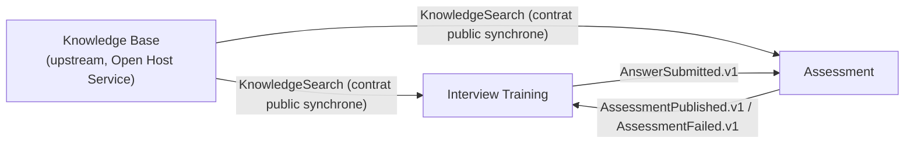
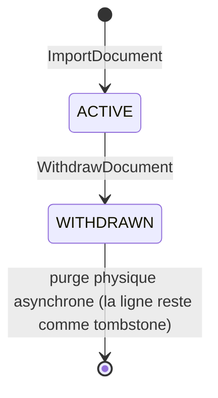
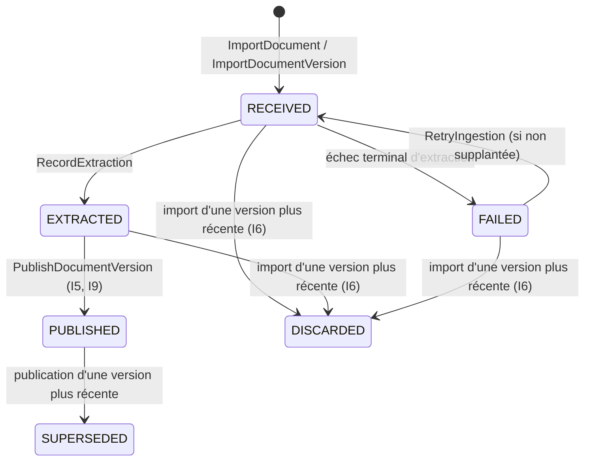
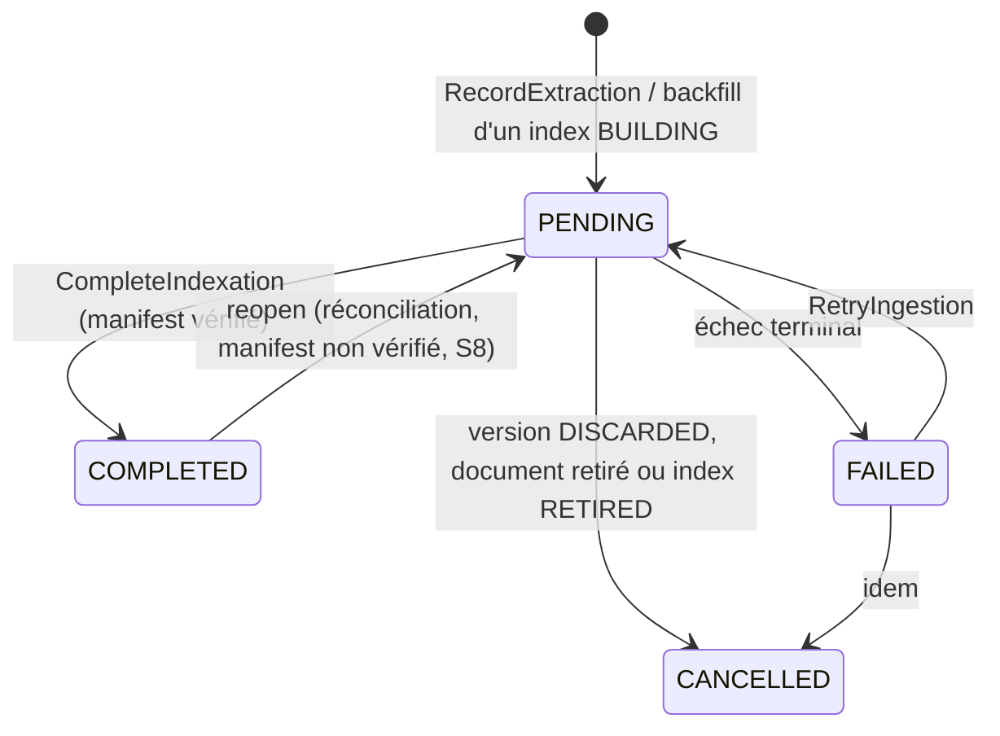
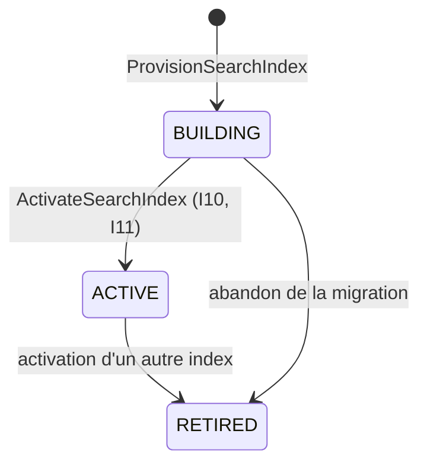

# Knowledge Base — Conception du Bounded Context

> **Statut : Accepted pour les orientations, Proposed pour les détails signalés.**
> Revue de conception close le 2026-11-17. Les orientations validées sont
> enregistrées dans les ADR [0007](../../decisions/0007-knowledge-base-bounded-context.md)
> à [0012](../../decisions/0012-original-document-storage-and-purge.md) et dans le
> complément de l'[ADR 0004](../../decisions/0004-reliable-messaging.md)
> (work queue durable). Ce document décrit le modèle cible : **aucun code
> Knowledge Base n'existe encore**.
>
> Légende utilisée dans ce document :
> **[Accepted]** décision validée par ADR ; **[Proposed]** détail recommandé,
> à confirmer pendant la slice qui l'implémente ; **[Open]** non tranché
> (voir [§16](#16-points-ouverts)).
>
> Documents liés : [feuille de route S0–S9](knowledge-base-roadmap.md),
> [conception détaillée de S0](knowledge-base-s0.md),
> [005 — structure et points d'entrée](../005-project-structure.md).

## Sommaire

1. [Mission, limites et Context Map](#1-mission-limites-et-context-map)
2. [Langage ubiquitaire](#2-langage-ubiquitaire)
3. [Agrégats, entités et Value Objects](#3-agrégats-entités-et-value-objects)
4. [Invariants](#4-invariants)
5. [États et transitions](#5-états-et-transitions)
6. [Workflow de traitement avec `work_items`](#6-workflow-de-traitement-avec-work_items)
7. [Leases et fencing tokens](#7-leases-et-fencing-tokens)
8. [Prévention des publications obsolètes](#8-prévention-des-publications-obsolètes)
9. [Intégrité de l'index Qdrant](#9-intégrité-de-lindex-qdrant)
10. [Publication, retrait et purge](#10-publication-retrait-et-purge)
11. [Visibilité et cohérence PostgreSQL / Qdrant](#11-visibilité-et-cohérence-postgresql--qdrant)
12. [Stratégie de recherche et limites de Recall](#12-stratégie-de-recherche-et-limites-de-recall)
13. [Changement de modèle d'embeddings](#13-changement-de-modèle-dembeddings)
14. [Contrat public `KnowledgeSearch`](#14-contrat-public-knowledgesearch)
15. [Pipeline, structure du code et feuille de route](#15-pipeline-structure-du-code-et-feuille-de-route)
16. [Points ouverts](#16-points-ouverts)

---

## 1. Mission, limites et Context Map

**[Accepted — ADR 0007]** Knowledge Base est le troisième Bounded Context,
distinct d'Interview Training et d'Assessment (ADR 0001 reste inchangé).

- **Responsabilités :** import de documents pédagogiques, conservation de
  l'original, dédoublonnage, versions, extraction, segmentation en unités de
  connaissance, chunking, embeddings, indexation, recherche sémantique sourcée,
  retrait et purge, récupération après panne.
- **Hors périmètre :** déroulement d'un entretien, choix de la question
  suivante, correction et score, suivi des compétences, génération de questions
  par LLM (Question Bank éventuelle, non conçue).



- Knowledge Base est **upstream** ; son contrat public est un **Open Host
  Service** : `knowledge_base.contracts.providers.KnowledgeSearch` (§14).
- Les consommateurs **figent** dans leurs propres snapshots les extraits et
  citations qu'ils utilisent (cohérent avec `QuestionSnapshot`, 003). Une
  réindexation ou une nouvelle version ne modifie jamais rétroactivement un
  entretien ou une correction.
- Aucun autre contexte ne lit les tables `knowledge_base.*` ni Qdrant.
- **Aucun Integration Event n'est publié en V1** : les noms
  `knowledge.document_version_published.v1` et `knowledge.document_withdrawn.v1`
  sont réservés pour l'arrivée d'un consommateur réel (ADR 0007).

## 2. Langage ubiquitaire

| Terme | Définition | Nature |
|---|---|---|
| `KnowledgeDocument` | Document pédagogique logique, stable entre ses versions | Aggregate Root |
| `DocumentVersion` | Contenu importé à un instant, identifié par son empreinte et son numéro ; immuable | Entité de `KnowledgeDocument` |
| `DocumentSource` | Provenance de l'original : nom de fichier, type de média, taille, SHA-256, date d'import. **Remplace le terme `KnowledgeSource`** de la première version de [domain.md](../../context/domain.md) | Value Object |
| `DocumentKind` | `COURSE`, `QA_SHEET`, `REVISION_SHEET`, `TECHNICAL` | Value Object (énumération) |
| `StructuredDocument` | Représentation interne neutre des blocs extraits (titres, paragraphes, code, tableaux, listes) et de leur provenance | Value Object |
| `KnowledgeUnit` | Unité pédagogique indivisible : question + réponse + code + explications, ou section, ou définition | Donnée dérivée immuable |
| `DocumentChunk` | Fragment indexable d'une unité, avec en-tête contextuel et provenance | Donnée dérivée immuable |
| `Citation` | Document, version, chemin de sections, pages : référence stable vers l'original | Value Object |
| `ChunkingPolicy` | Version des règles de segmentation et de découpage, budget en tokens, overlap, fallbacks | Value Object versionné |
| `EmbeddingProfile` | Modèle, révision, dimension, distance, normalisation, préfixes query/passage, longueur maximale, tokenizer | Value Object versionné |
| `KnowledgeCorpus` | Périmètre de recherche ; détient les générations d'index et la génération active. Singleton en V1 | Aggregate Root |
| `SearchIndex` | Génération d'index pour un couple (`EmbeddingProfile`, `ChunkingPolicy`) : `BUILDING`, `ACTIVE`, `RETIRED` | Entité de `KnowledgeCorpus` |
| `Indexation` | Fait de couverture : « cette version est (ou doit être) présente dans cet index » | Aggregate Root |
| `IndexManifest` | Ensemble des couples (identifiant de point, empreinte de chunk) attendus pour une indexation | Value Object |
| `Publication` | Bascule SQL rendant une version visible à la recherche | Opération de `KnowledgeDocument` |
| `Withdrawal` | Retrait logique immédiat d'un document, suivi d'une purge asynchrone | Opération de `KnowledgeDocument` |
| `WorkItem` | Unité de traitement durable (lease, fencing, tentatives) ; **concept technique, pas métier** | Ligne de `knowledge_base.work_items` |
| `RetrievedPassage` | Résultat public : unité (ou fenêtre), score, citation vérifiable | DTO public |

Termes **abandonnés** : `IngestionJob` et `IndexingAttempt` (remplacés par
`WorkItem` pour le processus et `Indexation` pour le fait de couverture),
`VectorIndex` comme concept métier (remplacé par `SearchIndex` ; « collection
Qdrant » est un détail d'adapter ; `VectorIndex` reste seulement le nom du
port technique vers le moteur vectoriel), `DocumentStatus` comme concept autonome.

## 3. Agrégats, entités et Value Objects

### 3.1 `KnowledgeDocument` — Aggregate Root [Accepted]

- Attributs : `document_id`, `title`, `kind`, `topics`, `language`, `status`,
  `published_version_id`, `visibility_revision`, `version` (verrouillage
  optimiste).
- Entité interne `DocumentVersion` : `version_id`, `number` (monotone par
  document), `DocumentSource`, `status`, `failure` (code, message, retryable),
  `created_at`.
- Contient **uniquement** des métadonnées : ni chunks, ni lease, ni compteur
  de tentatives (ces derniers vivent dans `work_items`, §6).
- `visibility_revision` [Proposed] : compteur incrémenté à chaque publication
  ou retrait ; il identifie la synchronisation Qdrant attendue (§11).

### 3.2 `KnowledgeCorpus` — Aggregate Root [Proposed, sur la décision Accepted « une génération active par corpus »]

- Attributs : `corpus_id` (singleton en V1), `active_index_id`, `version`.
- Entité interne `SearchIndex` : `index_id`, `EmbeddingProfile`,
  `ChunkingPolicy`, `status` (`BUILDING`, `ACTIVE`, `RETIRED`),
  `created_at`, `activated_at`, `retired_at`.
- Le nombre de générations est faible (une ou deux vivantes) : l'invariant
  « au plus un index `ACTIVE` » est porté **à l'intérieur d'un seul agrégat**,
  et le verrou de sa ligne sert de barrière blue/green (§13).
- Les noms de collections Qdrant sont calculés par l'adapter à partir de
  `index_id` ; ils n'appartiennent pas au domaine.
- *Précision S4 (2026-11-18, revue) : en base, `active_index_id` est une clé
  étrangère composite `(corpus_id, active_index_id) → search_indexes(corpus_id,
  index_id)`, contrôlée au commit (`DEFERRABLE INITIALLY DEFERRED`, la
  référence étant circulaire) : l'index actif existe et appartient au corpus.
  La preuve de couverture d'I11 n'est pas portée par l'agrégat, qui reçoit
  `coverage_complete` de l'appelant ; elle arrive avec `ActivateSearchIndex`
  en S9 ([ADR 0011, suivi](../../decisions/0011-embedding-profile-search-index-blue-green.md#suivi-2026-11-18)).*
- *Précision S9 (2026-11-18) : la preuve de couverture est calculée par
  `ActivateSearchIndex` dans la transaction qui tient la ligne du corpus
  `FOR UPDATE` (lecture des versions publiées de documents actifs et de leur
  indexation dans le candidat), puis transmise à `activate_index`. **Un seul
  index `BUILDING` à la fois** (décision 2 de l'orchestrateur) : règle de
  `StartIndexMigration`, sous le même verrou ; démarrer de nouveau le même
  couple (profil, politique) rend l'index en construction sans rien écrire,
  un autre couple est refusé (`MigrationInProgressError`). L'agrégat reste
  général (`provision_index` n'interdit pas un second `BUILDING`) : la règle
  ne porte que sur le démarrage d'une migration, seul chemin de production qui
  crée un index `BUILDING`.*

### 3.3 `Indexation` — Aggregate Root [Accepted]

- Identité logique unique `(version_id, index_id)`.
- Attributs : `status` (`PENDING`, `COMPLETED`, `FAILED`, `CANCELLED`),
  `chunking_policy_version`, `manifest_digest`, `point_count`,
  `completed_at`, `failure`.
- **Sans lease ni tentative** : ces aspects sont ceux du `WorkItem` qui la
  traite. L'`Indexation` est le fait métier sur lequel reposent la publication
  (§8) et l'activation d'un index (§13).

### 3.4 Unités et chunks — données dérivées immuables [Accepted]

- Persistés dans PostgreSQL, **hors des agrégats**, par lot, dans la
  transaction qui fait passer la version à `EXTRACTED`.
- Identité d'un lot : `(version_id, chunking_policy_version)`. *Précision S3 (2026-11-18) : `chunking_policy_version` est l'identité `version+tokenizer` de la politique (ex. `kb-chunking-v1+approx-xlmr-v1`).*
- `KnowledgeUnit` : `unit_id`, `ordinal`, `unit_type` (`QA`, `SECTION`,
  `DEFINITION`), `question_text?`, `section_path`, `page_span`, `token_count`.
- `DocumentChunk` : `chunk_id`, `unit_id`, `ordinal_in_unit`,
  `contextual_text` (texte + en-tête contextuel, **sans** préfixe de modèle),
  `chunk_hash`, `token_count`, `citation`.
- Identifiants **déterministes** [Proposed] : `unit_id` et `chunk_id` sont des
  UUIDv5 dérivés de `(version_id, chunking_policy_version, ordinals)`. Une
  ré-extraction après panne produit donc les mêmes identifiants.
- `chunk_hash = SHA-256(contextual_text ‖ chunking_policy_version)`. *Précision S3 (2026-11-18) : séparateur `\x00` entre les deux termes ; `unit_id` et `chunk_id` épinglés par `test_policy_identity`.*
- Taille : une transaction unique suffit dans les limites de l'ADR 0012
  (20 Mo, 300 pages). Un mécanisme de staging ne sera introduit que si une
  mesure le rend nécessaire. *Précision S6 (2026-11-18) : mesuré sur un PDF
  textuel de 300 pages dans le worker de dev, 410 unités et 682 chunks écrits
  dans la transaction de finalisation sans incident ; le volume de texte d'un
  DOCX, lui, n'est pas borné par les pages (O16) : depuis la revue S6, son XML
  décompressé est borné à 100 Mio avant Docling, la borne de volume de texte
  commune à tous les formats reste ouverte.*

### 3.5 Value Objects

`DocumentSource`, `ContentHash`, `DocumentKind`, `Citation`, `SectionPath`,
`PageSpan`, `ChunkingPolicy`, `EmbeddingProfile`, `IndexManifest`,
`FailureReason` (`code`, `message`, `retryable`), `StructuredDocument` et ses
blocs.

### 3.6 Hors domaine (adapters)

`DoclingDocument`, tokenizer concret, noms de collections, identifiants et
payloads Qdrant, chemins de blobs, messages Celery, lignes `work_items`.

*Précision S4 (2026-11-18) : `IndexedPoint` et `PointSelector`
(`domain/value_objects/indexed_point.py`) ne sont pas des Value Objects du
domaine mais les DTO du port `VectorIndex` : ils décrivent un point et une
sélection en termes du domaine (identifiants, empreinte, champs de filtrage),
sans rien de Qdrant. Ils restent à côté du port qui les emploie ; la
traduction en `PointStruct`, payload et filtres Qdrant appartient à l'adapter
(`adapters/gateway/vector_store/`).*

## 4. Invariants

### 4.1 Garanties strictes (transactionnelles, PostgreSQL)

| # | Invariant | Mécanisme |
|---|---|---|
| I1 | Une `DocumentVersion` est immuable (source, empreinte, numéro) | Aucune méthode de modification ; contraintes SQL. *Précision S2, 2026-11-18 :* trigger `BEFORE UPDATE` sur `document_versions` refusant la modification de `number`, `content_hash`, `filename`, `media_type`, `size_bytes`, `imported_at` (migration `756db53032ab`) |
| I2 | Numéros de version strictement croissants par document | Attribution sous verrou optimiste de l'agrégat |
| I3 | Une même empreinte n'est importée qu'une fois par document | *Précision S2, 2026-11-18 :* `UNIQUE(content_hash)` **global** sur `document_versions`, qui couvre I3 et la décision O2 (un contenu n'appartient qu'à un document, §16) ; remplace `UNIQUE(document_id, content_hash)` |
| I4 | Au plus une version `PUBLISHED` par document | `published_version_id` sous verrou + index unique partiel |
| I5 | Publication monotone : une version ne peut être publiée que si son numéro est supérieur à celui de la version publiée | Règle de l'agrégat, vérifiée dans la transaction de publication (§8) |
| I6 | Importer la version N supplante (`DISCARDED`) toutes les versions antérieures non publiées et annule leurs `work_items` | Même transaction que l'import. *Précision S7, 2026-11-18 :* la transaction annule aussi, dans chaque index vivant, l'item `index_version` des versions écartées et leurs `Indexation` `PENDING` ou `FAILED` (→ `CANCELLED`, une `COMPLETED` est laissée telle quelle) ; le corpus n'est lu (`FOR SHARE`) que si une version est écartée |
| I7 | Les unités et chunks d'une version sont écrits dans la transaction qui la fait passer à `EXTRACTED`, et ne sont jamais modifiés | Finalisation sous fencing (§7) |
| I8 | Une `Indexation` n'est `COMPLETED` que si le manifest a été vérifié dans Qdrant (§9) et que le fencing token du `WorkItem` est valide | Transaction de finalisation |
| I9 | Une version n'est publiée que si son `Indexation` dans l'index `ACTIVE` est `COMPLETED`, l'index actif étant lu sous le verrou du corpus | §8, §13 |
| I10 | Au plus un `SearchIndex` `ACTIVE` par corpus | Invariant interne de `KnowledgeCorpus` |
| I11 | Activation d'un index seulement si toutes les versions publiées de documents `ACTIVE` y sont `COMPLETED` | Contrôle sous `FOR UPDATE` du corpus (§13) |
| I12 | Un document `WITHDRAWN` n'est plus jamais renvoyé par une recherche commencée après le commit du retrait | Contrôle SQL final de chaque recherche (§11, §12) |
| I13 | Tout chunk porte une citation complète | Construction obligatoire du VO `Citation` |
| I14 | Au plus une finalisation réussie par tentative de `WorkItem` ; une tentative périmée ne peut rien finaliser | Fencing token (§7) |

### 4.2 Cohérence éventuelle (pas de garantie immédiate)

| Comportement | Délai borné par | Garantie de sûreté pendant le délai |
|---|---|---|
| Extraction, chunking, embeddings, upserts Qdrant | durée de traitement, retries | la version n'est pas visible tant qu'elle n'est pas publiée |
| Synchronisation du drapeau `visible` dans Qdrant | intervalle du scheduler + exécution | le contrôle SQL écarte tout passage non visible (§11) |
| Purge des points d'une version supplantée ou retirée | idem | les points restants sont filtrés (drapeau et contrôle SQL) |
| Purge des blobs et chunks d'un document retiré | idem + délai de rétention (ADR 0012) | aucune lecture possible : document `WITHDRAWN` |
| Construction d'un nouvel index `BUILDING` | backfill complet du corpus | la recherche continue sur l'index `ACTIVE` |
| Reprise après crash (lease expiré) | `lease_ttl` + intervalle de reprise | fencing : la tentative périmée ne peut pas finaliser |

**Aucun effet externe n'est garanti « exactly once ».** Les écritures Qdrant
et les écritures de blobs peuvent être exécutées plusieurs fois ; elles sont
conçues pour être **idempotentes** et **convergentes** (§7.3).

## 5. États et transitions

### 5.1 `KnowledgeDocument`



Un document `WITHDRAWN` n'accepte plus de nouvelle version. Une réactivation
éventuelle est **[Open]** (non prévue en V1).

*Précisions S7 (2026-11-18) : un second retrait est refusé
(`DocumentWithdrawnError`, 409 `DOCUMENT_WITHDRAWN` par l'API), sans effet :
ni révision, ni seconde purge. Un document `WITHDRAWN` refuse aussi
`record_extraction` (défense en profondeur de §7.3, condition 5, si
l'annulation du work item n'avait pas eu lieu). La purge physique est
enregistrée par `documents.purged_at` (hors agrégat) ; la ligne reste comme
tombstone, avec ses versions.*

### 5.2 `DocumentVersion`



- **`DISCARDED`** : abandonnée **avant** publication ; elle n'a jamais été
  visible. **`SUPERSEDED`** : a été publiée, puis remplacée. Les deux sont
  terminaux.
- L'état `EXTRACTING` de la première proposition est **supprimé** : « en
  cours » est l'état du `WorkItem`, pas de la version.
- `FAILED` ne concerne que l'**extraction**. Un échec d'indexation laisse la
  version `EXTRACTED` (ses chunks sont valides) et fait passer l'`Indexation`
  à `FAILED` ; `RetryIngestion` rouvre alors l'indexation, pas l'extraction.
- Le retrait d'un document ne change pas l'état de ses versions : la
  visibilité est portée par `KnowledgeDocument.status`.

*Précision S8 (2026-11-18) : `FAILED --> RECEIVED` est fait par
`RetryIngestion` dans la transaction qui rouvre l'item `extract_version`
(`POST /api/v1/knowledge-base/failures/{item_id}/retry`), refusé pour une
version `DISCARDED` ou un document retiré (409 `OBSOLETE_WORK`). Quand l'item
a fini `FAILED` sans que son hook d'échec ait abouti (O14), la version reste
`RECEIVED` jusqu'à ce que la réconciliation écrive l'échec à la place du hook.*

### 5.3 `Indexation`



*Précision S9 (2026-11-18) : `PENDING` est aussi créé par
`StartIndexMigration` (backfill) et par la réconciliation
(`MISSING_FROM_BUILDING_INDEX`) ; l'indexation porte la politique de
l'INDEX. `PENDING --> FAILED` : aussi par le hook de `rechunk_version`
(lot de la politique de l'index impossible à produire) et par
`index_version` en `CHUNK_BATCH_MISSING`.*

*Précision S8 (2026-11-18) : l'arête `COMPLETED --> PENDING`
(`Indexation.reopen()`, distincte de `retry()`) est réservée à la
réconciliation, quand le manifest échantillonné ne se vérifie plus (§9) ;
elle efface l'empreinte du manifest, le nombre de points et la date (I8).
L'indexation est refaite par un nouvel item `index_version` (génération
suivante de la clé, §6) ; une version déjà publiée n'est pas republiée, sa
synchronisation de visibilité est replanifiée (§11).*

### 5.4 `SearchIndex` (dans `KnowledgeCorpus`)



Cas initial (S4) : le premier index est créé puis activé alors que le corpus
est vide ; l'invariant I11 est trivialement satisfait.

*Précision S9 (2026-11-18) : `[*] --> BUILDING` d'une migration est
`StartIndexMigration` (le `ProvisionSearchIndex` de S4 reste la commande de
démarrage de la stack, idempotente, qui ne crée que le premier index et ne
démarre jamais de migration : un redémarrage avec une autre configuration ne
lance pas de backfill). `BUILDING --> RETIRED` (abandon) existe dans
l'agrégat mais n'est exposé par aucune commande en V1. Après `ACTIVE -->
RETIRED`, la collection de l'index est supprimée par `drop_index_collection`
(la ligne `RETIRED` reste : ses indexations y renvoient).*

### 5.5 `WorkItem`

États `PENDING`, `RUNNING`, `SUCCEEDED`, `FAILED`, `CANCELLED`. Transitions,
schéma et paramètres : [knowledge-base-s0.md](knowledge-base-s0.md#3-transitions-détat).

## 6. Workflow de traitement avec `work_items`

**[Accepted — ADR 0004, complément work queue]** Toutes les étapes longues
passent par `knowledge_base.work_items`. Le message RabbitMQ n'est qu'un
signal de déclenchement portant l'identifiant de l'item ; **l'état fait foi
dans PostgreSQL**. Un simple `celery.delay()` n'est jamais considéré comme
durable. Le message est acquitté avant l'exécution (`acks_late = False`) ; la
récupération repose sur la table et le scheduler, jamais sur une redélivrance
([S0 §8.6](knowledge-base-s0.md#86-cycle-complet-et-scénarios-de-panne)).

| Étape | Transaction d'entrée | Hors transaction | Transaction de finalisation | Item suivant |
|---|---|---|---|---|
| Import (HTTP) | — | stream vers fichier temporaire, SHA-256, dépôt du blob adressé par empreinte | document/version `RECEIVED`, I3, I6, idempotency key, item `extract_version` | `extract_version` |
| `extract_version` | claim (lease, fencing) | lecture du blob, Docling → `StructuredDocument`, segmentation, chunking | fencing + version toujours `RECEIVED` → chunks + `EXTRACTED` + `Indexation PENDING` pour chaque index `ACTIVE`/`BUILDING` (lus sous `FOR SHARE` du corpus) | `index_version` par indexation |
| `index_version` | claim | embeddings par lots, upserts Qdrant `visible=false`, vérification du manifest | fencing + `Indexation COMPLETED`, puis tentative de publication (§8) | `sync_visibility` si publiée |
| `sync_visibility` | claim | convergence Qdrant vers l'état SQL du document (§11) | fencing + item `SUCCEEDED` | — |
| `purge_document` | claim | suppression des points | fencing + chunks supprimés, `purged_at` ; après le commit, au mieux : blobs non référencés | — |
| `rechunk_version` (S9) | claim | lecture du blob, re-parsing, découpage selon la politique de l'index (tokenizer de son profil) | fencing + index vivant, indexation `PENDING` → lot `(version, politique)` s'il manque | `index_version` |
| `drop_index_collection` (S9) | claim | suppression de la collection d'un index `RETIRED` | fencing seul | — |

*Précision S7 (2026-11-18, ordre rétabli par la revue S7) : `purge_document`
(file d'ingestion, 5 tentatives, dedup `purge_document:<document_id>`) suit
la ligne `purge_document` et l'ordre de l'ADR 0012 point 6 (points, puis
chunks, puis blobs) ; les unités sont supprimées avec les chunks, à la
finalisation. Les blobs sont supprimés par le handler du work item **après**
le commit de la finalisation, hors de toute transaction : un échec n'est que
journalisé (l'item est déjà `SUCCEEDED`) et le fichier, plus détenu par aucun
document non purgé, est repris par `CleanBlobOrphans`. Détail : précisions
S7 du §10.*

*Précisions S9 (2026-11-18), décisions de l'orchestrateur ([README du
contexte](../../../backend/src/knowledge_base/README.md#s9--benchmark-des-embeddings-et-migration-bluegreen)) :*

- *La ligne `build_index` prévue ci-dessus n'existe pas : le provisionnement
  d'un index `BUILDING` et la planification de son backfill sont faits par la
  commande `StartIndexMigration`, dans une transaction (collection Qdrant
  créée juste avant, hors transaction), et non par un work item. Le backfill
  est une `Indexation PENDING` par version `PUBLISHED`/`EXTRACTED` de
  document actif, avec `index_version` si la version a déjà un lot de la
  politique de l'index, `rechunk_version` sinon (la ré-extraction
  `extract_version` prévue ne convenait pas : elle exige une version
  `RECEIVED` et réécrirait son état).*
- *Pilotage (décision 1) : `python -m runtime.index_migration start <cible>`
  et `… activate <index_id>` (cibles Make `kb-migration-start`,
  `kb-migration-activate`), par la surface publique ; pas de route HTTP.*
- *`rechunk_version` (dedup `rechunk_version:<version_id>:<index_id>`,
  payload `document_id`, `version_id`, `index_id`) et `drop_index_collection`
  (dedup `drop_index_collection:<index_id>`, payload `index_id`) : file
  d'ingestion, 5 tentatives, codes du catalogue (§15.5), rejouables par
  `/failures` selon le catalogue (décision 7). Hook de `rechunk_version` :
  indexation `FAILED` (comme `index_version`) ; `drop_index_collection` n'a
  pas d'état métier.*
- *`drop_index_collection` est planifié par l'activation, **disponible après
  `KB_INDEX_DROP_DELAY_SECONDS`** (`WorkQueue.enqueue(…, delay=)`, défaut
  300 s, Proposed ; décision 6) : une recherche lit l'index actif puis
  interroge Qdrant ; commencée avant le commit de la bascule, elle peut
  encore lire l'ancienne collection pendant au plus la durée d'une recherche.*

*Précisions S8 (2026-11-18), décisions de l'orchestrateur ([README du
contexte](../../../backend/src/knowledge_base/README.md#s8--réconciliation-et-gestion-des-erreurs)) :*

- *`reconcile_knowledge_base` : file d'ingestion, 3 tentatives, un item par
  créneau de `KB_RECONCILE_INTERVAL_SECONDS` (dedup
  `reconcile_knowledge_base:<floor(epoch / intervalle)>`, payload vide),
  enregistré par la tâche beat `knowledge_base.work.reconcile` (file par
  défaut). Exécuté par la work queue, le cycle est sérialisé avec les autres
  traitements (`--concurrency=1`) et bénéficie du lease et du backoff. Pas de
  hook d'échec. La tâche `recover` de S0 reste seule à reprendre les items
  `RUNNING` au-delà de leur lease.*
  *Revue S8 (2026-11-18, I2) : aucun item n'est créé tant qu'un cycle est
  `PENDING` ou `RUNNING` (la tâche beat rend l'item vivant) : une file
  d'ingestion occupée par une longue extraction ne cumule pas un cycle par
  créneau manqué, le cycle en attente fait le travail de tous. Un cycle
  `FAILED` reste en base mais n'est ni listé par `GET /failures` ni rejouable
  (409 `NOT_REPLAYABLE`, quel que soit son code) : il n'a pas d'objet propre,
  le créneau suivant en planifie un neuf. Deux beats simultanés (erreur de
  déploiement) pourraient créer deux cycles de créneaux voisins : un cycle en
  double est inoffensif (corrections relues, effets idempotents).*
  *Revue S8 (2026-11-18, M2, M3, M8) : chaque document dont la
  synchronisation ou la purge est replanifiée a sa propre transaction, qui
  relit le document (actif avec une version publiée ; retiré) avant
  d'écrire ; un document en échec n'annule ni n'empêche les autres, et les
  échecs sont relevés ensemble à la fin (le cycle échoue, il est rejoué). La
  borne des réouvertures automatiques d'une purge (`reopen_count`) est relue
  sous le verrou de l'item. `COMPLETED_NOT_PUBLISHED` ne compte que les
  publications rattrapées (commit abouti) : un refus, constat périmé ou
  refus persistant, est journalisé sans être compté, faute de quoi un refus
  qu'aucun cycle ne peut corriger rendrait chaque rapport « non propre ».*
- *Générations : `dedup_key` reste unique pour toujours (S0 §2). Un travail à
  refaire après un item terminé (synchronisation, purge, indexation) prend la
  génération suivante de sa clé, `<clé>:<n>` (`WorkQueue.enqueue_again`), sauf
  si un item de la même **famille** (la clé et ses générations) est encore
  `PENDING` ou `RUNNING` : il est alors rendu, sans doublon.
  `WorkQueue.cancel(clé)` annule toute la famille : l'annulation d'une
  indexation au retrait ou à l'import de N+1 atteint aussi une réindexation
  planifiée par la réconciliation. `test_rescheduling_a_completed_purge_under_its_key_creates_no_work`
  reste vrai : `enqueue` sous la clé d'origine d'une purge terminée ne crée
  toujours rien.*
- *`RetryIngestion` rouvre l'item `FAILED` (transition `reopen` de S0 §3 :
  `PENDING`, `attempts = 0`, disponible tout de suite, `dispatched_at` et
  `completed_at` effacés, dernière erreur conservée, jeton de fencing jamais
  reculé, `reopen_count + 1`) et remet l'état métier en attente dans la même
  transaction (§5.2, §5.3).*

Les noms des `kind` sont **[Proposed]** et fixés au moment de la slice qui les
introduit. S0 ne livre que le mécanisme générique, sans aucun `kind` métier.

**Commandes métier :** `ImportDocument`, `ImportDocumentVersion`,
`WithdrawDocument`, `RetryIngestion`, `PublishDocumentVersion`,
`ProvisionSearchIndex`, `ActivateSearchIndex`. **Query :** `SearchKnowledge`.

**Commandes de processus (handlers de `WorkItem`) :** `RecordExtraction`,
`CompleteIndexation`, `FailExtraction`, `FailIndexation`,
`SyncDocumentVisibility`, `PurgeDocument`, `ReconcileKnowledgeBase`,
`RechunkVersion` et `DropIndexCollection` (S9). *Précision S9 : la commande
métier de démarrage d'une migration est `StartIndexMigration` ;
`ProvisionSearchIndex` reste celle du premier index.*

**Domain Events locaux :** `DocumentImported`, `DocumentVersionExtracted`,
`DocumentVersionDiscarded`, `IndexationCompleted`, `DocumentVersionPublished`,
`DocumentWithdrawn`, `SearchIndexActivated`. Ils restent internes au contexte
(005). « Ingestion démarrée » est un log ou une métrique, pas un événement.

## 7. Leases et fencing tokens

Détails, schéma et paramètres : [knowledge-base-s0.md](knowledge-base-s0.md).

### 7.1 Principe

- **Claim** : `UPDATE … SET status='RUNNING', attempts=attempts+1,
  fencing_token=fencing_token+1, lease_expires_at=now()+ttl WHERE id=:id AND
  status='PENDING' AND available_at<=now() RETURNING fencing_token`. Le claim
  est atomique ; un message dupliqué trouve un item déjà `RUNNING` ou terminé
  et ne fait rien.
- **Finalisation** : la transaction qui écrit les effets métier exécute aussi
  `UPDATE work_items SET status='SUCCEEDED' WHERE id=:id AND
  fencing_token=:token AND status='RUNNING'`. Zéro ligne modifiée → rollback
  complet : la tentative est périmée.
- **Reprise** : un item `RUNNING` dont le lease a expiré redevient `PENDING`
  (ou `FAILED` si les tentatives sont épuisées). L'expiration n'incrémente pas
  le token : c'est le claim suivant qui l'incrémente, ce qui invalide l'ancienne
  tentative.
- **Annulation** : `CANCELLED` incrémente le token ; une tentative en cours ne
  peut plus finaliser.

### 7.2 Ce que le fencing garantit, et ce qu'il ne garantit pas

| Garanti | Non garanti |
|---|---|
| Au plus une finalisation PostgreSQL réussie par item | Qu'un handler ne s'exécute qu'une fois : redélivrance, reprise après lease expiré, tentative « zombie » toujours active |
| Une tentative périmée ne modifie aucun état métier | Qu'un effet externe (Qdrant, fichier) ne soit produit qu'une fois |
| Un item finalement `SUCCEEDED`, `FAILED` ou `CANCELLED` (jamais perdu) | Un délai maximal strict avant traitement |

### 7.3 Conditions d'idempotence des effets externes

Un effet externe est acceptable si **toutes** ces conditions tiennent :

1. **Identité déterministe** : points Qdrant `uuid5(index_id, chunk_id)` ;
   blob `sha256/<aa>/<bb>/<empreinte>`.
2. **Contenu déterministe** : mêmes entrées → même payload ; la variation
   numérique infime d'un ré-encodage CPU est acceptée (écrasement).
3. **Écrasement sans accumulation** : upsert ou écriture atomique (fichier
   temporaire puis renommage) ; jamais d'append ni de compteur.
4. **Suppressions par filtre déterministe** (`version_id`, `document_id`),
   répétables sans effet de bord.
5. **Revérification métier à la finalisation** : la transaction relit l'état
   (version non `DISCARDED`, document non `WITHDRAWN`, index non `RETIRED`).
6. **Convergence** : une tentative zombie qui réécrit des points après une
   purge crée des points `visible=false`, jamais renvoyés (§11) et supprimés
   par la réconciliation.
   *Précision S4 (2026-11-18) : une tentative zombie d'`index_version` peut
   aussi réécrire `visible=false` les points d'une version déjà publiée et
   synchronisée par la tentative qui l'a remplacée : le document **manque**
   alors des résultats (jamais l'inverse, §11), sans qu'aucune
   synchronisation ne soit replanifiée. Pour réduire cette fenêtre, le
   travail hors transaction tourne dans une tâche annulée dès le premier
   heartbeat refusé (`keeping_lease`, `adapters/controller/tasks/lease.py`).
   Il reste une fenêtre résiduelle : entre la reprise de l'item par une autre
   tentative et le heartbeat suivant du zombie (au plus
   `KB_WORK_HEARTBEAT_INTERVAL_SECONDS`), plus l'upsert déjà envoyé à Qdrant
   au moment de l'annulation. Elle est réparée par la réconciliation S8
   (points d'une version `PUBLISHED` de document `ACTIVE` avec
   `visible=false` → replanifier `sync_visibility`) ; aucune garantie n'est
   donnée avant S8.*
   *Précision S7 (2026-11-18) : vérifié contre Qdrant réel
   (`test_s7_withdrawal_purge`) : une indexation dont l'item a été annulé par
   le retrait et qui écrit après la purge laisse des points `visible=false`,
   jamais renvoyés (filtre `visible` et contrôle SQL), que seule une nouvelle
   exécution de `purge_document` supprime. Rien ne la planifie en S7 : la
   réconciliation S8 replanifiera `purge_document` pour un document
   `WITHDRAWN` qui a encore des points.*
   *Précision S7 (revue, 2026-11-18) : cette replanification ne peut pas
   réutiliser la clé `purge_document:<document_id>`. `dedup_key` est
   `UNIQUE` sans condition et `enqueue` rend l'item existant, même terminé :
   réenfiler la purge d'un document déjà purgé est un no-op silencieux (même
   item `SUCCEEDED`, aucun travail ; comportement figé par
   `test_rescheduling_a_completed_purge_under_its_key_creates_no_work`). S8
   doit choisir une clé distincte (suffixe de génération, par exemple
   `purge_document:<document_id>:<n>`) ou une réouverture explicite de
   l'item, et changer ce test en conséquence.*
   *Précision S8 (2026-11-18) : réparé par la réconciliation. Points d'une
   version `PUBLISHED` de document `ACTIVE` avec `visible=false`, sans
   synchronisation en attente pour ce document → `sync_visibility`
   replanifiée (génération suivante de la clé de la révision courante).
   Points d'un document `WITHDRAWN` **et purgé** → `purge_document`
   replanifiée sous `purge_document:<document_id>:<n>` ; la clé d'origine
   reste celle de l'item terminé, et le test cité garde sa vérité (même clé =
   aucun travail). Un document retiré dont la purge est simplement en attente
   n'est pas touché. Vérifié contre Qdrant réel (`test_s8_reconciliation`,
   `test_s8_reconciliation_decisions`).*

## 8. Prévention des publications obsolètes

Scénario couvert : la version N est en cours d'indexation, N+1 est importée,
puis l'indexation de N se termine.

1. **À l'import de N+1** (même transaction) : N passe `DISCARDED`, ses
   `Indexation` passent `CANCELLED`, ses `work_items` non terminaux passent
   `CANCELLED` (token incrémenté).
2. **À la finalisation de N** : le fencing échoue (item annulé), donc rollback.
3. **Garde-fou indépendant du fencing**, dans `PublishDocumentVersion` :
   - la version est `EXTRACTED` (donc ni `DISCARDED` ni `FAILED`) ;
   - le document est `ACTIVE` ;
   - `version.number > numéro de la version publiée` (I5) ;
   - l'`Indexation(version, index ACTIVE)` est `COMPLETED`, l'index actif étant
     lu sous `FOR SHARE` de la ligne du corpus (I9).
4. Si N+1 est publiée **avant** que N ne termine (cas impossible après 1,
   mais protégé), I5 refuse la publication de N.

*Précision S7 (2026-11-18) : le point 1 est complet depuis S7 (S4 n'annulait
que l'item `extract_version`) ; vérifié sous concurrence réelle
(`test_s7_concurrent_versions`) : la tentative de N, suspendue avant son
upsert pendant l'import de N+1, finit `stale`, N n'est jamais publiée, ses
points restent `visible=false` puis sont supprimés à la synchronisation de
N+1. Une recherche ne mêle jamais deux versions d'un document, y compris
quand Qdrant porte les deux versions visibles (fenêtre de `sync_visibility`
entre `set_visibility` et `delete_points`, tenue ouverte par une barrière).*

## 9. Intégrité de l'index Qdrant

**[Accepted — ADR 0010]** Un simple `count` ne suffit pas.

- **Payload de chaque point** : `chunk_id`, `unit_id`, `version_id`,
  `document_id`, `chunk_hash`, `index_id`, `visible`, plus les champs de
  filtrage (`topics`, `kind`, `language`).
- **Manifest** : ensemble trié des couples `(point_id, chunk_hash)` attendus ;
  `manifest_digest = SHA-256` de sa sérialisation canonique, stocké dans
  l'`Indexation`.
- **Vérification avant `COMPLETED`** :
  1. upserts par lots avec `wait=true`, statut de mise à jour exigé ;
  2. relecture par identifiants (`retrieve`, payload sans vecteurs), par lots ;
  3. égalité exacte de l'ensemble des identifiants et de chaque `chunk_hash` ;
  4. configuration de la collection conforme au profil (dimension, distance),
     vérifiée une fois par tentative.
- **Points en trop** pour une version (`scroll` filtré sur `version_id`) :
  supprimés par la réconciliation.
- La réconciliation périodique (S8) recalcule le manifest des indexations
  `COMPLETED` par échantillonnage et ré-ouvre l'indexation en cas d'écart.

*Précisions S8 (2026-11-18) :*

- *Ordre de lecture : Qdrant **avant** PostgreSQL. Chaque cycle parcourt
  tous les points des index vivants (`scroll` paginé, sans vecteur, port
  `PointInventory`, regroupés par document, version et visibilité), puis lit
  l'état SQL de leurs documents. Un point écrit après une lecture SQL
  antérieure serait pris pour un orphelin ; lu avant, sa version est
  forcément commitée, et une version ne disparaît jamais de PostgreSQL
  (vérifié par une publication concurrente du parcours).*
- *Points sans propriétaire (document ou version inconnus, version
  `SUPERSEDED` ou `DISCARDED`) : supprimés par filtre (version, ou document
  s'il est inconnu). Un point visible d'une version non publiée n'est pas
  corrigé : aucun travail ne le ferait, et le contrôle SQL l'écarte (§11).*
- *Manifest : au plus `KB_RECONCILE_MANIFEST_SAMPLE_SIZE` indexations
  `COMPLETED` (version `EXTRACTED` ou `PUBLISHED` d'un document actif, index
  vivant) par cycle, tirées au hasard (défaut 20, Proposed). Le manifest
  attendu est recalculé depuis les chunks de PostgreSQL et comparé aux points
  de la version lus par filtre : point manquant, `chunk_hash` différent, ou
  empreinte enregistrée qui n'est plus celle des chunks (I8 ne tient plus) →
  indexation rouverte (§5.3) et `index_version` replanifié. Pour une version
  `PUBLISHED`, la réindexation ne réécrit que les points manquants ou
  d'empreinte différente (revue S8, I3 ; §11).*
- *Points en trop **à l'intérieur** d'une version vérifiée (identifiants
  absents de son manifest) : supprimés par identifiant (décision 12 de
  l'orchestrateur : simple et sûr, les identifiants étant déterministes et
  les chunks d'un lot immuables), au fil de l'échantillonnage seulement.
  Leur contenu n'est jamais rendu de toute façon : un passage est reconstruit
  depuis les unités et chunks de PostgreSQL ; ils ne coûtent que des places
  dans le top-k.*
- *Coût mesuré (2026-11-18, PostgreSQL de `compose.test.yaml`, 100 000 items
  terminés) : l'annulation d'une famille de clés (`cancel`) passe par l'index
  `(kind, status)` en 0,036 ms (0,009 ms pour la clé exacte d'avant S8) ; la
  recherche de la génération suivante (`enqueue_again`, appelée seulement par
  les corrections) parcourt la table, 7,0 ms. Un cycle de la base de dev
  (3 à 5 documents, un index) dure 0,02 à 0,08 s ; le parcours complet des
  points n'a pas été mesuré sur un grand corpus.*

## 10. Publication, retrait et purge

| Opération | Effet immédiat (commit SQL) | Effets asynchrones |
|---|---|---|
| Publication de N | N `PUBLISHED`, précédente `SUPERSEDED`, `visibility_revision+1`, item `sync_visibility` | points de N `visible=true`, puis suppression des points de la version supplantée |
| Retrait | document `WITHDRAWN`, `visibility_revision+1`, items en cours annulés, item `purge_document` | suppression de tous les points du document dans tous les index, puis des chunks, puis des blobs non référencés (rétention : ADR 0012) |
| Abandon (`DISCARDED`) | items annulés | points éventuellement écrits (`visible=false`) supprimés par `sync_visibility` ou la réconciliation |

Sémantique d'un retrait concurrent à une recherche : la visibilité est
évaluée **au début de la requête** (instantané de lecture du contrôle SQL).
Une recherche commencée avant le commit du retrait peut encore renvoyer le
document ; les consommateurs ayant figé l'extrait, ce comportement est accepté.

*Précisions S7 (2026-11-18), décisions de l'orchestrateur ([README du
contexte](../../../backend/src/knowledge_base/README.md#s7--versions-concurrentes-retrait-et-purge)) :*

- *API : `DELETE /api/v1/knowledge-base/documents/{id}` → 202
  `{document_id, status: "WITHDRAWN", visibility_revision}` ; le document reste
  comme tombstone. 404 `DOCUMENT_NOT_FOUND` ; 409 `DOCUMENT_WITHDRAWN` pour un
  document déjà retiré, sans effet (pas de nouvelle purge, révision
  inchangée) ; 409 `CONCURRENT_MODIFICATION` si le verrou optimiste est perdu
  deux fois (un import de version concurrent est rejoué une fois, pour que sa
  version n'échappe pas à l'annulation) ; 422 pour un identifiant invalide.*
- *« Items en cours annulés » : item `extract_version` des versions
  `RECEIVED`, `EXTRACTED` et `FAILED` ; dans chaque index vivant, item
  `index_version` de chaque version et indexation `PENDING` ou `FAILED` →
  `CANCELLED` (une `COMPLETED` reste un fait). Une même transaction.*
- *Le retrait ne planifie **pas** `sync_visibility` : la recherche exclut le
  document dès le commit par le contrôle SQL (I12), alors que Qdrant porte
  encore ses points visibles (le complément de §12 compense la perte de
  Recall) ; la purge supprime ces points. Vérifié avec des recherches
  concurrentes : aucune recherche commencée après le commit ne rend le
  document.*
- *Ordre de la purge, celui du tableau, du §6 et de l'ADR 0012 point 6
  (rétabli par la revue S7) : **points Qdrant** (index vivants, hors
  transaction), puis **chunks, unités et `purged_at`** dans la transaction de
  finalisation, sous fencing, puis, après son commit, **blobs** non détenus.
  Une panne de Qdrant ne supprime rien d'autre (l'item est rejoué) ; une
  tentative périmée ne supprime aucun blob (son `finalize` lève avant). La
  suppression des blobs est faite au mieux, par le handler du work item : un
  échec (volume, PostgreSQL) est journalisé sans faire échouer l'item ;
  `purged_at` posée, le fichier n'est plus détenu et `CleanBlobOrphans` le
  supprime après le délai de grâce. Choix d'une étape après le commit plutôt
  que d'un item `delete_blob` : `CleanBlobOrphans` est déjà la garantie
  durable de cette suppression (même règle, aucun détenteur) ; un `kind` de
  plus n'en ajouterait pas. La suppression y est sans condition :
  `UNIQUE(content_hash)` global (O2) empêche tout autre document de porter
  l'empreinte, et un réimport du contenu est refusé (le dépôt qu'il laisse
  est un orphelin).
  Les points d'un document retiré ne sont jamais renvoyés de toute façon
  (contrôle SQL) : l'ordre n'affecte pas la visibilité.*
- *Index purgés : les index vivants (`ACTIVE`, `BUILDING`,
  `live_indexes()`). Les points d'un index `RETIRED` partent avec sa
  collection, supprimée en entier en S9.*
- *Blob « non référencé » : aucun document **non purgé** (`purged_at IS
  NULL`) n'a de version, quel que soit son état, qui porte l'empreinte. Les
  versions du document purgé (tombstones) ne retiennent pas son propre blob ;
  après la purge, le tombstone garde l'empreinte (réimport refusé, O2/O11)
  sans retenir le fichier.*
- *Points écrits par une tentative zombie après la purge : invisibles ;
  réparation par la réconciliation S8 (§7.3, condition 6).*
- *Blobs orphelins (ADR 0012 point 6) : cas d'usage `CleanBlobOrphans` livré
  en S7 (délai de grâce réglable, `KB_BLOB_ORPHAN_GRACE_SECONDS`, défaut
  24 h, **Proposed**) ; son ordonnancement périodique est celui de la
  réconciliation (S8) ; les fichiers temporaires de `tmp/` sont hors
  périmètre (S8).*
- *Course entre `CleanBlobOrphans` et un import du **même** contenu (revue
  S7) : l'import redépose le fichier (`os.replace`, nouvel inode) puis
  commite sa version. Un `unlink` sans condition entre la lecture des
  références et la suppression effaçait ce dépôt : version sans blob,
  `BLOB_MISSING` **terminal** à l'extraction, et, `UNIQUE(content_hash)`
  étant global, contenu jamais réimportable. Fermé par
  `DocumentBlobEraser.delete_if_unchanged(content_hash, observed,
  still_unreferenced=…)` : le fichier est renommé atomiquement vers
  `KB_BLOB_ROOT/quarantine/` ; il revient à son chemin si son inode et sa
  date (ns) ne sont plus ceux de l'inventaire (dépôt concurrent, octets
  identiques) ou si les détenteurs, relus une fois le fichier retiré, ne sont
  plus vides ; sinon il est supprimé. Restent, non mesurés : une lecture du
  blob pendant les deux appels système où il est hors de son chemin ; un
  import dont le dépôt dépasse le délai de grâce avant son commit ; un crash
  pendant la quarantaine (fichier sous `quarantine/`, à remettre en place par
  la réconciliation S8). Détail : [ADR 0012, suivi
  S7](../../decisions/0012-original-document-storage-and-purge.md#s7--purge-et-orphelins-2026-11-18).*
- *Défaut corrigé : pendant un `delete_points` concurrent, Qdrant peut rendre
  un hit au payload réduit à la clé de regroupement ; la recherche levait
  `KeyError` (500). Un hit sans `chunk_id` est désormais ignoré.*

*Précisions S8 (2026-11-18), entretien par la réconciliation :*

- *Item `purge_document` `FAILED` (aucun hook métier) d'un document retiré
  non purgé : rouvert par la réconciliation, au plus
  `KB_RECONCILE_MAX_PURGE_REOPENINGS` fois (défaut 3, compteur
  `work_items.reopen_count`, migration `5d2f8c1a7b30`) ; au-delà, il reste
  `FAILED`, compté `FAILED_PURGE` et journalisé à chaque cycle, rejouable par
  l'API. Qdrant durablement en panne ne fait donc pas boucler la purge au
  rythme du cycle (décision 6 de l'orchestrateur). Les points d'un document
  retiré ne sont jamais renvoyés pendant ce temps (I12).*
- *Ordonnancement : `CleanBlobOrphans` (délai `KB_BLOB_ORPHAN_GRACE_SECONDS`)
  tourne à chaque cycle ; il reprend aussi les blobs restés après une purge
  dont la suppression post-commit a échoué (orphelins ordinaires).*
- *Temporaires de dépôt (`KB_BLOB_ROOT/tmp/`) abandonnés : supprimés par
  `CleanStaleUploads` au-delà du même délai (port `StagedUploadStore`).*
- *Quarantaine (`KB_BLOB_ROOT/quarantine/<empreinte>-<uuid>`) laissée par un
  crash pendant la suppression conditionnelle d'un orphelin : avant
  `CleanBlobOrphans`, le fichier est remis à son chemin si l'empreinte est
  encore détenue et que le chemin est libre ; sinon (plus détenu, ou original
  déjà revenu à son chemin) il est supprimé une fois sa mise en quarantaine
  plus vieille que le délai de grâce, datée par le changement d'état du
  fichier (`ctime` : le renommage le met à jour, vérifié le 2026-11-18 sur le
  volume `kb_blobs` du conteneur et sous macOS). Pas de course
  avec un nettoyage en cours : seule la réconciliation nettoie les orphelins,
  et ses cycles sont sérialisés (décision 9).*

## 11. Visibilité et cohérence PostgreSQL / Qdrant

**[Accepted — ADR 0010]**

- **PostgreSQL arbitre la visibilité.** Une version est visible si et
  seulement si elle est `PUBLISHED` et que son document est `ACTIVE`.
- **Qdrant porte une copie synchronisée** : le drapeau `visible` dans le
  payload. Il sert à filtrer **avant** le top-k pour préserver le Recall
  (§12), jamais à décider.
- **Synchronisation convergente** (`sync_visibility`) : le handler lit l'état
  SQL courant du document et fait converger Qdrant (points de la version
  publiée → `visible=true` dans les index non retirés ; points des autres
  versions → supprimés ; document retiré → tout supprimé). Il est idempotent
  par construction et identifié par `(document_id, visibility_revision)`.
  *Précision S4 (2026-11-18) : « points des autres versions → supprimés » se
  limite aux versions `SUPERSEDED` et `DISCARDED` (états terminaux). Les
  points d'une version `EXTRACTED` ne sont pas touchés : son indexation peut
  être en cours (points écrits `visible=false`, finalisation à venir) ; les
  supprimer forcerait une réécriture, voire une vérification de manifest en
  échec. Ils restent `visible=false`, donc jamais renvoyés, et sont supprimés
  par une synchronisation ultérieure dès que la version devient `DISCARDED`.
  Le handler lit l'état SQL courant : la révision de la commande n'est qu'une
  identité de dédoublonnage.*
  *Précision S7 (2026-11-18) : « document retiré → tout supprimé » reste vrai
  si une synchronisation s'exécute après un retrait, mais le retrait n'en
  planifie aucune : la suppression des points est l'affaire de
  `purge_document` (§10, précisions S7).*
- **Ordre des écritures** : points écrits `visible=false` → publication SQL →
  synchronisation. Entre le commit et la synchronisation, le document republié
  peut **manquer temporairement** des résultats (l'ancienne version est écartée
  par le contrôle SQL, la nouvelle n'est pas encore visible dans Qdrant). Il ne
  peut **jamais** apparaître à tort. Cette perte transitoire est acceptée et
  mesurée en S5/S7.
  *Précision S4 (2026-11-18) : une tentative zombie d'`index_version` peut
  réécrire `visible=false` les points d'une version déjà publiée et
  synchronisée (§7.3, condition 6) ; la copie Qdrant n'est alors plus
  convergente tant que la réconciliation S8 n'a pas replanifié
  `sync_visibility`. La conséquence est la même perte de Recall (le document
  manque), jamais une apparition à tort ; l'annulation du travail au premier
  heartbeat refusé borne la fenêtre sans la fermer.*
  *Précision S8 (2026-11-18) : la fenêtre est refermée par la réconciliation
  (§7.3, condition 6). Une réindexation d'une version déjà publiée (manifest
  rouvert, §9 ; backfill d'un index `BUILDING`, S9) réécrit aussi ses points
  invisibles : la finalisation d'`index_version` replanifie alors
  `sync_visibility` (génération suivante de la clé de la révision courante,
  aucune si une synchronisation est déjà en attente) au lieu de tenter une
  publication qui serait refusée (décision 8). Entre les deux, le document
  manque des résultats, comme pendant toute synchronisation.*
  *Revue S8 (2026-11-18, I3) : la règle « points écrits `visible=false` »
  (ADR 0010, point 7) est inchangée, mais une réparation de dérive de
  manifest d'une version **déjà publiée** ne réécrit plus tous ses points :
  `CompleteIndexation.prepare` relit d'abord le manifest attendu
  (`retrieve` par identifiants, la lecture qu'il fait déjà pour la
  vérification) et n'écrit que les points absents ou dont le `chunk_hash`
  diffère. Les points corrects ne sont pas touchés et restent visibles : le
  document reste trouvable pendant toute la réparation, il ne perd que les
  passages des points réécrits, invisibles jusqu'au `sync_visibility`
  replanifié par la finalisation. Les points hors manifest restent supprimés
  par la réconciliation (§9). Une version non publiée est toujours réécrite
  en entier (ses points sont invisibles de toute façon). Le backfill d'un
  index `BUILDING` (S9) part d'une collection vide : tous ses points sont
  absents, donc tous écrits. Vérifié contre Qdrant réel
  (`test_repairing_a_published_version_keeps_it_searchable_throughout`) :
  barrière après l'upsert de réparation, un seul point réécrit et invisible,
  les deux autres visibles, la recherche rend le document ; après la
  synchronisation, les trois points sont visibles.*
  *Précision S9 (2026-11-18), décision 5 de l'orchestrateur : le backfill
  d'une version déjà publiée écrit ses points `visible=false` dans l'index
  `BUILDING` et sa finalisation replanifie `sync_visibility` (règle S8 ci-
  dessus). L'activation est donc **refusée** (`SynchronizationPendingError`)
  tant qu'un item `sync_visibility` d'un document publié est `PENDING` ou
  `RUNNING` : sans cela, une recherche juste après la bascule pourrait ne pas
  rendre ce document. La garde est lue sous le verrou `FOR UPDATE` du
  corpus ; une publication (qui planifie une synchronisation) ne peut pas
  s'intercaler entre elle et la bascule. Les items `index_version` et
  `rechunk_version` en attente du candidat ne sont pas une garde séparée :
  pour une version publiée, son indexation n'est pas `COMPLETED` et la
  couverture (I11) refuse déjà ; pour une version seulement `EXTRACTED`, ils
  ne bloquent pas (elle sera publiée d'après l'index actif). Vérifié contre
  PostgreSQL et Qdrant réels (`test_s9_guards_and_failures`).*

## 12. Stratégie de recherche et limites de Recall

**[Accepted — ADR 0010 ; paramètres Proposed]**

1. Lire l'index `ACTIVE` du corpus (SQL).
2. Encoder la requête avec le profil de cet index (préfixe `query: ` pour E5),
   dans un thread (`asyncio.to_thread`) pour ne pas bloquer FastAPI.
3. Interroger Qdrant **groupé par `unit_id`** avec le filtre `visible=true`
   et les filtres de la requête (`document_ids`, `topics`, `kinds`,
   `language`), avec un suréchantillonnage `k × f` (f = 2 proposé).
4. **Contrôle SQL final** : ne conserver que les unités de versions
   `PUBLISHED` de documents `ACTIVE`.
5. **Complément** : si des unités ont été écartées et que moins de `k` restent,
   **une** passe supplémentaire excluant les identifiants rejetés (nombre de
   passes configurable, 1 par défaut).
6. **Reconstruction small-to-big** depuis PostgreSQL : l'unité complète si elle
   tient dans `max_passage_tokens`, sinon une fenêtre contenant la question
   racine et les chunks trouvés, avec `truncated=true`.
7. Score d'une unité = meilleur score de ses chunks.

*Précisions S5 (2026-11-18), implémentation de `SearchKnowledge`
([README du contexte](../../../backend/src/knowledge_base/README.md#s5--recherche-sémantique-provenance-et-évaluation)) :*

- *Étape 1 : index actif absent → `NoActiveSearchIndexError`, rendue au
  consommateur comme `KnowledgeSearchUnavailableError`
  (`NO_ACTIVE_SEARCH_INDEX`) et par l'API comme 503 avec ce code.*
- *Étape 2 : en V1, la requête est encodée par l'unique embedder du
  processus. Le profil de l'index actif doit lui être égal, sinon
  `SearchProfileMismatchError` (503 `SEARCH_PROFILE_MISMATCH`) avant tout
  encodage : jamais de résultat silencieusement faux sur des vecteurs
  incomparables (ADR 0011 §2). Le choix du modèle d'après l'index arrive avec
  S9.*
  *Précision S9 (2026-11-18), décision 4 : le modèle est choisi d'après le
  profil de l'index actif (`EmbedderProvider.for_profile`, un modèle par
  profil du catalogue, chargé à la première recherche sur cet index), et son
  tokenizer compte la question du passage. Un profil que le processus ne sait
  pas charger reste `SearchProfileMismatchError` (503
  `SEARCH_PROFILE_MISMATCH`), jamais un repli silencieux sur un autre
  modèle. Pendant et après une bascule, l'API garde les deux modèles en
  mémoire (aucun déchargement en V1) ; un redémarrage libère l'ancien.*
- *Étape 3 : Qdrant `query_points_groups` groupé par `unit_id`, au plus
  3 chunks par unité (constante `CHUNKS_PER_UNIT` de l'adapter, non mesurée :
  le jeu S5 n'a que des unités d'un chunk ; à mesurer avec les unités
  multi-chunks de S6) ; `visible=true` est ajouté par l'adapter, jamais par
  l'appelant. Filtres : `topics` = tous requis, `kinds` et `document_ids` =
  l'un d'eux, `language` = langue du document.*
- *Les filtres sont évalués sur le payload Qdrant, copie des métadonnées du
  document (`topics`, `kind`, `language`) écrite à l'indexation ; le contrôle
  SQL de l'étape 4 ne les revérifie pas. C'est correct parce que ces
  métadonnées sont immuables en V1 (aucune opération ne les modifie après
  l'import). Une édition de métadonnées devra soit réécrire le payload des
  points du document, soit revérifier les filtres en SQL : à revoir si elle
  apparaît.*
- *Étape 5 : passe de complément tant que des unités ont été écartées, qu'il
  manque des passages et qu'il reste des passes ; elle demande
  `manquantes × f` unités et exclut les unités écartées **et** déjà retenues.
  Une passe qui rend moins d'unités que demandé arrête le complément (plus
  rien à trouver).*
- *`complete = false` si et seulement si des unités ont été écartées **et**
  qu'il reste moins de `limit` passages après complément. Un corpus
  simplement trop petit pour la requête, sans aucun rejet, donne
  `complete = true` : le drapeau signale une perte due à la visibilité, pas
  l'absence de résultats.*
- *Étape 6 : le budget d'une unité complète compte la question
  (`token_count` des blocs + ligne `Question : …`). La règle est dans le
  domaine (`passage_assembler`), qui compte la question avec le tokenizer du
  profil (celui de l'embedder, déjà chargé par l'encodage de la requête) ;
  revue S5 : elle était dans l'adapter SQL, avec un majorant, et non testée.
  Au-delà, fenêtre contiguë de chunks autour du meilleur chunk
  trouvé, étendue vers un autre chunk trouvé, sinon vers la suite, sinon vers
  le début, tant que la somme de leurs `token_count` tient ; un chunk seul
  plus gros que le budget est rendu seul ; `truncated=true` dès qu'il s'agit
  d'une fenêtre. Le texte d'un passage commence par la question (unités
  `QA`) ; la fenêtre ne répète pas l'en-tête contextuel de chaque chunk,
  qu'il soit entier ou tronqué par le `ChunkPlanner` (préfixe suivi de ` …`).
  `matched_chunk_ids` : chunks trouvés présents dans le passage, le meilleur
  d'abord.*
- *Contrôle SQL : deux requêtes par passe, quel que soit le nombre d'unités
  (unités publiées de documents actifs par clé primaire, puis leurs chunks par
  l'index unique `(unit_id, ordinal_in_unit)`) ; aucune session tenue pendant
  l'encodage ; aucune migration nécessaire.*

Limites connues, documentées et mesurées :

- Recall réduit pendant la fenêtre de synchronisation (§11).
- Si les rejets dépassent le complément, le résultat contient moins de `k`
  passages et `complete=false` (§14).
- L'index HNSW est approximatif ; les filtres de payload exigent des index de
  payload (`visible`, `unit_id`, `document_id`, `topics`, `kind`, `language`).
- La recherche dense seule est faible sur les identifiants de code exacts ;
  une recherche hybride est **[Open]** (§16).

## 13. Changement de modèle d'embeddings

**[Accepted — ADR 0011 ; barrière Proposed jusqu'à S9]**

- Un `SearchIndex` = un `EmbeddingProfile` + une `ChunkingPolicy` + une
  collection Qdrant dédiée. **Jamais deux profils dans une même collection.**
- `ProvisionSearchIndex(profile, policy)` crée un index `BUILDING` et planifie
  le backfill : une `Indexation PENDING` par version `PUBLISHED` ou `EXTRACTED`
  de document `ACTIVE`, plus une ré-extraction si la `ChunkingPolicy` diffère.
- **Barrière transactionnelle d'activation** :
  - `RecordExtraction` lit les index `ACTIVE` et `BUILDING` **sous
    `SELECT … FOR SHARE`** de la ligne `KnowledgeCorpus`, puis crée une
    `Indexation` pour chacun, dans la même transaction ;
  - `ActivateSearchIndex` prend **`SELECT … FOR UPDATE`** sur la même ligne,
    vérifie I11 (toutes les versions publiées de documents actifs sont
    `COMPLETED` dans l'index candidat), puis bascule `active_index_id` et
    retire l'ancien index ;
  - `PublishDocumentVersion` lit l'index actif sous `FOR SHARE`.
  Conséquence : une extraction qui se termine pendant la construction voit
  forcément l'index `BUILDING` ; une activation ne peut s'intercaler entre une
  extraction et la création de ses indexations. Si une version est publiée
  pendant la vérification, elle attend le verrou et est contrôlée après.
- Après activation : l'API charge le modèle du nouveau profil (préchauffage
  recommandé) ; deux modèles peuvent coexister en mémoire pendant la
  transition. L'ancien index est retiré, puis sa collection supprimée par un
  item de maintenance.
- **Profil initial : `intfloat/multilingual-e5-base`** (préfixes `query: ` /
  `passage: `, 768 dimensions, 512 tokens, cosine, vecteurs normalisés).
  **Choix révisable** : le profil définitif sera décidé par un nouvel ADR fondé
  sur le benchmark de S9.
- Rechunking : la `ChunkingPolicy` appartient au `SearchIndex` ; un profil à
  longueur maximale plus courte entraîne un nouveau lot de chunks pour ce seul
  index. Les citations restent stables, car elles référencent version, section
  et pages, jamais `chunk_id`.

*Précisions S9 (2026-11-18), implémentation de la migration ([README du
contexte](../../../backend/src/knowledge_base/README.md#s9--benchmark-des-embeddings-et-migration-bluegreen),
[ADR 0011, suivi S9](../../decisions/0011-embedding-profile-search-index-blue-green.md#s9--migration-bluegreen-2026-11-18),
profil définitif : [ADR 0013, Proposed](../../decisions/0013-definitive-embedding-profile.md),
mesures : [benchmark](knowledge-base-embedding-benchmark.md)) :*

- *Barrière : en place des trois côtés. `StartIndexMigration` et
  `ActivateSearchIndex` lisent le corpus `FOR UPDATE` dès leur première
  lecture (vérifié par `NOWAIT` et `pg_stat_activity`, sans délai,
  `test_s9_concurrency`) ; une extraction en cours (`FOR SHARE`) retarde le
  provisionnement, dont le backfill voit alors sa version ; une publication en
  cours retarde l'activation, dont la preuve voit alors la version publiée et
  refuse tant qu'elle n'est pas `COMPLETED` dans le candidat.*
- *`ProvisionSearchIndex(profile, policy)` décrit ci-dessus est
  `StartIndexMigration` (§5.4, précision S9) ; le backfill couvre les
  versions `PUBLISHED` **et** `EXTRACTED` de documents actifs ; la
  ré-extraction est un `rechunk_version` (O4 : re-parsing de l'original), pas
  un `extract_version`.*
- *Une version extraite pendant la construction reçoit une indexation dans
  chaque index vivant ; pour un index d'une autre politique, `RecordExtraction`
  planifie `rechunk_version` (S4 ignorait l'index, avec un avertissement).*
- *Activation (I11 calculée) : chaque version `PUBLISHED` de document actif
  a une indexation `COMPLETED` dans le candidat, sinon
  `IncompleteCoverageError` ; puis aucune `sync_visibility` en attente pour
  un document publié (§11, précision S9), sinon `SynchronizationPendingError`.
  Les deux refus n'écrivent rien ; l'activation se relance.*
- *Décision 9 : une version `EXTRACTED`, `COMPLETED` dans le nouvel index mais
  pas dans l'ancien (donc jamais publiée, I9), n'est pas exigée par
  l'activation ; après la bascule, la règle S8 « publication perdue »
  (`COMPLETED_NOT_PUBLISHED`) la publie au cycle suivant. Accepté : pendant ce
  délai (au plus `KB_RECONCILE_INTERVAL_SECONDS`), la version précédente reste
  servie ; vérifié (`test_a_version_completed_in_the_new_index_is_published_after_the_switch`).*
- *Décision 8 : la réconciliation retrouve une version qu'un index `BUILDING`
  ne couvre pas (`MISSING_FROM_BUILDING_INDEX`, règle distincte de
  `EXTRACTED_WITHOUT_INDEXATION`, qui reste inchangée) : version `PUBLISHED`
  sans indexation dans cet index, ou `EXTRACTED` sans lot ni indexation de sa
  politique → indexation `PENDING` + `index_version` ou `rechunk_version`.
  Sans elle, une indexation perdue bloquerait l'activation pour toujours.*
- *Retrait de l'ancien index : `drop_index_collection` après le délai (§6,
  précision S9) ; une recherche servie par le nouvel index n'est pas dérangée
  (`test_s9_search_continuity`). Hors périmètre, non mesuré : une requête
  commencée avant le commit qui interrogerait l'ancienne collection plus de
  `KB_INDEX_DROP_DELAY_SECONDS` après.*
- *Un worker qui ne sait pas charger le profil d'un index échoue en
  `COLLECTION_MISMATCH` terminal pour cet index seulement, sans rien écrire
  (report S4 M3) ; le catalogue des cibles (`frameworks/configuration/
  embedding_targets.py`) définit les profils que l'API et les workers savent
  charger.*

## 14. Contrat public `KnowledgeSearch`

**[Accepted pour le principe — ADR 0007 ; champs Proposed jusqu'à S5]**

```python
# knowledge_base/contracts/providers/knowledge_search.py
class KnowledgeSearch(Protocol):
    async def search(self, query: KnowledgeQuery) -> KnowledgeSearchResult: ...

# knowledge_base/contracts/result/
@dataclass(frozen=True)
class KnowledgeQuery:
    text: str
    limit: int = 5
    language: str | None = None
    topics: tuple[str, ...] = ()
    kinds: tuple[str, ...] = ()
    document_ids: tuple[UUID, ...] = ()

@dataclass(frozen=True)
class KnowledgeSearchResult:
    passages: tuple[RetrievedPassage, ...]
    complete: bool            # False si moins de `limit` passages après complément
    index_id: UUID            # génération d'index utilisée (provenance)

@dataclass(frozen=True)
class RetrievedPassage:
    unit_id: UUID
    unit_type: str            # QA, SECTION, DEFINITION
    question: str | None
    text: str                 # unité complète ou fenêtre bornée
    truncated: bool
    matched_chunk_ids: tuple[UUID, ...]
    score: float
    citation: Citation

@dataclass(frozen=True)
class Citation:
    document_id: UUID
    document_title: str
    version_id: UUID
    version_number: int
    section_path: tuple[str, ...]
    page_start: int | None
    page_end: int | None
    source_filename: str
```

*Précisions S5 (2026-11-18) : champs livrés tels quels
(`backend/src/knowledge_base/contracts/`, bibliothèque standard seulement,
vérifié par `tests/architecture/test_knowledge_search_contract.py`) ; le
commentaire de `complete` s'entend « moins de `limit` passages **parce que**
le contrôle SQL a écarté des unités » (précision du §12). Le contrat publie
aussi `KnowledgeSearchUnavailableError(reason)` et `UnavailabilityReason`
(`NO_ACTIVE_SEARCH_INDEX`, `SEARCH_PROFILE_MISMATCH`) : un consommateur ne
peut pas importer les erreurs internes du contexte. Une requête invalide
(texte blanc ou de plus de 2 000 caractères, `limit` hors de 1 à 50, `kind`
inconnu) lève `ValueError` ; une panne de
PostgreSQL ou de Qdrant est propagée, jamais convertie en résultat vide.
L'API REST sert le même contrat : `POST /api/v1/knowledge-base/search`
(`limit` de 1 à 50, `text` de 1 à 2 000 caractères), 200, 422 ou 503. Les
deux bornes (revue S5) sont celles de la query `SearchKnowledge`
(`MAX_SEARCH_LIMIT`, `MAX_SEARCH_TEXT_LENGTH`), reprises par le schéma REST :
le contrat et l'API refusent les mêmes requêtes. Au-delà de 50 passages
(jusqu'à `max_passage_tokens` chacun), le résultat n'est plus un contexte
exploitable ; 2 000 caractères font plus de vingt fois la plus longue requête
du jeu de référence (90).*

- Aucun objet Qdrant, ORM ou Docling dans le contrat.
- Le consommateur reçoit l'implémentation par injection depuis `runtime`
  (fabrique publique `build_knowledge_search(resources)`, voir
  [005](../005-project-structure.md#transmission-dun-contrat-public-à-un-autre-contexte)) ;
  elle partage le modèle d'embeddings des ressources avec la route de
  recherche (un seul chargement par processus).
- Toute évolution incompatible crée une nouvelle version du contrat.

## 15. Pipeline, structure du code et feuille de route

### 15.1 Composants

| Phase | Choix | Port / frontière | ADR |
|---|---|---|---|
| Import | HTTP multipart, 20 Mo et 300 pages maximum, liste blanche de types, SHA-256, `Idempotency-Key` | Controller REST | 0012 |
| Original | Volume persistant adressé par SHA-256 | `DocumentBlobStore` | 0012 |
| Extraction | Docling (extras ciblés), OCR désactivé ; TXT par adapter natif | `DocumentParser` → `StructuredDocument` | 0008 |
| Segmentation | `KnowledgeUnitSegmenter`, règles par `DocumentKind`, convention front-matter prioritaire | Service de domaine | 0009 |
| Découpage | `ChunkPlanner`, budget en tokens du profil, overlap configurable (0 initial) | Service de domaine + `TokenCounter` fourni par l'`Embedder` | 0009 |
| Embeddings | SentenceTransformers, `multilingual-e5-base` initial | `Embedder` | 0008, 0011 |
| Index | Qdrant, une collection par `SearchIndex` | `VectorIndex` | 0010, 0011 |
| Recherche | `SearchKnowledge` | Query + contrat `KnowledgeSearch` | 0007, 0010 |
| Traitement | Celery + RabbitMQ, `work_items`, worker d'ingestion dédié, scheduler | Controller de tâches | 0004 |

Pas de LangChain ni de LlamaIndex (ADR 0008).

*Précisions S6 (2026-11-18), extraction PDF/DOCX ([README du contexte](../../../backend/src/knowledge_base/README.md#s6--extraction-pdfdocx-avec-docling), [ADR 0012, suivi S6](../../decisions/0012-original-document-storage-and-purge.md#s6--limites-mesurées-2026-11-18)) :*

- *Liste blanche : `application/pdf` (`.pdf`) et le type OOXML de Word (`.docx`), type et extension concordants ; le Word binaire (`.doc`) reste refusé.*
- *La limite de **300 pages** s'applique au **parsing**, pas à l'import HTTP : un PDF plus long est importé (blob, version `RECEIVED`), puis sa version échoue en `TOO_MANY_PAGES`, terminal (jamais réessayé seul). *Revue S8 (I1) : rejouable par `RetryIngestion` une fois la borne relevée (`failure_retryable` vrai), voir §15.5.* L'import ne lit pas le contenu (S2) ; compter les pages y ajouterait un parseur PDF à l'API.*
- ***Aucune limite de pages pour un DOCX** (pas de pagination avant mise en page) ; la limite d'octets de l'import (20 Mio) s'applique à tous les formats. Revue S6 : avant Docling, la taille décompressée déclarée des parties `word/*.xml` d'un DOCX est bornée à 100 Mio (`MAX_DOCX_XML_BYTES`) → `DOCUMENT_TOO_COMPLEX`, terminal (O16).*
- *`OCR_REQUIRED` si **aucune** page du PDF n'a un caractère visible dans sa couche texte. Un PDF partiellement scanné est extrait : ses pages textuelles seulement, le nombre de pages sans texte est journalisé, sans échec.*
- *Chiffrement, corruption et nombre de pages sont vérifiés par pypdfium2 **avant** le pipeline de layout (sans modèle) ; PDF chiffré ou corrompu, DOCX illisible → `INVALID_DOCUMENT` (message avec la cause première de l'échec de Docling).*
- *Revue S6 : les conversions d'un même parseur Docling sont sérialisées dans un processus (verrou) : une conversion abandonnée par `keeping_lease` (lease perdu) va à son terme dans son thread, la suivante l'attend au lieu de partager le convertisseur.*
- *Routage des parseurs par type de média, jamais par `DocumentKind`. Une seule traduction `DoclingDocument` → `StructuredDocument` pour Markdown, PDF et DOCX ; un PDF n'a pas de hiérarchie de titres (tous de niveau 2) : le chemin de section d'une unité PDF se réduit à son dernier titre.*

### 15.2 Chunking pédagogique (résumé ; détail dans l'ADR 0009)

1. `QA_SHEET` : question + réponse + code + explications = une unité ;
   `COURSE` / `TECHNICAL` : une section ; `REVISION_SHEET` : une définition.
2. Unité ≤ budget : un chunk. Unité > budget : fragments aux frontières de
   blocs, chacun préfixé de l'en-tête contextuel (titre, chemin de sections,
   question racine).
3. Code ou tableau plus grand que le budget : découpe aux lignes vides ou aux
   définitions (`def`, `class`), puis aux lignes en dernier recours ; chaque
   fragment porte l'en-tête et un marqueur de continuation.
4. Overlap : paramètre de `ChunkingPolicy`, 0 par défaut, à mesurer.
5. Recherche : reconstruction de l'unité dans la limite `max_passage_tokens`.

### 15.3 Structure du code

Conforme à [005](../005-project-structure.md) ; **un dossier n'est créé
qu'avec le code de la slice qui l'utilise**.

```text
backend/src/knowledge_base/
  __init__.py                 # réexporte les points d'entrée publics (005)
  README.md
  domain/
    entities/                 # knowledge_document, knowledge_corpus, indexation
    value_objects/            # document_source, citation, chunking_policy, embedding_profile…
    services/                 # knowledge_unit_segmenter, chunk_planner
    events/
    exceptions/
    providers/                # repositories, unit_of_work, work_queue, blob store, parser, embedder, vector_index
  use_cases/                  # un dossier par commande ou query (§6)
  adapters/
    controller/
      dependencies.py         # register, register_worker, build_knowledge_search (005)
      rest/                   # FastAPI
      tasks/                  # Celery : exécution des work_items, dispatch, reprise
      contracts/              # implémentation de KnowledgeSearch
    gateway/
      persistence/            # SQLAlchemy, unit of work, work queue
      parsing/                # Docling, TXT natif
      embedding/              # SentenceTransformers
      vector_store/           # Qdrant
      blob/                   # système de fichiers
  contracts/
    providers/                # KnowledgeSearch
    result/                   # KnowledgeQuery, KnowledgeSearchResult, RetrievedPassage, Citation
  frameworks/
    sqlalchemy/               # tables et MetaData du schéma knowledge_base
    configuration/            # KnowledgeBaseSettings (préfixe KB_)
```

### 15.4 Feuille de route

| Slice | Objectif |
|---|---|
| S0 | Infrastructure de traitement durable : work queue, leases, fencing, retries, scheduler |
| S1 | Domaine `KnowledgeDocument` et `DocumentVersion` |
| S2 | Import Markdown/TXT, stockage original et dédoublonnage |
| S3 | Docling Markdown, `KnowledgeUnit` et chunking |
| S4 | Embeddings, Qdrant, index initial et publication |
| S5 | Recherche sémantique, provenance et évaluation RAG |
| S6 | Extraction PDF/DOCX avec Docling |
| S7 | Versions concurrentes, retrait et purge |
| S8 | Durcissement de la réconciliation et gestion des erreurs |
| S9 | Benchmark des embeddings et migration blue/green |

Détail par slice (périmètre, dépendances, tests, critères, risques) :
[knowledge-base-roadmap.md](knowledge-base-roadmap.md). Conception de S0 :
[knowledge-base-s0.md](knowledge-base-s0.md).

### 15.5 Catalogue des codes d'erreur (S8)

*Précision S8 (2026-11-18).* Liste **unique**,
`domain/value_objects/error_catalog.py` : un code n'est défini qu'ici, les
autres modules l'importent ou le réexportent (règle d'architecture
`test_reconciliation_structure`). Deux axes distincts : **réessayé
automatiquement** (la work queue rejoue seule, avec backoff, jusqu'à la
dernière tentative) et **rejouable** (`RetryIngestion` peut rouvrir l'item
`FAILED` une fois la cause corrigée hors de l'item). Un code réessayé
automatiquement est toujours rejouable ; un code inconnu du catalogue n'est
ni l'un ni l'autre (`UnknownErrorCodeError`, liste des échecs : non
rejouable). `failure_retryable` d'une version ou d'une indexation `FAILED`
vaut « rejouable » (hooks d'échec et réconciliation).

| Code | Origine | Réessayé seul | Rejouable |
|---|---|---|---|
| `TRANSIENT`, `UNEXPECTED_ERROR` | erreur passagère ou inattendue d'une tentative | oui | oui |
| `LEASE_EXPIRED` | lease expiré, tentatives restantes (`recover`) | oui | oui |
| `LEASE_EXPIRED_MAX_ATTEMPTS` | lease expiré à la dernière tentative | non | oui |
| `TERMINAL_HOOK_FAILED` | hook d'échec en erreur à la dernière tentative (O14) | non | oui |
| `BLOB_MISSING` | original absent du volume | non | oui (après restauration) |
| `COLLECTION_MISMATCH` | collection absente ou non conforme au profil ; depuis S9, profil de l'index que le worker ne sait pas charger | non | oui (après réparation) |
| `CHUNK_BATCH_MISSING` (S9) | indexation sans lot de chunks de sa politique (rechunking non fait) | non | oui (après rechunking) |
| `TOO_MANY_PAGES` | PDF au-delà de la limite de pages du parseur (`MAX_PDF_PAGES`, 300) | non | oui (borne relevée, par déploiement) |
| `DOCUMENT_TOO_LARGE` | texte extrait au-delà de `KB_MAX_DOCUMENT_TOKENS` (O16) | non | oui (borne relevée) |
| `UNKNOWN_KIND`, `NOT_FINALIZED` | défaut du code déployé (worker qui ignore un kind, handler sans finalisation) | non | oui (correctif déployé) |
| `EMPTY_DOCUMENT`, `INVALID_DOCUMENT`, `DOCUMENT_TOO_COMPLEX`, `OCR_REQUIRED` | parseur (contenu) | non | non |
| `CHUNKING_FAILED` | budget de chunk sans place | non | non |
| `INDEX_STILL_LIVE` (S9) | `drop_index_collection` d'un index `ACTIVE` ou `BUILDING` | non | non |
| `INVALID_PAYLOAD` | payload de l'item illisible (rien n'est désigné) | non | non |

`BLOB_MISSING` était, en S3, « terminal mais `retryable` vrai » : le
catalogue lève l'ambiguïté (terminal pour la work queue, rejouable par
`RetryIngestion`). `NOT_RETRYABLE_CODES` (`extract_version_handler`) est
désormais une vue dérivée du catalogue.

*Revue S8 (2026-11-18, I1), décision de l'orchestrateur :* `TOO_MANY_PAGES`,
`DOCUMENT_TOO_LARGE`, `UNKNOWN_KIND` et `NOT_FINALIZED` deviennent
rejouables. Ils dépendent de la configuration ou du code déployé, pas du
seul contenu ; or O2 renvoie la version existante pour un contenu connu : non
rejouables, ils bloquaient ce contenu pour toujours. Ils restent sans
réessai automatique : le rejeu est manuel, un rejeu sans correction échoue
une fois de plus, rien ne boucle. Un cycle de réconciliation `FAILED` n'est
jamais rejoué, quel que soit son code (§6, précisions S8). Depuis la revue
(M5), `TerminalWorkError` refuse à la construction un code absent du
catalogue (`UnknownErrorCodeError`, erreur de programmation) ; une règle
d'architecture vérifie que chaque `TerminalWorkError` du code reçoit un code
du catalogue.

## 16. Points ouverts

Liste **unique** des questions ouvertes de Knowledge Base ;
[006](../006-open-questions.md) y renvoie sans la dupliquer.

| # | Point | Recommandation actuelle | Tranché par |
|---|---|---|---|
| O1 | Profil d'embeddings définitif | `multilingual-e5-base` jusqu'au benchmark | ADR après S9 — **Proposé en S9 (2026-11-19) : [ADR 0013](../../decisions/0013-definitive-embedding-profile.md), Proposed** : conserver `multilingual-e5-base` ; Qwen3-Embedding-0.6B est meilleur en qualité (S5 Recall@5 0,976 contre 0,881) mais pèse 2,96 à 4,37 Gio par processus, hors du budget mesuré de la stack (VM de 7,75 Gio) ; bge-m3 régresse sur les unités longues et les identifiants. Mesures : [benchmark](knowledge-base-embedding-benchmark.md) |
| O2 | Même fichier importé pour deux documents distincts | Refuser (409 avec l'identifiant existant) | S2 — **Tranché en S2 (2026-11-18) :** un contenu (SHA-256) n'appartient qu'à un seul document, garanti par `UNIQUE(content_hash)` global sur `document_versions` (qui couvre aussi I3). Import **sans** document cible d'un contenu connu → 200 avec le document et la version existants (métadonnées de la requête ignorées) ; import d'une version **ciblée** sur un autre document → 409 `DUPLICATE_CONTENT` avec `document_id` et `version_id` existants. Course entre deux imports simultanés : le perdant bute sur la contrainte, rejoue sa transaction et obtient le même résultat (200 ou 409). **Conséquence :** le contenu d'un document retiré ne peut plus être réimporté, ni comme nouveau document (409 `DOCUMENT_WITHDRAWN`) ni comme version d'un autre (409 `DUPLICATE_CONTENT`), cohérent avec O11 |
| O3 | Périmètre de corpus au-delà du singleton V1 | Singleton tant qu'un besoin multi-corpus n'existe pas | — |
| O4 | Persister le `StructuredDocument` pour rechunker sans re-parser | Non en V1 : re-parser depuis le blob | S9 — **Tranché en S9 (2026-11-18) : non, re-parsing depuis le blob** (`rechunk_version`). Mesuré : 15 versions (dont un PDF et un DOCX) rechunkées, indexées et synchronisées en 53 s dans le worker de dev ; à réexaminer si un corpus de PDF longs rend le backfill trop long (Docling ~2 s/page, S6) |
| O5 | Images ou groupes de dépendances séparés pour API et workers | Image unique en V1, séparer si la taille mesurée gêne | S4/S6  *Faits mesurés en S4 (2026-11-18), sans décision : avec torch CPU et SentenceTransformers, l'image `production` passe de 152 à 479 Mo (contenu compressé ; 699 Mo → 2,27 Go décompressés), `/app/.venv` de 366 à 1 547 Mio dont torch 687 Mio ; l'image `development` de 341 à 995 Mo. Le modèle (1,1 Go de poids) est hors image, dans le volume `models_cache`. Seul le worker d'ingestion charge le modèle en S4 : 904 Mio de RSS après chargement, 1 667 Mio après un lot de 32 (conteneur Linux arm64) ; l'API embarque torch sans le charger. Image unique conservée en S4 ; à réexaminer en S5, quand l'API chargera aussi le modèle, et en S6 (Docling PDF). Faits mesurés en S5 (2026-11-18), sans décision : l'API charge le modèle à la première recherche ; RSS de son processus serveur 146 → 1 267 Mio (stack de dev), premier appel 4,3 s ; image inchangée (aucune dépendance ajoutée). Détail : [ADR 0008, suivi](../../decisions/0008-custom-pipeline-docling-extraction.md#s4--torch-et-sentencetransformers-2026-11-18). Faits mesurés en S6 (2026-11-18), sans décision : Docling PDF/DOCX et les polices de rendu font passer l'image `production` de 480 à 558 Mo (contenu compressé, +16 % ; 2,27 → 2,53 Go décompressés), `/app/.venv` de 1 547 à 1 696 Mio ; poids Docling (~506 Mio) hors image, dans `models_cache`. Seul `worker_ingestion` charge Docling PDF (pic de RSS 2,6 Gio pour un PDF de 300 pages, modèle d'embeddings compris) ; l'API compose le handler d'extraction sans importer Docling, pypdfium2, OpenCV ni torchvision. Image unique conservée : le surcoût de S6 est faible devant torch. Détail : [ADR 0008, suivi S6](../../decisions/0008-custom-pipeline-docling-extraction.md#s6--docling-pdfdocx-2026-11-18). Revue S6 (M8), sans décision : un processus de l'image qui garde un parseur PDF et convertit cinq fois un PDF de 50 pages garde une RSS résiduelle stable (1 260 → 1 377 Mio, maximum 1 423) mais un pic encore croissant (`VmHWM` 1 786 → 2 038 Mio, incréments décroissants) ; à remesurer sur plus de conversions ([ADR 0012, suivi S6](../../decisions/0012-original-document-storage-and-purge.md#s6--limites-mesurées-2026-11-18)). Décision S8 (2026-11-18, orchestrateur), sans nouvelle mesure longue : le processus enfant de `worker_ingestion` est remplacé toutes les `KB_INGESTION_MAX_TASKS_PER_CHILD` tâches (défaut 50, option `--max-tasks-per-child` de Celery dans `compose.yaml`) ; le pic ne peut plus croître au-delà de ce nombre de tâches, au prix d'un rechargement des modèles (~4 s pour E5, ~5 s pour Docling PDF, mesures S5/S6) par nouvel enfant. Revue S8 (M9), sans nouvelle mesure : les cycles de réconciliation sont des tâches de `worker_ingestion` et comptent dans ces 50 (comme `sync_visibility` et `purge_document`) ; à vide, 12 cycles par heure au défaut de 300 s, donc un enfant remplacé toutes les ~4 h 10 min. Le coût reste borné : les modèles sont chargés paresseusement (E5 à la première indexation, Docling PDF au premier PDF), un enfant recyclé à vide ne recharge rien tant qu'aucun traitement n'arrive, et le premier traitement suivant paie au plus ~9 s. Défaut **conservé à 50** : le relever à 100 diviserait ce coût rare par deux mais doublerait le nombre de conversions qu'un même enfant peut enchaîner, dont la croissance du pic n'est pas mesurée au-delà de cinq. Le choix d'images séparées reste ouvert.* |
| O6 | Recherche hybride (sparse/BM25) pour les identifiants de code | Mesurer en S5/S9 avant de l'introduire | S9 — **Mesuré en S9, report décidé (2026-11-19)** : sur 12 requêtes réduites à un identifiant de code, la recherche dense d'e5-base les trouve toutes dans les 5 premiers ; BM25 + RRF ne gagne qu'en première position (0,833 → 1,000) et dégrade l'inter-langues (0,750 → 0,500, idem pour les autres modèles). À réexaminer sur un corpus où la recherche dense manque des identifiants |
| O7 | Prise en charge de `.txt` par Docling | Adapter natif par défaut | S2/S3 — **Tranché en S3 (2026-11-18) : adapter natif.** `PlainTextParser` (`adapters/gateway/parsing/`) : UTF-8, un bloc par suite de lignes non vides, `CodeBlock` si toutes ses lignes sont indentées (4 espaces ou tabulation), `Paragraph` sinon ; ni titre, ni page, ni métadonnée. Docling ne reçoit que le Markdown (`RoutingDocumentParser`) |
| O8 | OCR, formats supplémentaires (HTML), limites définitives | Hors V1 ; limites réévaluées après S6 | S6 — **Limites tranchées en S6 (2026-11-18) : 20 Mio et 300 pages confirmées**, la limite de pages appliquée au parsing d'un PDF (`TOO_MANY_PAGES`), aucune pour un DOCX (O16). Mesures : PDF de 300 pages en 15 min de l'import à `PUBLISHED` dans le worker de dev, pic de RSS 2,6 Gio ; détail dans l'[ADR 0012, suivi S6](../../decisions/0012-original-document-storage-and-purge.md#s6--limites-mesurées-2026-11-18). OCR et HTML restent hors V1 (`OCR_REQUIRED` pour un PDF sans couche texte) |
| O9 | Accès et documents privés (multi-utilisateur) | Hors V1 ; `KnowledgeQuery` extensible sans rupture | — |
| O10 | DLQ RabbitMQ | Non en V1 ; réexaminer avec les consommateurs d'Integration Events | ADR 0004 — **Tranché par l'[ADR 0004](../../decisions/0004-reliable-messaging.md), point 11 (constat S8, 2026-11-18) :** pas de DLQ RabbitMQ ; le message ne porte qu'un identifiant, l'item `FAILED` reste en base avec son code et son message. S8 livre la consultation (`GET /api/v1/knowledge-base/failures?limit=`, items `FAILED` du plus récent au plus ancien, `replayable` d'après le catalogue §15.5) et le rejeu (`POST /api/v1/knowledge-base/failures/{item_id}/retry` : 202 ; 404 `FAILURE_NOT_FOUND` ; 409 `NOT_FAILED`, `NOT_REPLAYABLE`, `OBSOLETE_WORK`, `CONCURRENT_MODIFICATION`). Revue S8 (I2) : les cycles de réconciliation `FAILED` ne sont pas listés et sont refusés en `NOT_REPLAYABLE` (le cycle suivant les remplace). Réexamen inchangé : à l'arrivée d'une inbox d'Integration Events |
| O11 | Réactivation d'un document retiré | Non prévue en V1 | — |
| O12 | Facteur de suréchantillonnage, nombre de passes de complément, `max_passage_tokens` | f = 2, 1 passe, budget à mesurer | S5 — **Tranché en S5 (2026-11-18) pour f et les passes, budget Proposed.** Mesures sur le jeu de référence (42 requêtes, 10 documents, vrai E5) : sans rejet, f et les passes ne changent aucun résultat (le contrôle SQL n'écarte rien) et la latence de Qdrant ne dépend pas de f (médiane 2,8 à 3,2 ms pour f = 1 à 8). Rejets simulés (3 documents sur 10 retirés en SQL, points encore visibles ; 24 requêtes) : Recall@5 0,917 dès f = 2 ou une passe, `complete=false` sur 66,7 % des résultats à f = 1 sans passe, 12,5 % à **f = 2, 1 passe** (retenu : 19,5 ms médians), 0 % à f = 2 / 2 passes ou f ≥ 3. f = 2 et 1 passe sont conservés : le cas simulé (30 % du corpus en fenêtre de synchronisation à la fois) dépasse de loin une republication ordinaire, et les deux leviers sans coût mesuré (f = 3, 2 passes) restent réglables (`KB_SEARCH_OVERSAMPLING_FACTOR`, `KB_SEARCH_COMPLEMENT_PASSES`). **`max_passage_tokens` = 1024 reste Proposed** : le jeu de référence ne l'exerce pas (49 unités, toutes en un chunk, 427 tokens au plus, question comprise ; 0 passage tronqué sur 210 pour des budgets de 508 à 1 536). 1024 contient deux chunks entiers (508) et borne 5 passages à environ 5 000 tokens ; à remesurer sur des cours longs (S6, PDF/DOCX). Depuis la revue S5, une valeur inférieure à un chunk entier de la politique de production (508) est refusée au démarrage. **Intégrité d'unité 1,00 non exercée en S5** : aucune unité multi-chunks, aucune troncature ; le seuil de non-régression est conservé mais ne protège rien avant S6. **Limites du jeu** (revue S5) : 12 documents indexés (10 visés, 2 distracteurs) aux thèmes largement disjoints (hors des cinq documents Python, un document par sujet : aucun négatif proche) ; 40 requêtes sur 42 filtrées ; requêtes inter-langues pour la plupart traduites ou reformulées de requêtes de même langue ; aucune requête à identifiant de code exact. Négatifs proches et identifiants de code : S6/S9. Détail : [README du contexte](../../../backend/src/knowledge_base/README.md#s5--recherche-sémantique-provenance-et-évaluation). **Remesuré en S6 (2026-11-18), `max_passage_tokens` = 1024 reste Proposed.** Jeu des unités longues (cours PDF dont une section de 1 294 tokens en 3 chunks, pages 1-2, parmi quatre documents Python voisins ; 10 requêtes dont 8 visent cette section, 4 à identifiant de code) : à 508 et 768, 8/8 passages tronqués, intégrité 0,625 ; **à 1 024, 8/8 tronqués, intégrité 0,875** (la fenêtre garde les deux chunks trouvés, une réponse est dans le troisième), 5 premiers passages de 1 661 tokens en médiane ; à 1 536 et 2 048, l'unité tient entière (intégrité 1, Recall@5 1,000 au lieu de 0,900), 5 premiers passages de 2 052 tokens en médiane (+24 %). Le gain de 1 536 tient à la taille de cette unité (1 294) : une seule unité longue ne suffit pas à fixer le budget ; à trancher avec un jeu de plusieurs cours longs (S9), en mesurant aussi la règle de fenêtre (centrée sur les chunks trouvés). L'intégrité de S5 (unité reconnue à l'extrait de réponse) ne voit pas une fenêtre qui a perdu la réponse : sur ce jeu, l'unité est reconnue à sa provenance. Les métriques de S5 ne régressent pas avec un PDF et un DOCX dans le corpus (Recall@5 0,905, MRR 0,857, intégrité 1,000). `CHUNKS_PER_UNIT` (3) reste non mesuré. Détail : [README du contexte](../../../backend/src/knowledge_base/README.md#évaluation-s6) |
| O13 | Heuristiques Q/R sans front-matter | Couvrir les formats rencontrés, mesurés par golden tests | S3 — **Heuristiques retenues en S3 (2026-11-18), Proposed jusqu'aux mesures de S5 :** un titre est une question s'il commence par `Question` ou `Q` (casse indifférente, numéro facultatif) suivi de `:`, ou s'il se termine par `?` ; l'unité `QA` court jusqu'à la question suivante ou un titre de niveau strictement inférieur, les titres du corps (« Réponse », « Explication ») restent des blocs ; le contenu hors question forme des unités `SECTION` ; une fiche sans aucune question est découpée comme un cours. Le front-matter `kind: qa_sheet` l'emporte : tout titre de niveau 2 est alors une question. Couverture : golden files du corpus FR/EN (`backend/tests/fixtures/knowledge_base/`) ; détail dans le [README du contexte](../../../backend/src/knowledge_base/README.md#s3--docling-markdown-knowledgeunit-et-chunking) |
| O14 | État métier d'un item terminé `FAILED` par `recover` (`LEASE_EXPIRED_MAX_ATTEMPTS`) ou après un hook d'échec en erreur (`TERMINAL_HOOK_FAILED`) : le hook n'a pas abouti, l'agrégat n'est pas marqué en échec | **[Open]** ; à trancher avec `RetryIngestion` et la réconciliation | S8 — **Tranché en S8 (2026-11-18), décision de l'orchestrateur :** la réconciliation **adopte** l'échec à la place du hook : item `extract_version` `FAILED` et version encore `RECEIVED` → version `FAILED` ; item `index_version` `FAILED` et indexation encore `PENDING` → indexation `FAILED` ; avec le code et le message de l'item, `retryable` d'après le catalogue (§15.5 ; `TERMINAL_HOOK_FAILED` et `LEASE_EXPIRED_MAX_ATTEMPTS` sont rejouables). L'item n'est jamais rouvert par la réconciliation (une erreur déterministe ne boucle pas) ; seul `RetryIngestion` rejoue, y compris une version restée `RECEIVED` (l'item seul est rouvert). Ignoré si un autre item du même travail est en attente ou en cours, ou si la version a changé d'état (supplantée). L'item est verrouillé pendant l'adoption : un rejeu concurrent passe avant ou après, jamais entre les deux. *Revue S8 (M1) : vérifié sur PostgreSQL réel, deux sessions et une barrière dans la transaction de l'une (`test_s8_failed_work`) : adoption tenue → le rejeu attend puis défait l'échec adopté ; rejeu tenu → l'adoption attend puis trouve l'item rouvert et n'écrit rien.* |
| O15 | Expiration des clés d'idempotence (`knowledge_base.idempotency_keys`) : aucune purge en S2, la table croît sans borne | **[Open]** ; recommandation : purge des clés au-delà de 24 h par la réconciliation S8 | S8 — **Tranché en S8 (2026-11-18) selon la recommandation :** chaque cycle supprime les clés enregistrées il y a strictement plus de `KB_IDEMPOTENCY_KEY_TTL_SECONDS` (défaut 86 400 s, Proposed). Un rejeu plus tardif de la même requête n'est plus reconnu comme tel ; il ne crée pas de doublon pour autant (`UNIQUE(content_hash)` global, O2 : même contenu → 200 avec le document existant). Pas d'index sur `created_at` : la table compte une ligne par import avec clé, purgée chaque jour |
| O16 | Borne du volume de texte d'un DOCX : sans pagination, il n'a pas de limite de pages (S6) ; seule la limite d'octets (20 Mio de XML compressé) le borne, soit des ordres de grandeur au-delà de 300 pages de texte (51 Ko pour l'équivalent de 300 pages mesuré en S6) : un DOCX textuel de 20 Mio produirait un lot d'unités et de chunks que la transaction unique (§3.4) et l'encodage n'ont pas été mesurés à tenir | **Garde-fou de taille décompressée DOCX en S6** (revue S6, 2026-11-18, arbitrage de l'orchestrateur) : avant Docling, la somme des tailles décompressées déclarées des parties `word/*.xml` est bornée à 100 Mio (`MAX_DOCX_XML_BYTES`, réglable par le constructeur du parseur) → `DOCUMENT_TOO_COMPLEX`, terminal ; ZIP illisible → `INVALID_DOCUMENT`. Ce garde-fou arrête une bombe de décompression (101 Mio de XML tiennent en ~100 Kio compressés), pas un DOCX textuel de quelques Mio de XML, déjà bien au-delà de 300 pages. **La borne de volume de texte commune à tous les formats (tokens extraits ou chunks) reste [Open] pour S8** ; recommandation inchangée : échec terminal dédié, à mesurer avant de la fixer. Détail : [ADR 0012, suivi S6](../../decisions/0012-original-document-storage-and-purge.md#s6--limites-mesurées-2026-11-18). **Tranché en S8 (2026-11-18), décision de l'orchestrateur :** après la segmentation et avant le chunking et toute écriture, la somme des `token_count` des **unités** (le texte, sans les en-têtes contextuels que chaque chunk répète) est comparée à `KB_MAX_DOCUMENT_TOKENS`, quel que soit le format ; strictement au-dessus → `DOCUMENT_TOO_LARGE`, terminal, distinct de `DOCUMENT_TOO_COMPLEX`. *Revue S8 (I1) : rejouable* — le même contenu ne peut pas être réimporté (O2) ; **voie de reprise : relever `KB_MAX_DOCUMENT_TOKENS` (redémarrer `worker_ingestion`), puis `POST /api/v1/knowledge-base/failures/{item_id}/retry`** ; la version repasse `RECEIVED`, est extraite sous la nouvelle borne puis indexée et publiée (vérifié : `test_raising_the_limit_then_replaying_publishes_the_document`). Un rejeu sans relèvement échoue une fois de plus, sans boucle. **Défaut 1 000 000 tokens (Proposed)**, d'après : 3,74 caractères par token (tokenizer E5, 15 687 caractères des fixtures FR/EN, mesuré le 2026-11-18) ; une page A4 très dense (~5 000 caractères) ≈ 1 340 tokens, 300 pages ≈ 400 000 ; le PDF de 300 pages de S6 (410 unités, 682 chunks d'au plus 508 tokens) ≤ 350 000. Un PDF légitime de 300 pages garde donc plus de 2× de marge ; à 1 000 000, l'indexation (~2 200 chunks à 0,46 s mesurés en S6) dure ~17 min, sous la limite de 3 600 s d'une tâche | S6 / S8 |
