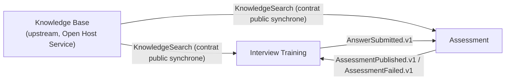
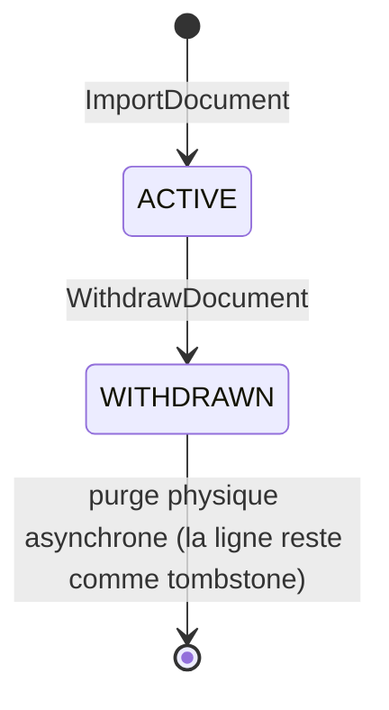
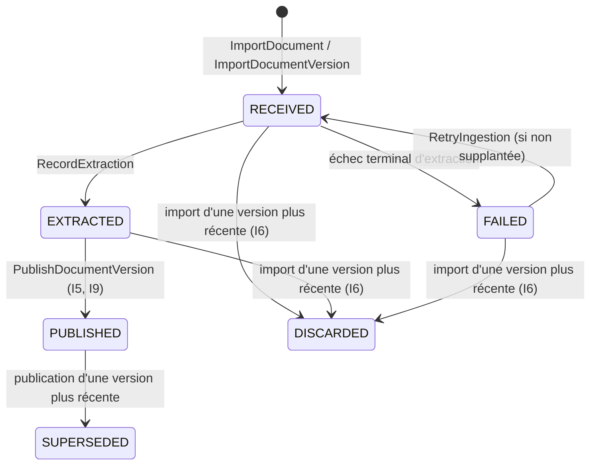
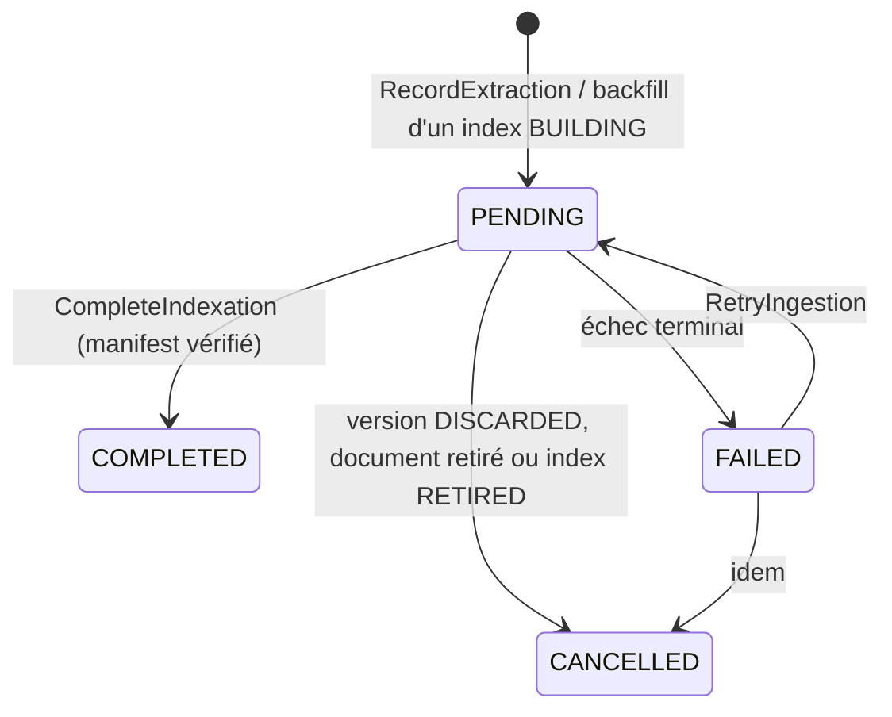
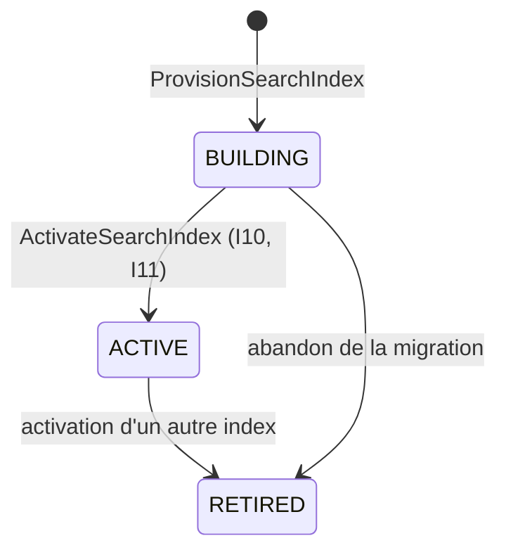

# Knowledge Base — Conception du Bounded Context

> **Statut : Accepted pour les orientations, Proposed pour les détails signalés.**
> Revue de conception close le 2026-11-17. Les orientations validées sont
> enregistrées dans les ADR [0007](../../decisions/0007-knowledge-base-bounded-context.md)
> à [0012](../../decisions/0012-original-document-storage-and-purge.md) et dans le
> complément de l'[ADR 0004](../../decisions/0004-reliable-messaging.md)
> (work queue durable). Ce document décrit le modèle cible : **aucun code
> Knowledge Base n'existe encore**.
>
> Légende utilisée dans ce document :
> **[Accepted]** décision validée par ADR ; **[Proposed]** détail recommandé,
> à confirmer pendant la slice qui l'implémente ; **[Open]** non tranché
> (voir [§16](#16-points-ouverts)).
>
> Documents liés : [feuille de route S0–S9](knowledge-base-roadmap.md),
> [conception détaillée de S0](knowledge-base-s0.md),
> [005 — structure et points d'entrée](../005-project-structure.md).

## Sommaire

1. [Mission, limites et Context Map](#1-mission-limites-et-context-map)
2. [Langage ubiquitaire](#2-langage-ubiquitaire)
3. [Agrégats, entités et Value Objects](#3-agrégats-entités-et-value-objects)
4. [Invariants](#4-invariants)
5. [États et transitions](#5-états-et-transitions)
6. [Workflow de traitement avec `work_items`](#6-workflow-de-traitement-avec-work_items)
7. [Leases et fencing tokens](#7-leases-et-fencing-tokens)
8. [Prévention des publications obsolètes](#8-prévention-des-publications-obsolètes)
9. [Intégrité de l'index Qdrant](#9-intégrité-de-lindex-qdrant)
10. [Publication, retrait et purge](#10-publication-retrait-et-purge)
11. [Visibilité et cohérence PostgreSQL / Qdrant](#11-visibilité-et-cohérence-postgresql--qdrant)
12. [Stratégie de recherche et limites de Recall](#12-stratégie-de-recherche-et-limites-de-recall)
13. [Changement de modèle d'embeddings](#13-changement-de-modèle-dembeddings)
14. [Contrat public `KnowledgeSearch`](#14-contrat-public-knowledgesearch)
15. [Pipeline, structure du code et feuille de route](#15-pipeline-structure-du-code-et-feuille-de-route)
16. [Points ouverts](#16-points-ouverts)

---

## 1. Mission, limites et Context Map

**[Accepted — ADR 0007]** Knowledge Base est le troisième Bounded Context,
distinct d'Interview Training et d'Assessment (ADR 0001 reste inchangé).

- **Responsabilités :** import de documents pédagogiques, conservation de
  l'original, dédoublonnage, versions, extraction, segmentation en unités de
  connaissance, chunking, embeddings, indexation, recherche sémantique sourcée,
  retrait et purge, récupération après panne.
- **Hors périmètre :** déroulement d'un entretien, choix de la question
  suivante, correction et score, suivi des compétences, génération de questions
  par LLM (Question Bank éventuelle, non conçue).



- Knowledge Base est **upstream** ; son contrat public est un **Open Host
  Service** : `knowledge_base.contracts.providers.KnowledgeSearch` (§14).
- Les consommateurs **figent** dans leurs propres snapshots les extraits et
  citations qu'ils utilisent (cohérent avec `QuestionSnapshot`, 003). Une
  réindexation ou une nouvelle version ne modifie jamais rétroactivement un
  entretien ou une correction.
- Aucun autre contexte ne lit les tables `knowledge_base.*` ni Qdrant.
- **Aucun Integration Event n'est publié en V1** : les noms
  `knowledge.document_version_published.v1` et `knowledge.document_withdrawn.v1`
  sont réservés pour l'arrivée d'un consommateur réel (ADR 0007).

## 2. Langage ubiquitaire

| Terme | Définition | Nature |
|---|---|---|
| `KnowledgeDocument` | Document pédagogique logique, stable entre ses versions | Aggregate Root |
| `DocumentVersion` | Contenu importé à un instant, identifié par son empreinte et son numéro ; immuable | Entité de `KnowledgeDocument` |
| `DocumentSource` | Provenance de l'original : nom de fichier, type de média, taille, SHA-256, date d'import. **Remplace le terme `KnowledgeSource`** de la première version de [domain.md](../../context/domain.md) | Value Object |
| `DocumentKind` | `COURSE`, `QA_SHEET`, `REVISION_SHEET`, `TECHNICAL` | Value Object (énumération) |
| `StructuredDocument` | Représentation interne neutre des blocs extraits (titres, paragraphes, code, tableaux, listes) et de leur provenance | Value Object |
| `KnowledgeUnit` | Unité pédagogique indivisible : question + réponse + code + explications, ou section, ou définition | Donnée dérivée immuable |
| `DocumentChunk` | Fragment indexable d'une unité, avec en-tête contextuel et provenance | Donnée dérivée immuable |
| `Citation` | Document, version, chemin de sections, pages : référence stable vers l'original | Value Object |
| `ChunkingPolicy` | Version des règles de segmentation et de découpage, budget en tokens, overlap, fallbacks | Value Object versionné |
| `EmbeddingProfile` | Modèle, révision, dimension, distance, normalisation, préfixes query/passage, longueur maximale, tokenizer | Value Object versionné |
| `KnowledgeCorpus` | Périmètre de recherche ; détient les générations d'index et la génération active. Singleton en V1 | Aggregate Root |
| `SearchIndex` | Génération d'index pour un couple (`EmbeddingProfile`, `ChunkingPolicy`) : `BUILDING`, `ACTIVE`, `RETIRED` | Entité de `KnowledgeCorpus` |
| `Indexation` | Fait de couverture : « cette version est (ou doit être) présente dans cet index » | Aggregate Root |
| `IndexManifest` | Ensemble des couples (identifiant de point, empreinte de chunk) attendus pour une indexation | Value Object |
| `Publication` | Bascule SQL rendant une version visible à la recherche | Opération de `KnowledgeDocument` |
| `Withdrawal` | Retrait logique immédiat d'un document, suivi d'une purge asynchrone | Opération de `KnowledgeDocument` |
| `WorkItem` | Unité de traitement durable (lease, fencing, tentatives) ; **concept technique, pas métier** | Ligne de `knowledge_base.work_items` |
| `RetrievedPassage` | Résultat public : unité (ou fenêtre), score, citation vérifiable | DTO public |

Termes **abandonnés** : `IngestionJob` et `IndexingAttempt` (remplacés par
`WorkItem` pour le processus et `Indexation` pour le fait de couverture),
`VectorIndex` comme concept métier (remplacé par `SearchIndex` ; « collection
Qdrant » est un détail d'adapter ; `VectorIndex` reste seulement le nom du
port technique vers le moteur vectoriel), `DocumentStatus` comme concept autonome.

## 3. Agrégats, entités et Value Objects

### 3.1 `KnowledgeDocument` — Aggregate Root [Accepted]

- Attributs : `document_id`, `title`, `kind`, `topics`, `language`, `status`,
  `published_version_id`, `visibility_revision`, `version` (verrouillage
  optimiste).
- Entité interne `DocumentVersion` : `version_id`, `number` (monotone par
  document), `DocumentSource`, `status`, `failure` (code, message, retryable),
  `created_at`.
- Contient **uniquement** des métadonnées : ni chunks, ni lease, ni compteur
  de tentatives (ces derniers vivent dans `work_items`, §6).
- `visibility_revision` [Proposed] : compteur incrémenté à chaque publication
  ou retrait ; il identifie la synchronisation Qdrant attendue (§11).

### 3.2 `KnowledgeCorpus` — Aggregate Root [Proposed, sur la décision Accepted « une génération active par corpus »]

- Attributs : `corpus_id` (singleton en V1), `active_index_id`, `version`.
- Entité interne `SearchIndex` : `index_id`, `EmbeddingProfile`,
  `ChunkingPolicy`, `status` (`BUILDING`, `ACTIVE`, `RETIRED`),
  `created_at`, `activated_at`, `retired_at`.
- Le nombre de générations est faible (une ou deux vivantes) : l'invariant
  « au plus un index `ACTIVE` » est porté **à l'intérieur d'un seul agrégat**,
  et le verrou de sa ligne sert de barrière blue/green (§13).
- Les noms de collections Qdrant sont calculés par l'adapter à partir de
  `index_id` ; ils n'appartiennent pas au domaine.

### 3.3 `Indexation` — Aggregate Root [Accepted]

- Identité logique unique `(version_id, index_id)`.
- Attributs : `status` (`PENDING`, `COMPLETED`, `FAILED`, `CANCELLED`),
  `chunking_policy_version`, `manifest_digest`, `point_count`,
  `completed_at`, `failure`.
- **Sans lease ni tentative** : ces aspects sont ceux du `WorkItem` qui la
  traite. L'`Indexation` est le fait métier sur lequel reposent la publication
  (§8) et l'activation d'un index (§13).

### 3.4 Unités et chunks — données dérivées immuables [Accepted]

- Persistés dans PostgreSQL, **hors des agrégats**, par lot, dans la
  transaction qui fait passer la version à `EXTRACTED`.
- Identité d'un lot : `(version_id, chunking_policy_version)`.
- `KnowledgeUnit` : `unit_id`, `ordinal`, `unit_type` (`QA`, `SECTION`,
  `DEFINITION`), `question_text?`, `section_path`, `page_span`, `token_count`.
- `DocumentChunk` : `chunk_id`, `unit_id`, `ordinal_in_unit`,
  `contextual_text` (texte + en-tête contextuel, **sans** préfixe de modèle),
  `chunk_hash`, `token_count`, `citation`.
- Identifiants **déterministes** [Proposed] : `unit_id` et `chunk_id` sont des
  UUIDv5 dérivés de `(version_id, chunking_policy_version, ordinals)`. Une
  ré-extraction après panne produit donc les mêmes identifiants.
- `chunk_hash = SHA-256(contextual_text ‖ chunking_policy_version)`.
- Taille : une transaction unique suffit dans les limites de l'ADR 0012
  (20 Mo, 300 pages). Un mécanisme de staging ne sera introduit que si une
  mesure le rend nécessaire.

### 3.5 Value Objects

`DocumentSource`, `ContentHash`, `DocumentKind`, `Citation`, `SectionPath`,
`PageSpan`, `ChunkingPolicy`, `EmbeddingProfile`, `IndexManifest`,
`FailureReason` (`code`, `message`, `retryable`), `StructuredDocument` et ses
blocs.

### 3.6 Hors domaine (adapters)

`DoclingDocument`, tokenizer concret, noms de collections, identifiants et
payloads Qdrant, chemins de blobs, messages Celery, lignes `work_items`.

## 4. Invariants

### 4.1 Garanties strictes (transactionnelles, PostgreSQL)

| # | Invariant | Mécanisme |
|---|---|---|
| I1 | Une `DocumentVersion` est immuable (source, empreinte, numéro) | Aucune méthode de modification ; contraintes SQL |
| I2 | Numéros de version strictement croissants par document | Attribution sous verrou optimiste de l'agrégat |
| I3 | Une même empreinte n'est importée qu'une fois par document | `UNIQUE(document_id, content_hash)` |
| I4 | Au plus une version `PUBLISHED` par document | `published_version_id` sous verrou + index unique partiel |
| I5 | Publication monotone : une version ne peut être publiée que si son numéro est supérieur à celui de la version publiée | Règle de l'agrégat, vérifiée dans la transaction de publication (§8) |
| I6 | Importer la version N supplante (`DISCARDED`) toutes les versions antérieures non publiées et annule leurs `work_items` | Même transaction que l'import |
| I7 | Les unités et chunks d'une version sont écrits dans la transaction qui la fait passer à `EXTRACTED`, et ne sont jamais modifiés | Finalisation sous fencing (§7) |
| I8 | Une `Indexation` n'est `COMPLETED` que si le manifest a été vérifié dans Qdrant (§9) et que le fencing token du `WorkItem` est valide | Transaction de finalisation |
| I9 | Une version n'est publiée que si son `Indexation` dans l'index `ACTIVE` est `COMPLETED`, l'index actif étant lu sous le verrou du corpus | §8, §13 |
| I10 | Au plus un `SearchIndex` `ACTIVE` par corpus | Invariant interne de `KnowledgeCorpus` |
| I11 | Activation d'un index seulement si toutes les versions publiées de documents `ACTIVE` y sont `COMPLETED` | Contrôle sous `FOR UPDATE` du corpus (§13) |
| I12 | Un document `WITHDRAWN` n'est plus jamais renvoyé par une recherche commencée après le commit du retrait | Contrôle SQL final de chaque recherche (§11, §12) |
| I13 | Tout chunk porte une citation complète | Construction obligatoire du VO `Citation` |
| I14 | Au plus une finalisation réussie par tentative de `WorkItem` ; une tentative périmée ne peut rien finaliser | Fencing token (§7) |

### 4.2 Cohérence éventuelle (pas de garantie immédiate)

| Comportement | Délai borné par | Garantie de sûreté pendant le délai |
|---|---|---|
| Extraction, chunking, embeddings, upserts Qdrant | durée de traitement, retries | la version n'est pas visible tant qu'elle n'est pas publiée |
| Synchronisation du drapeau `visible` dans Qdrant | intervalle du scheduler + exécution | le contrôle SQL écarte tout passage non visible (§11) |
| Purge des points d'une version supplantée ou retirée | idem | les points restants sont filtrés (drapeau et contrôle SQL) |
| Purge des blobs et chunks d'un document retiré | idem + délai de rétention (ADR 0012) | aucune lecture possible : document `WITHDRAWN` |
| Construction d'un nouvel index `BUILDING` | backfill complet du corpus | la recherche continue sur l'index `ACTIVE` |
| Reprise après crash (lease expiré) | `lease_ttl` + intervalle de reprise | fencing : la tentative périmée ne peut pas finaliser |

**Aucun effet externe n'est garanti « exactly once ».** Les écritures Qdrant
et les écritures de blobs peuvent être exécutées plusieurs fois ; elles sont
conçues pour être **idempotentes** et **convergentes** (§7.3).

## 5. États et transitions

### 5.1 `KnowledgeDocument`



Un document `WITHDRAWN` n'accepte plus de nouvelle version. Une réactivation
éventuelle est **[Open]** (non prévue en V1).

### 5.2 `DocumentVersion`



- **`DISCARDED`** : abandonnée **avant** publication ; elle n'a jamais été
  visible. **`SUPERSEDED`** : a été publiée, puis remplacée. Les deux sont
  terminaux.
- L'état `EXTRACTING` de la première proposition est **supprimé** : « en
  cours » est l'état du `WorkItem`, pas de la version.
- `FAILED` ne concerne que l'**extraction**. Un échec d'indexation laisse la
  version `EXTRACTED` (ses chunks sont valides) et fait passer l'`Indexation`
  à `FAILED` ; `RetryIngestion` rouvre alors l'indexation, pas l'extraction.
- Le retrait d'un document ne change pas l'état de ses versions : la
  visibilité est portée par `KnowledgeDocument.status`.

### 5.3 `Indexation`



### 5.4 `SearchIndex` (dans `KnowledgeCorpus`)



Cas initial (S4) : le premier index est créé puis activé alors que le corpus
est vide ; l'invariant I11 est trivialement satisfait.

### 5.5 `WorkItem`

États `PENDING`, `RUNNING`, `SUCCEEDED`, `FAILED`, `CANCELLED`. Transitions,
schéma et paramètres : [knowledge-base-s0.md](knowledge-base-s0.md#3-transitions-détat).

## 6. Workflow de traitement avec `work_items`

**[Accepted — ADR 0004, complément work queue]** Toutes les étapes longues
passent par `knowledge_base.work_items`. Le message Celery n'est qu'un signal
de réveil portant l'identifiant de l'item ; **l'état fait foi dans
PostgreSQL**. Un simple `celery.delay()` n'est jamais considéré comme durable.

| Étape | Transaction d'entrée | Hors transaction | Transaction de finalisation | Item suivant |
|---|---|---|---|---|
| Import (HTTP) | — | stream vers fichier temporaire, SHA-256, dépôt du blob adressé par empreinte | document/version `RECEIVED`, I3, I6, idempotency key, item `extract_version` | `extract_version` |
| `extract_version` | claim (lease, fencing) | lecture du blob, Docling → `StructuredDocument`, segmentation, chunking | fencing + version toujours `RECEIVED` → chunks + `EXTRACTED` + `Indexation PENDING` pour chaque index `ACTIVE`/`BUILDING` (lus sous `FOR SHARE` du corpus) | `index_version` par indexation |
| `index_version` | claim | embeddings par lots, upserts Qdrant `visible=false`, vérification du manifest | fencing + `Indexation COMPLETED`, puis tentative de publication (§8) | `sync_visibility` si publiée |
| `sync_visibility` | claim | convergence Qdrant vers l'état SQL du document (§11) | fencing + item `SUCCEEDED` | — |
| `purge_document` | claim | suppression des points, puis des blobs non référencés | fencing + chunks supprimés, `purged_at` | — |
| `build_index` (S9) | claim | création de la collection, planification du backfill | fencing + `Indexation PENDING` pour le corpus éligible | `index_version`, éventuellement `extract_version` (rechunking) |

Les noms des `kind` sont **[Proposed]** et fixés au moment de la slice qui les
introduit. S0 ne livre que le mécanisme générique, sans aucun `kind` métier.

**Commandes métier :** `ImportDocument`, `ImportDocumentVersion`,
`WithdrawDocument`, `RetryIngestion`, `PublishDocumentVersion`,
`ProvisionSearchIndex`, `ActivateSearchIndex`. **Query :** `SearchKnowledge`.

**Commandes de processus (handlers de `WorkItem`) :** `RecordExtraction`,
`CompleteIndexation`, `FailExtraction`, `FailIndexation`,
`SyncDocumentVisibility`, `PurgeDocument`, `ReconcileKnowledgeBase`.

**Domain Events locaux :** `DocumentImported`, `DocumentVersionExtracted`,
`DocumentVersionDiscarded`, `IndexationCompleted`, `DocumentVersionPublished`,
`DocumentWithdrawn`, `SearchIndexActivated`. Ils restent internes au contexte
(005). « Ingestion démarrée » est un log ou une métrique, pas un événement.

## 7. Leases et fencing tokens

Détails, schéma et paramètres : [knowledge-base-s0.md](knowledge-base-s0.md).

### 7.1 Principe

- **Claim** : `UPDATE … SET status='RUNNING', attempts=attempts+1,
  fencing_token=fencing_token+1, lease_expires_at=now()+ttl WHERE id=:id AND
  status='PENDING' AND available_at<=now() RETURNING fencing_token`. Le claim
  est atomique ; un message dupliqué trouve un item déjà `RUNNING` ou terminé
  et ne fait rien.
- **Finalisation** : la transaction qui écrit les effets métier exécute aussi
  `UPDATE work_items SET status='SUCCEEDED' WHERE id=:id AND
  fencing_token=:token AND status='RUNNING'`. Zéro ligne modifiée → rollback
  complet : la tentative est périmée.
- **Reprise** : un item `RUNNING` dont le lease a expiré redevient `PENDING`
  (ou `FAILED` si les tentatives sont épuisées). L'expiration n'incrémente pas
  le token : c'est le claim suivant qui l'incrémente, ce qui invalide l'ancienne
  tentative.
- **Annulation** : `CANCELLED` incrémente le token ; une tentative en cours ne
  peut plus finaliser.

### 7.2 Ce que le fencing garantit, et ce qu'il ne garantit pas

| Garanti | Non garanti |
|---|---|
| Au plus une finalisation PostgreSQL réussie par item | Qu'un handler ne s'exécute qu'une fois : redélivrance, reprise après lease expiré, tentative « zombie » toujours active |
| Une tentative périmée ne modifie aucun état métier | Qu'un effet externe (Qdrant, fichier) ne soit produit qu'une fois |
| Un item finalement `SUCCEEDED`, `FAILED` ou `CANCELLED` (jamais perdu) | Un délai maximal strict avant traitement |

### 7.3 Conditions d'idempotence des effets externes

Un effet externe est acceptable si **toutes** ces conditions tiennent :

1. **Identité déterministe** : points Qdrant `uuid5(index_id, chunk_id)` ;
   blob `sha256/<aa>/<bb>/<empreinte>`.
2. **Contenu déterministe** : mêmes entrées → même payload ; la variation
   numérique infime d'un ré-encodage CPU est acceptée (écrasement).
3. **Écrasement sans accumulation** : upsert ou écriture atomique (fichier
   temporaire puis renommage) ; jamais d'append ni de compteur.
4. **Suppressions par filtre déterministe** (`version_id`, `document_id`),
   répétables sans effet de bord.
5. **Revérification métier à la finalisation** : la transaction relit l'état
   (version non `DISCARDED`, document non `WITHDRAWN`, index non `RETIRED`).
6. **Convergence** : une tentative zombie qui réécrit des points après une
   purge crée des points `visible=false`, jamais renvoyés (§11) et supprimés
   par la réconciliation.

## 8. Prévention des publications obsolètes

Scénario couvert : la version N est en cours d'indexation, N+1 est importée,
puis l'indexation de N se termine.

1. **À l'import de N+1** (même transaction) : N passe `DISCARDED`, ses
   `Indexation` passent `CANCELLED`, ses `work_items` non terminaux passent
   `CANCELLED` (token incrémenté).
2. **À la finalisation de N** : le fencing échoue (item annulé), donc rollback.
3. **Garde-fou indépendant du fencing**, dans `PublishDocumentVersion` :
   - la version est `EXTRACTED` (donc ni `DISCARDED` ni `FAILED`) ;
   - le document est `ACTIVE` ;
   - `version.number > numéro de la version publiée` (I5) ;
   - l'`Indexation(version, index ACTIVE)` est `COMPLETED`, l'index actif étant
     lu sous `FOR SHARE` de la ligne du corpus (I9).
4. Si N+1 est publiée **avant** que N ne termine (cas impossible après 1,
   mais protégé), I5 refuse la publication de N.

## 9. Intégrité de l'index Qdrant

**[Accepted — ADR 0010]** Un simple `count` ne suffit pas.

- **Payload de chaque point** : `chunk_id`, `unit_id`, `version_id`,
  `document_id`, `chunk_hash`, `index_id`, `visible`, plus les champs de
  filtrage (`topics`, `kind`, `language`).
- **Manifest** : ensemble trié des couples `(point_id, chunk_hash)` attendus ;
  `manifest_digest = SHA-256` de sa sérialisation canonique, stocké dans
  l'`Indexation`.
- **Vérification avant `COMPLETED`** :
  1. upserts par lots avec `wait=true`, statut de mise à jour exigé ;
  2. relecture par identifiants (`retrieve`, payload sans vecteurs), par lots ;
  3. égalité exacte de l'ensemble des identifiants et de chaque `chunk_hash` ;
  4. configuration de la collection conforme au profil (dimension, distance),
     vérifiée une fois par tentative.
- **Points en trop** pour une version (`scroll` filtré sur `version_id`) :
  supprimés par la réconciliation.
- La réconciliation périodique (S8) recalcule le manifest des indexations
  `COMPLETED` par échantillonnage et ré-ouvre l'indexation en cas d'écart.

## 10. Publication, retrait et purge

| Opération | Effet immédiat (commit SQL) | Effets asynchrones |
|---|---|---|
| Publication de N | N `PUBLISHED`, précédente `SUPERSEDED`, `visibility_revision+1`, item `sync_visibility` | points de N `visible=true`, puis suppression des points de la version supplantée |
| Retrait | document `WITHDRAWN`, `visibility_revision+1`, items en cours annulés, item `purge_document` | suppression de tous les points du document dans tous les index, puis des chunks, puis des blobs non référencés (rétention : ADR 0012) |
| Abandon (`DISCARDED`) | items annulés | points éventuellement écrits (`visible=false`) supprimés par `sync_visibility` ou la réconciliation |

Sémantique d'un retrait concurrent à une recherche : la visibilité est
évaluée **au début de la requête** (instantané de lecture du contrôle SQL).
Une recherche commencée avant le commit du retrait peut encore renvoyer le
document ; les consommateurs ayant figé l'extrait, ce comportement est accepté.

## 11. Visibilité et cohérence PostgreSQL / Qdrant

**[Accepted — ADR 0010]**

- **PostgreSQL arbitre la visibilité.** Une version est visible si et
  seulement si elle est `PUBLISHED` et que son document est `ACTIVE`.
- **Qdrant porte une copie synchronisée** : le drapeau `visible` dans le
  payload. Il sert à filtrer **avant** le top-k pour préserver le Recall
  (§12), jamais à décider.
- **Synchronisation convergente** (`sync_visibility`) : le handler lit l'état
  SQL courant du document et fait converger Qdrant (points de la version
  publiée → `visible=true` dans les index non retirés ; points des autres
  versions → supprimés ; document retiré → tout supprimé). Il est idempotent
  par construction et identifié par `(document_id, visibility_revision)`.
- **Ordre des écritures** : points écrits `visible=false` → publication SQL →
  synchronisation. Entre le commit et la synchronisation, le document republié
  peut **manquer temporairement** des résultats (l'ancienne version est écartée
  par le contrôle SQL, la nouvelle n'est pas encore visible dans Qdrant). Il ne
  peut **jamais** apparaître à tort. Cette perte transitoire est acceptée et
  mesurée en S5/S7.

## 12. Stratégie de recherche et limites de Recall

**[Accepted — ADR 0010 ; paramètres Proposed]**

1. Lire l'index `ACTIVE` du corpus (SQL).
2. Encoder la requête avec le profil de cet index (préfixe `query: ` pour E5),
   dans un thread (`asyncio.to_thread`) pour ne pas bloquer FastAPI.
3. Interroger Qdrant **groupé par `unit_id`** avec le filtre `visible=true`
   et les filtres de la requête (`document_ids`, `topics`, `kinds`,
   `language`), avec un suréchantillonnage `k × f` (f = 2 proposé).
4. **Contrôle SQL final** : ne conserver que les unités de versions
   `PUBLISHED` de documents `ACTIVE`.
5. **Complément** : si des unités ont été écartées et que moins de `k` restent,
   **une** passe supplémentaire excluant les identifiants rejetés (nombre de
   passes configurable, 1 par défaut).
6. **Reconstruction small-to-big** depuis PostgreSQL : l'unité complète si elle
   tient dans `max_passage_tokens`, sinon une fenêtre contenant la question
   racine et les chunks trouvés, avec `truncated=true`.
7. Score d'une unité = meilleur score de ses chunks.

Limites connues, documentées et mesurées :

- Recall réduit pendant la fenêtre de synchronisation (§11).
- Si les rejets dépassent le complément, le résultat contient moins de `k`
  passages et `complete=false` (§14).
- L'index HNSW est approximatif ; les filtres de payload exigent des index de
  payload (`visible`, `unit_id`, `document_id`, `topics`, `kind`, `language`).
- La recherche dense seule est faible sur les identifiants de code exacts ;
  une recherche hybride est **[Open]** (§16).

## 13. Changement de modèle d'embeddings

**[Accepted — ADR 0011 ; barrière Proposed jusqu'à S9]**

- Un `SearchIndex` = un `EmbeddingProfile` + une `ChunkingPolicy` + une
  collection Qdrant dédiée. **Jamais deux profils dans une même collection.**
- `ProvisionSearchIndex(profile, policy)` crée un index `BUILDING` et planifie
  le backfill : une `Indexation PENDING` par version `PUBLISHED` ou `EXTRACTED`
  de document `ACTIVE`, plus une ré-extraction si la `ChunkingPolicy` diffère.
- **Barrière transactionnelle d'activation** :
  - `RecordExtraction` lit les index `ACTIVE` et `BUILDING` **sous
    `SELECT … FOR SHARE`** de la ligne `KnowledgeCorpus`, puis crée une
    `Indexation` pour chacun, dans la même transaction ;
  - `ActivateSearchIndex` prend **`SELECT … FOR UPDATE`** sur la même ligne,
    vérifie I11 (toutes les versions publiées de documents actifs sont
    `COMPLETED` dans l'index candidat), puis bascule `active_index_id` et
    retire l'ancien index ;
  - `PublishDocumentVersion` lit l'index actif sous `FOR SHARE`.
  Conséquence : une extraction qui se termine pendant la construction voit
  forcément l'index `BUILDING` ; une activation ne peut s'intercaler entre une
  extraction et la création de ses indexations. Si une version est publiée
  pendant la vérification, elle attend le verrou et est contrôlée après.
- Après activation : l'API charge le modèle du nouveau profil (préchauffage
  recommandé) ; deux modèles peuvent coexister en mémoire pendant la
  transition. L'ancien index est retiré, puis sa collection supprimée par un
  item de maintenance.
- **Profil initial : `intfloat/multilingual-e5-base`** (préfixes `query: ` /
  `passage: `, 768 dimensions, 512 tokens, cosine, vecteurs normalisés).
  **Choix révisable** : le profil définitif sera décidé par un nouvel ADR fondé
  sur le benchmark de S9.
- Rechunking : la `ChunkingPolicy` appartient au `SearchIndex` ; un profil à
  longueur maximale plus courte entraîne un nouveau lot de chunks pour ce seul
  index. Les citations restent stables, car elles référencent version, section
  et pages, jamais `chunk_id`.

## 14. Contrat public `KnowledgeSearch`

**[Accepted pour le principe — ADR 0007 ; champs Proposed jusqu'à S5]**

```python
# knowledge_base/contracts/providers/knowledge_search.py
class KnowledgeSearch(Protocol):
    async def search(self, query: KnowledgeQuery) -> KnowledgeSearchResult: ...

# knowledge_base/contracts/result/
@dataclass(frozen=True)
class KnowledgeQuery:
    text: str
    limit: int = 5
    language: str | None = None
    topics: tuple[str, ...] = ()
    kinds: tuple[str, ...] = ()
    document_ids: tuple[UUID, ...] = ()

@dataclass(frozen=True)
class KnowledgeSearchResult:
    passages: tuple[RetrievedPassage, ...]
    complete: bool            # False si moins de `limit` passages après complément
    index_id: UUID            # génération d'index utilisée (provenance)

@dataclass(frozen=True)
class RetrievedPassage:
    unit_id: UUID
    unit_type: str            # QA, SECTION, DEFINITION
    question: str | None
    text: str                 # unité complète ou fenêtre bornée
    truncated: bool
    matched_chunk_ids: tuple[UUID, ...]
    score: float
    citation: Citation

@dataclass(frozen=True)
class Citation:
    document_id: UUID
    document_title: str
    version_id: UUID
    version_number: int
    section_path: tuple[str, ...]
    page_start: int | None
    page_end: int | None
    source_filename: str
```

- Aucun objet Qdrant, ORM ou Docling dans le contrat.
- Le consommateur reçoit l'implémentation par injection depuis `runtime`
  (fabrique publique `build_knowledge_search`, voir
  [005](../005-project-structure.md#surface-publique-dun-contexte-et-composition-root)).
- Toute évolution incompatible crée une nouvelle version du contrat.

## 15. Pipeline, structure du code et feuille de route

### 15.1 Composants

| Phase | Choix | Port / frontière | ADR |
|---|---|---|---|
| Import | HTTP multipart, 20 Mo et 300 pages maximum, liste blanche de types, SHA-256, `Idempotency-Key` | Controller REST | 0012 |
| Original | Volume persistant adressé par SHA-256 | `DocumentBlobStore` | 0012 |
| Extraction | Docling (extras ciblés), OCR désactivé ; TXT par adapter natif | `DocumentParser` → `StructuredDocument` | 0008 |
| Segmentation | `KnowledgeUnitSegmenter`, règles par `DocumentKind`, convention front-matter prioritaire | Service de domaine | 0009 |
| Découpage | `ChunkPlanner`, budget en tokens du profil, overlap configurable (0 initial) | Service de domaine + `TokenCounter` fourni par l'`Embedder` | 0009 |
| Embeddings | SentenceTransformers, `multilingual-e5-base` initial | `Embedder` | 0008, 0011 |
| Index | Qdrant, une collection par `SearchIndex` | `VectorIndex` | 0010, 0011 |
| Recherche | `SearchKnowledge` | Query + contrat `KnowledgeSearch` | 0007, 0010 |
| Traitement | Celery + RabbitMQ, `work_items`, worker d'ingestion dédié, scheduler | Controller de tâches | 0004 |

Pas de LangChain ni de LlamaIndex (ADR 0008).

### 15.2 Chunking pédagogique (résumé ; détail dans l'ADR 0009)

1. `QA_SHEET` : question + réponse + code + explications = une unité ;
   `COURSE` / `TECHNICAL` : une section ; `REVISION_SHEET` : une définition.
2. Unité ≤ budget : un chunk. Unité > budget : fragments aux frontières de
   blocs, chacun préfixé de l'en-tête contextuel (titre, chemin de sections,
   question racine).
3. Code ou tableau plus grand que le budget : découpe aux lignes vides ou aux
   définitions (`def`, `class`), puis aux lignes en dernier recours ; chaque
   fragment porte l'en-tête et un marqueur de continuation.
4. Overlap : paramètre de `ChunkingPolicy`, 0 par défaut, à mesurer.
5. Recherche : reconstruction de l'unité dans la limite `max_passage_tokens`.

### 15.3 Structure du code

Conforme à [005](../005-project-structure.md) ; **un dossier n'est créé
qu'avec le code de la slice qui l'utilise**.

```text
backend/src/knowledge_base/
  __init__.py                 # réexporte les points d'entrée publics (005)
  README.md
  domain/
    entities/                 # knowledge_document, knowledge_corpus, indexation
    value_objects/            # document_source, citation, chunking_policy, embedding_profile…
    services/                 # knowledge_unit_segmenter, chunk_planner
    events/
    exceptions/
    providers/                # repositories, unit_of_work, work_queue, blob store, parser, embedder, vector_index
  use_cases/                  # un dossier par commande ou query (§6)
  adapters/
    controller/
      dependencies.py         # register, register_worker, build_knowledge_search (005)
      rest/                   # FastAPI
      tasks/                  # Celery : exécution des work_items, dispatch, reprise
      contracts/              # implémentation de KnowledgeSearch
    gateway/
      persistence/            # SQLAlchemy, unit of work, work queue
      parsing/                # Docling, TXT natif
      embedding/              # SentenceTransformers
      vector_store/           # Qdrant
      blob/                   # système de fichiers
  contracts/
    providers/                # KnowledgeSearch
    result/                   # KnowledgeQuery, KnowledgeSearchResult, RetrievedPassage, Citation
  frameworks/
    sqlalchemy/               # tables et MetaData du schéma knowledge_base
    configuration/            # KnowledgeBaseSettings (préfixe KB_)
```

### 15.4 Feuille de route

| Slice | Objectif |
|---|---|
| S0 | Infrastructure de traitement durable : work queue, leases, fencing, retries, scheduler |
| S1 | Domaine `KnowledgeDocument` et `DocumentVersion` |
| S2 | Import Markdown/TXT, stockage original et dédoublonnage |
| S3 | Docling Markdown, `KnowledgeUnit` et chunking |
| S4 | Embeddings, Qdrant, index initial et publication |
| S5 | Recherche sémantique, provenance et évaluation RAG |
| S6 | Extraction PDF/DOCX avec Docling |
| S7 | Versions concurrentes, retrait et purge |
| S8 | Durcissement de la réconciliation et gestion des erreurs |
| S9 | Benchmark des embeddings et migration blue/green |

Détail par slice (périmètre, dépendances, tests, critères, risques) :
[knowledge-base-roadmap.md](knowledge-base-roadmap.md). Conception de S0 :
[knowledge-base-s0.md](knowledge-base-s0.md).

## 16. Points ouverts

Liste **unique** des questions ouvertes de Knowledge Base ;
[006](../006-open-questions.md) y renvoie sans la dupliquer.

| # | Point | Recommandation actuelle | Tranché par |
|---|---|---|---|
| O1 | Profil d'embeddings définitif | `multilingual-e5-base` jusqu'au benchmark | ADR après S9 |
| O2 | Même fichier importé pour deux documents distincts | Refuser (409 avec l'identifiant existant) | S2 |
| O3 | Périmètre de corpus au-delà du singleton V1 | Singleton tant qu'un besoin multi-corpus n'existe pas | — |
| O4 | Persister le `StructuredDocument` pour rechunker sans re-parser | Non en V1 : re-parser depuis le blob | S9 |
| O5 | Images ou groupes de dépendances séparés pour API et workers | Image unique en V1, séparer si la taille mesurée gêne | S4/S6 |
| O6 | Recherche hybride (sparse/BM25) pour les identifiants de code | Mesurer en S5/S9 avant de l'introduire | S9 |
| O7 | Prise en charge de `.txt` par Docling | Adapter natif par défaut | S2/S3 |
| O8 | OCR, formats supplémentaires (HTML), limites définitives | Hors V1 ; limites réévaluées après S6 | S6 |
| O9 | Accès et documents privés (multi-utilisateur) | Hors V1 ; `KnowledgeQuery` extensible sans rupture | — |
| O10 | DLQ RabbitMQ | Non en V1 ; réexaminer avec les consommateurs d'Integration Events | ADR 0004 |
| O11 | Réactivation d'un document retiré | Non prévue en V1 | — |
| O12 | Facteur de suréchantillonnage, nombre de passes de complément, `max_passage_tokens` | f = 2, 1 passe, budget à mesurer | S5 |
| O13 | Heuristiques Q/R sans front-matter | Couvrir les formats rencontrés, mesurés par golden tests | S3 |
